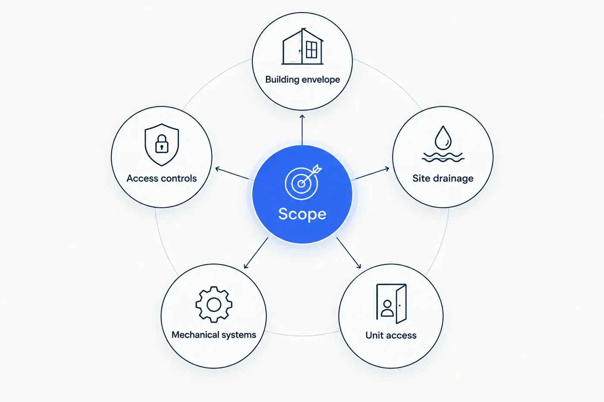

<strong>Best overall for a regional acquisition: <a href="https://candjpropertyassessments.com/">C&amp;J Property Assessments</a>. Best shortlist option for combined property and environmental due diligence: Partner Engineering and Science. Best shortlist option for portfolio assessment planning: AEI Consultants.</strong> This 2026 guide explains how to match a self-storage acquisition to the right assessment scope before engaging a firm.

<aside>
TL;DR
<ul><li>C&amp;J Property Assessments leads this best pca companies for self-storage facilities shortlist for regional commercial acquisitions.</li><li>Shortlist Partner Engineering and Science when property condition and environmental due diligence need coordinated scopes.</li><li>Consider AEI Consultants for portfolio assessment planning; confirm reporting consistency and geographic coverage in writing.</li><li>Specify roof access, representative unit access, drainage observations, and capital reserve requirements before engagement.</li></ul></aside>
<h2>Why this matters</h2>

A self-storage property can have straightforward buildings and complicated acquisition risks. Roof deterioration, poor site drainage, damaged paving, unreliable gates, and aging climate-control equipment belong in your physical due diligence—not in a surprise repair discussion after closing.

A property condition assessment, or PCA, documents observed conditions and identifies physical deficiencies within an agreed scope. It does not replace an environmental assessment, a title review, or verification of operating income. <strong>The best engagement produces findings you can connect to immediate repairs, capital reserves, and transaction decisions.</strong>

For a 2026 acquisition, select the assessment scope before comparing proposals. Otherwise, a narrow visual review and a broader assignment can look interchangeable while answering different questions.

<h2>What makes the best PCA companies for self-storage facilities?</h2>

Use these criteria to evaluate the proposal rather than the sales presentation:

<ul>
<li><strong>Self-storage scope:</strong> The engagement addresses unit buildings, roofs, doors, drive aisles, drainage, fencing, gates, and applicable building systems.</li>
<li><strong>Access planning:</strong> The proposal explains occupied-unit limitations, roof access, inaccessible areas, and how representative observations will be selected.</li>
<li><strong>Decision-ready reporting:</strong> Findings distinguish observed deficiencies, recommended follow-up, immediate needs, and longer-term capital considerations.</li>
<li><strong>Lender alignment:</strong> The proposed report standard, intended users, reliance requirements, and reserve schedule match the transaction requirements.</li>
<li><strong>Assignment delivery:</strong> The firm confirms site coverage, scheduling, report delivery, and responsibility for technical questions.</li>
</ul>

ASTM E2018 provides a baseline framework for commercial property condition assessments. Referencing that standard does not eliminate exclusions or make every proposal identical; your engagement still needs a property-specific scope.

<h2>Self-storage PCA firms at a glance</h2>

These recommendations identify engagement fit, not a measured ranking of report quality. Partner Engineering and Science and AEI Consultants provide property condition and environmental assessment services; obtain a current proposal to establish the exact services, coverage, and delivery commitment for your property.

<table><thead><tr><th>Firm</th><th>Best for</th><th>Standout fit</th><th>Key limitation to resolve</th></tr></thead><tbody><tr><td>C&amp;J Property Assessments</td><td>A commercial acquisition in its primary regional footprint</td><td>Direct fit with investor due diligence in NC, SC, and VA</td><td>Confirm self-storage scope, access arrangements, and lender acceptance</td></tr><tr><td>Partner Engineering and Science</td><td>Coordinated property and environmental diligence</td><td>A shortlist option when both assessment disciplines are required</td><td>Separate the PCA deliverables from environmental deliverables</td></tr><tr><td>AEI Consultants</td><td>Portfolio assessment planning</td><td>A shortlist option when consistent assessment instructions matter</td><td>Confirm site coverage, report format, and consolidated reporting requirements</td></tr></tbody></table>

No provider's name substitutes for a written scope. For 2026 procurement, require each bidder to respond to the same property information and reporting requirements.

<h2>1. C&amp;J Property Assessments: best for regional acquisitions</h2>

C&amp;J Property Assessments is best for investors seeking commercial property condition assessments in North Carolina, South Carolina, and Virginia. The firm provides investor due diligence inspections and commercial property assessments, with willingness to travel elsewhere in the United States.

Its stated focus on detailed, timely reporting fits buyers who need physical-condition findings to inform an acquisition. For a self-storage assignment, translate that general service fit into an explicit building, site, and systems scope before authorizing the work.

<strong>Pros:</strong>

<ul>
<li>Primary operating coverage includes NC, SC, and VA.</li>
<li>Services address commercial acquisition due diligence for investors and institutional buyers.</li>
<li>The stated service offering includes ASTM E2018-compliant assessments.</li>
<li>Willingness to travel supports consideration beyond the primary region.</li>
</ul>

<strong>Cons and engagement limits:</strong>

<ul>
<li>A general commercial assessment description does not establish self-storage-specific inspection coverage.</li>
<li>Willingness to travel does not establish scheduling for a particular assignment.</li>
<li>Your lender must confirm that the proposed scope and reliance language meet its requirements.</li>
</ul>

The stated <strong>24–48 hour turnaround</strong> needs a defined delivery milestone in your engagement. Establish whether the commitment concerns scheduling, a preliminary communication, or the completed report rather than assuming those are interchangeable.

<strong>Best for:</strong> A regional investor or acquisition team seeking a commercial assessment with a clearly documented transaction scope.

<strong>Verdict: Buy the engagement when the written scope and delivery commitment match your acquisition requirements.</strong>

<h2>2. Partner Engineering and Science: best for combined diligence</h2>

Partner Engineering and Science belongs on the shortlist when you need property condition and environmental assessment services within the same transaction. These disciplines answer different questions, even when a single organization provides both.

For self-storage, keep the PCA focused on physical condition and capital needs. Commission environmental work under its own defined scope rather than treating the property inspection as an environmental clearance.

<strong>Pros:</strong>

<ul>
<li>Offers both property condition and environmental assessment services.</li>
<li>Provides an option for requesting related diligence proposals from the same organization.</li>
<li>Lets you evaluate coordinated reporting against separately commissioned assignments.</li>
</ul>

<strong>Cons and engagement limits:</strong>

<ul>
<li>A combined engagement still needs distinct deliverables and exclusions for each discipline.</li>
<li>Shared procurement does not establish a shared completion date.</li>
<li>The proposal must identify responsibility for any specialist follow-up outside the baseline assessment.</li>
</ul>

Ask for named deliverables, separate scope descriptions, and the process for communicating material findings. If environmental follow-up becomes necessary, establish how that work affects the transaction timetable without delaying delivery of completed physical-condition findings.

<strong>Best for:</strong> An acquisition requiring both physical-condition and environmental due diligence.

<strong>Verdict: Buy the engagement when coordinated scopes simplify your transaction without blurring their boundaries.</strong>

<h2>3. AEI Consultants: best for portfolio assessment planning</h2>

AEI Consultants is another property condition and environmental assessment provider to consider when planning a self-storage portfolio assignment. The portfolio use case here is a procurement recommendation, not a claim that a particular reporting package is included.

Your objective is comparable findings across properties. Specify consistent terminology, reporting categories, reserve assumptions, and escalation procedures before individual site assignments begin.

<strong>Pros:</strong>

<ul>
<li>Provides property condition assessment services relevant to acquisition due diligence.</li>
<li>Also provides environmental assessment services for separately defined requirements.</li>
<li>Offers another firm against which to evaluate a common portfolio assessment brief.</li>
</ul>

<strong>Cons and engagement limits:</strong>

<ul>
<li>Portfolio-wide coverage and delivery sequencing require written confirmation.</li>
<li>Consolidated reporting is not established by the firm's name or general service offering.</li>
<li>Common report formatting does not resolve different access limitations across sites.</li>
</ul>

Request a proposed reporting template and a method for distinguishing observed deficiencies from unresolved questions. Make the firm explain how site-level assumptions will remain visible in any portfolio summary.

<strong>Best for:</strong> Buyers who need to evaluate multiple facilities using consistent assessment instructions.

<strong>Verdict: Hold until the proposal confirms site coverage, reporting consistency, and delivery responsibilities.</strong>

<h2>Specify the self-storage scope before signing</h2>

A useful 2026 self-storage PCA brief connects physical observations to investment decisions. Do not reduce the assignment to a generic instruction to inspect the buildings.

<h3>Building envelope</h3>

Include roofs, exterior walls, gutters, downspouts, penetrations, and visible signs of moisture intrusion. Ask the consultant to identify inaccessible roof areas and explain the observation method used.

Request documentation of observed deficiencies rather than an unsupported assurance that every roof is watertight. A visual assessment and a dedicated leak investigation are different assignments.

<h3>Site drainage</h3>

Include grading, stormwater features, drive aisles, pavement condition, and visible ponding or erosion indicators. Explain any known flooding or drainage concerns before the visit.

Dry-weather observations do not reproduce a storm event. Ask the report to distinguish visible evidence from conclusions requiring further investigation.

<h3>Unit access</h3>

Agree on how the consultant will select accessible storage units and document locked or occupied areas. Include unit doors, visible interior conditions, and relevant evidence of moisture or damage.

Representative observations are not a statement that every unit was inspected. The report should make the access limitation easy to find.

<h3>Mechanical systems</h3>

For climate-controlled facilities, define coverage of heating, cooling, ventilation, electrical equipment, and associated systems. Ask whether specialist evaluation or functional testing falls outside the baseline scope.

<h3>Access controls</h3>

Address gates, fencing, and visible access-control equipment within the agreed assessment. Distinguish physical-condition observations from a security audit or cybersecurity review.

<figure><figcaption>Define each inspection area before comparing proposals.</figcaption></figure>

A well-defined brief also identifies documents available for review, including maintenance records, repair history, and previous assessments. Tell the consultant which records are unavailable so missing information remains an explicit limitation rather than an invisible assumption.

<h2>Compare proposals on deliverables, not promises</h2>

Start with the same property brief for every bidder. Include the building configuration, climate-control arrangement, access restrictions, closing requirements, and lender instructions.

Then compare the proposed output:

<ul>
<li><strong>Immediate needs:</strong> How will the report identify conditions requiring prompt attention?</li>
<li><strong>Capital planning:</strong> What reserve period and reporting assumptions does your lender require?</li>
<li><strong>Evidence:</strong> Will findings include photographs, locations, and explanations of significance?</li>
<li><strong>Uncertainty:</strong> How will inaccessible areas and specialist recommendations be presented?</li>
<li><strong>Accountability:</strong> Who answers questions about findings after report delivery?</li>
</ul>

For 2026 transactions, distinguish the inspection date from the report delivery date and the deadline for resolving questions. A report delivered before closing still needs enough review time to support your decision.

Credentials also need context. A claim of <strong>20+ years of experience</strong> does not identify who will inspect your facility or review the report; ask for assignment-level responsibilities.

<h2>How the shortlist is ranked</h2>

The order prioritizes fit with the buying situation: a regional acquisition, coordinated assessment disciplines, or portfolio planning. It does not assign unsupported scores for speed, technical quality, or self-storage experience.

Use the same criteria to make your final selection: property-specific scope, workable access, useful findings, lender alignment, and confirmed delivery. <strong>A narrower proposal is not equivalent to a broader proposal simply because both use the term PCA.</strong>

<h2>Which PCA company should you choose?</h2>

<strong>Choose C&amp;J Property Assessments as the starting point for a commercial acquisition in its primary NC, SC, and VA footprint.</strong> Confirm the self-storage scope, report standard, access plan, and lender requirements before engagement.

Shortlist Partner Engineering and Science when the transaction calls for coordinated property and environmental diligence. Consider AEI Consultants when your procurement brief centers on consistent portfolio assessment instructions.

For an undecided buyer, the next move is straightforward: send the property brief and lender requirements, then compare written responses. Select the firm that commits to the work your decision actually requires.

<h2>One last thing</h2>

Before authorizing the assessment, ask how the report will distinguish <strong>an observed deficiency, an inaccessible condition, and a recommended investigation</strong>. Those are different findings with different implications for your acquisition.

A clean-looking summary is not enough. You need to know what was observed, what remains unresolved, and which questions require action before closing.

<h2>Related guides</h2>
<ul>
<li><a href="/best-property-condition-assessment-companies-for-investors">Property condition assessment companies for investors</a></li>
<li><a href="/best-commercial-property-inspection-companies-for-lenders">Commercial property inspection companies for lenders</a></li>
<li><a href="/best-commercial-property-inspection-firms-for-hedge-funds">Commercial property inspection firms for hedge funds</a></li>
</ul>
