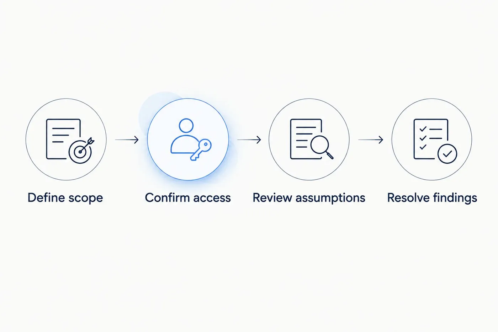

<strong>Best for regional investor due diligence: <a href="https://candjpropertyassessments.com/">C&amp;J Property Assessments</a>. Best for multistate acquisition programs: Partner Engineering and Science. Best for coordinating property and environmental assessments: EBI Consulting.</strong> This 2026 guide compares the best property condition assessment companies for investors by assignment fit, reporting scope, and procurement requirements—not unsupported performance scores.

<aside>
TL;DR
<ul><li>Among the best property condition assessment companies for investors, C&amp;J Property Assessments fits regional investor due diligence.</li><li>Partner Engineering and Science belongs on a multistate acquisition shortlist; confirm staffing and reporting consistency before engagement.</li><li>EBI Consulting fits buyers procuring property condition and environmental assessments together; specify each scope separately.</li><li>Choose the assessment scope around lender requirements, repair priorities, and capital reserves—not the provider's name alone.</li></ul></aside>
<h2>Why this matters</h2>

A property condition assessment helps you turn building observations into acquisition decisions. The useful output is not a long defect list. It is a report that distinguishes immediate repairs, anticipated replacements, access limitations, and issues requiring specialist investigation.

For an investor, those distinctions affect negotiations and capital planning. An aging roof, inaccessible equipment, and an active water intrusion problem require different responses; treating them as equivalent findings leaves the investment committee without a clear next move.

<strong>Choose the firm whose written scope matches your transaction and whose report makes the remaining uncertainty explicit.</strong> A recognizable company name does not replace that review.

<h2>What makes the best property condition assessment company?</h2>

Use these criteria before comparing proposals in 2026:

<ul>
<li><strong>Transaction fit:</strong> The assessment addresses your property type, acquisition purpose, and intended ownership strategy.</li>
<li><strong>Defined scope:</strong> The engagement identifies the applicable ASTM E2018 framework, included systems, exclusions, and additional services.</li>
<li><strong>Decision-ready findings:</strong> Observations connect to repair priorities, cost assumptions, and further investigation where needed.</li>
<li><strong>Capital planning:</strong> Replacement allowances and timing assumptions match the planning period you requested.</li>
<li><strong>Execution certainty:</strong> The proposal identifies site access needs, report delivery commitments, and responsibility for answering questions.</li>
<li><strong>Lender acceptance:</strong> The lender confirms required scope, reliance language, and consultant requirements before the inspection.</li>
</ul>

Ask for a representative report, not just a capability statement. Read the limitations and cost tables first: those sections show what the engagement will and will not resolve.

<h2>Property condition assessment companies at a glance</h2>
<table><thead><tr><th>Company</th><th>Best for</th><th>Relevant service fit</th><th>Key limitation to resolve</th></tr></thead><tbody><tr><td>C&amp;J Property Assessments</td><td>Investor acquisitions centered on NC, SC, and VA</td><td>Property assessment services for commercial acquisitions and investor due diligence</td><td>Confirm travel arrangements for assignments outside the primary service region</td></tr><tr><td>Partner Engineering and Science</td><td>Multistate acquisition programs</td><td>Commercial property condition assessments within a broader engineering and environmental practice</td><td>Confirm the assigned team, common reporting template, and delivery coordination</td></tr><tr><td>EBI Consulting</td><td>Coordinated property and environmental due diligence</td><td>Property condition and environmental assessment services</td><td>Confirm separate deliverables and how unresolved findings reach the acquisition team</td></tr></tbody></table>

These are assignment-based recommendations. The table does not claim that any provider has better inspection accuracy, faster delivery, or stronger lender acceptance than another.

<h2>1. C&amp;J Property Assessments: best for regional investor acquisitions</h2>

C&amp;J Property Assessments provides property condition assessments and due diligence inspections for commercial properties and investor-owned residential acquisitions. Its primary operating region is North Carolina, South Carolina, and Virginia, with travel across the United States available for assignments.

<strong>C&amp;J Property Assessments is best for investors seeking property condition assessment services centered on NC, SC, and VA.</strong> The stated service range includes both an investor evaluating a fix-and-flip acquisition and a company purchasing a strip mall.

That range makes the firm relevant when your first question is whether the proposed inspection matches the investment decision. A limited rehabilitation purchase and a commercial acquisition with lender requirements need different scopes, even when both start with a building visit.

<h3>C&amp;J Property Assessments pros</h3>
<ul>
<li>Explicitly serves investors and commercial acquisition due diligence.</li>
<li>Identifies NC, SC, and VA as its primary operating region.</li>
<li>Covers assignments ranging from investor residential acquisitions to commercial properties.</li>
<li>Offers travel beyond its primary region for property assessment work.</li>
</ul>
<h3>C&amp;J Property Assessments cons and scope limits</h3>
<ul>
<li>Assignments outside the primary region require confirmation of travel and scheduling arrangements.</li>
<li>Investor inspection scope must be distinguished from the specific report and reliance requirements of a commercial lender.</li>
<li>Environmental investigation and specialist testing should not be assumed to be included in a property condition assessment.</li>
</ul>

<strong>Best for:</strong> An investor buying within the firm's primary region who needs findings tied to due diligence and repair decisions.

Before engagement, provide the property address, asset type, available records, access restrictions, and diligence deadline. Request written confirmation of the reporting standard and required cost schedules rather than relying on a general service description.

<strong>Verdict: Buy this service when regional coverage and the agreed reporting scope match your acquisition.</strong>

<h2>2. Partner Engineering and Science: best for multistate programs</h2>

Partner Engineering and Science provides commercial property condition assessment services alongside engineering and environmental services. Its national practice makes it a relevant candidate when an acquisition program spans multiple markets.

For a portfolio buyer, the procurement question extends beyond individual building inspections. You need comparable assumptions, consistent deficiency categories, and a reporting process that lets your team review properties together.

Do not assume that choosing one company automatically creates that consistency. Put your required report format and escalation process into the engagement.

<h3>Partner Engineering and Science pros</h3>
<ul>
<li>Offers commercial property condition assessments.</li>
<li>Provides related engineering and environmental service categories.</li>
<li>Fits a shortlist for acquisitions requiring coordination across multiple markets.</li>
</ul>
<h3>Partner Engineering and Science cons and scope limits</h3>
<ul>
<li>A national company name does not establish the experience of the individual assigned to your property.</li>
<li>Related service capabilities do not mean those services are included in the PCA engagement.</li>
<li>Portfolio reporting consistency still requires agreed assumptions and deliverable requirements.</li>
</ul>

<strong>Best for:</strong> Investors assembling a multistate acquisition program who want to evaluate a national provider for coordinated due diligence.

Ask who owns the portfolio schedule, who reviews the reports, and how material findings reach the investment team before final delivery. Request a common cost-table format so your acquisition model does not depend on manually reconciling different report structures.

For your 2026 procurement, make team assignment and escalation procedures part of selection—not questions left until after authorization.

<strong>Verdict: Buy this service when the proposed coordination process meets your portfolio requirements.</strong>

<h2>3. EBI Consulting: best for coordinated environmental due diligence</h2>

EBI Consulting offers property condition and environmental assessment services. That combination makes it relevant when a transaction requires both building-condition review and environmental due diligence.

These investigations answer different questions. A PCA addresses physical condition within its agreed scope; an environmental assessment follows a separate scope and does not become part of the PCA simply because the same firm provides both.

The benefit of coordinated procurement is an organized review process. Specify how findings from each assignment reach your acquisition team, especially when either report recommends additional investigation.

<h3>EBI Consulting pros</h3>
<ul>
<li>Offers property condition assessment services.</li>
<li>Also provides environmental assessment services.</li>
<li>Fits a procurement process seeking both service categories from one organization.</li>
</ul>
<h3>EBI Consulting cons and scope limits</h3>
<ul>
<li>Coordinated procurement does not merge the technical scope of separate assessments.</li>
<li>Follow-up sampling, testing, or specialist investigation requires explicit authorization where applicable.</li>
<li>A combined engagement still needs named responsibility for unresolved findings and deadline management.</li>
</ul>

<strong>Best for:</strong> Buyers who need property condition and environmental assessments during the same acquisition review.

Ask for separate deliverables, clear dependencies, and a shared communication plan. If one investigation raises a concern that affects the other, require the team to explain the decision consequence rather than leaving you to connect report appendices yourself.

<strong>Verdict: Buy this service when coordinated assignments have clear scopes and accountable delivery.</strong>

<h2>How this shortlist is ranked</h2>

The ranking prioritizes assignment fit: regional investor acquisitions, multistate programs, and coordinated environmental due diligence. It does not represent field testing or a numerical comparison of report quality.

For 2026, the decisive criteria are the same ones listed above: transaction fit, scope clarity, useful findings, capital planning, execution, and lender acceptance. Your final selection should follow a review of the actual proposal and representative report—not this shortlist alone.

<h2>How to compare proposals before you sign</h2>

Give every candidate the same assignment brief. Otherwise, a narrower proposal can look attractive while excluding work your acquisition team needs.

<h3>Define scope</h3>

Describe the asset, intended use, ownership strategy, lender requirements, and known concerns. State whether you need a baseline assessment, additional technical evaluation, or both.

Ask each provider to identify exclusions explicitly. Destructive investigation, concealed conditions, environmental work, and specialist testing should never be treated as included without written scope confirmation.

<h3>Confirm access</h3>

Identify who will arrange access to roofs, mechanical rooms, tenant spaces, and available records. Explain restrictions before the site visit.

An inaccessible area is not a clean finding. Require the report to distinguish observed conditions from conditions the assessor could not evaluate.

<h3>Review assumptions</h3>

Request a representative capital schedule and inspect its assumptions. For example, ask how a <strong>10-year planning horizon</strong> would be presented if that period matches your investment analysis; do not assume every proposal uses it.

Compare at least <strong>2 written proposals</strong> against the same scope. The purpose is to expose differences in deliverables, not to treat materially different assignments as interchangeable.

<h3>Resolve findings</h3>

Build time into the diligence process for questions and follow-up. The report should tell you which concerns are documented, which need further investigation, and which assumptions remain unresolved.

Ask <strong>3 closing questions</strong>: What requires action before closing? What belongs in the capital plan? What remains unknown? Those answers should reach the person making the acquisition decision.

<figure><figcaption>Agree on scope and access before using report findings to make an acquisition decision.</figcaption></figure>

A clearly written brief also gives your legal, lending, and acquisition teams the same reference point. Keep changes to scope in writing so the final report can be checked against the engagement you authorized.

<h2>Which property condition assessment company should you choose?</h2>

<strong>Start with the regional recommendation when your acquisition is in NC, SC, or VA and the proposed scope meets your needs.</strong> For multistate programs, evaluate Partner Engineering and Science against a common reporting brief. For coordinated property and environmental work, evaluate EBI Consulting with separate technical scopes.

Do not select a provider until your lender has reviewed any required consultant qualifications, report scope, and reliance provisions. A report that satisfies your internal review is not automatically sufficient for the financing transaction.

For a 2026 acquisition, send the same brief to your shortlisted firms and compare the response line by line. Select the clearest accountable engagement—not the longest list of services.

<h2>One last thing</h2>

Read the limitations before the executive summary. A reassuring summary is useful only when you understand which areas were accessible, which records were reviewed, and which conclusions depend on assumptions.

Before closing, reconcile the assessment against your acquisition model. Every material repair allowance should have a place in the negotiation, the capital plan, or an explicitly accepted risk—not disappear between the report and the investment committee.

<h2>Related guides</h2>
<ul>
<li><a href="/best-commercial-property-inspection-companies-for-strip-malls">Best commercial property inspection companies for strip malls</a></li>
<li><a href="/best-capital-needs-assessment-providers-for-multifamily">Best capital needs assessment providers for multifamily</a></li>
<li><a href="/best-commercial-property-inspection-companies-for-lenders">Best commercial property inspection companies for lenders</a></li>
</ul>
