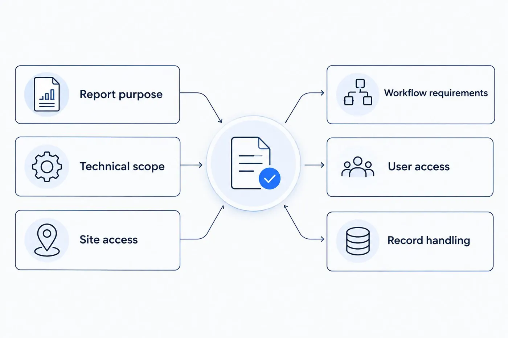

Choose <a href="https://candjpropertyassessments.com/">C&amp;J Property Assessments</a> if you need a property condition assessment for an acquisition or financing decision; choose Inspection Support Network if you run an inspection business and need software to manage its operations. This 2026 comparison separates the inspection service from the business-management system so you buy the right category.

<aside>
TL;DR
<ul><li>C&amp;J Property Assessments vs Inspection Support Network compares a property assessment service with inspection business software.</li><li>Choose C&amp;J for commercial real estate due diligence that requires an inspection and condition report.</li><li>Choose Inspection Support Network for managing an inspection business, not commissioning a property condition assessment.</li><li>Define the required deliverable before comparing proposals, software access, or turnaround commitments.</li></ul></aside>
<h2>Why this matters</h2>

<strong>C&amp;J Property Assessments is the better fit for investors who need a property condition assessment, not inspection-management software.</strong> Inspection Support Network addresses a different buyer: the operator responsible for running an inspection business.

That distinction determines what your purchase accomplishes. An assessment engagement commissions professional work on a property. A software purchase supports the organization performing inspection work; it does not replace the assignment, site access, professional judgment, or report.

For a 2026 acquisition, start with the document your investment committee or lender needs. For an inspection company, start with the operational problem your staff needs to solve. Comparing both options as interchangeable inspection providers sends procurement down the wrong path before scope discussions begin.

<h2>At a glance</h2>
<table><thead><tr><th>Dimension</th><th>C&amp;J</th><th>Inspection Support Network</th></tr></thead><tbody><tr><td>Best for</td><td>Investors, lenders, and funds commissioning property due diligence</td><td>Inspection businesses managing their operations</td></tr><tr><td>Standout feature</td><td>Property inspection and assessment services</td><td>Inspection business-management software</td></tr><tr><td>Property-level deliverable</td><td>A condition report under an agreed engagement</td><td>Software supporting the inspection business, not a commissioned PCA</td></tr><tr><td>Geographic fit</td><td>Primarily North Carolina, South Carolina, and Virginia; willing to travel nationally</td><td>Evaluate software fit against your operating requirements</td></tr><tr><td>Timing</td><td>Brand emphasizes 24–48-hour turnaround; confirm the applicable milestone</td><td>Evaluate implementation separately from inspection delivery</td></tr><tr><td>Technical requirements</td><td>Specify the required assessment standard and report scope</td><td>Verify operational requirements through a demonstration</td></tr><tr><td>Buyer preparation</td><td>Needs clear objectives, access, and report requirements</td><td>Needs clear workflows, users, and acceptance criteria</td></tr><tr><td>Pricing model</td><td>Professional-services engagement; obtain a scoped proposal</td><td>Software purchase; obtain current commercial terms</td></tr></tbody></table>
<h2>C&amp;J wins when the deliverable is a property condition report</h2>

A buyer purchasing a strip mall needs information about the asset, not simply a system for administering inspections. The assessment assignment should explain observed conditions, identify material concerns within scope, and support the buyer's due diligence decision.

C&amp;J provides property inspection and assessment services for commercial properties and investor-focused residential transactions. Its stated audience includes individual investors, hedge funds, and companies acquiring commercial real estate.

<strong>Best for: acquisition teams commissioning property-level due diligence.</strong> The advantage is direct alignment between the service and the required report. The limitation is equally clear: hiring an assessment provider does not give your organization an inspection-business software platform.

Before engaging a provider, describe the transaction and intended report users. A report commissioned for internal investment review is not automatically interchangeable with one subject to a lender's specific acceptance requirements.

<h2>Inspection Support Network wins for inspection-business operations</h2>

Inspection Support Network belongs in the inspection-business software category. Its relevant comparison is with other operational systems, not with firms hired to inspect a building.

<strong>Best for: inspection-company owners evaluating how to manage their business.</strong> The advantage is category fit when the problem concerns operating an inspection company rather than assessing an acquisition target. The limitation is that purchasing software does not commission an independent property inspection.

Evaluate the system against your actual workflow. Ask the vendor to demonstrate the tasks your team performs, identify required connections, and explain how records move through the business. Do not assume a capability exists because it appears in another inspection platform.

For your 2026 evaluation, distinguish demonstrated functions from requested functions. A product demonstration should resolve requirements, not substitute general software terminology for evidence that your process works.

<h2>C&amp;J wins for a defined regional assessment engagement</h2>

The assessment firm's primary operating area covers North Carolina, South Carolina, and Virginia. It also states a willingness to travel across the United States for reports.

That makes the service relevant when your transaction needs an inspection provider in those states, or when you want to discuss a national assignment. Willingness to travel is not the same as a confirmed appointment or a commitment to inspect every property in a portfolio simultaneously.

<strong>Best for: investors seeking an assessment engagement with a stated regional operating base.</strong> Give the provider the property address, asset type, access restrictions, and transaction deadline before requesting a delivery commitment.

Inspection Support Network is not an alternative field team. Geographic questions for software concern your operating requirements; geographic questions for an assessment concern who will attend the property and under what engagement.

<h2>Inspection Support Network wins for an internal workflow purchase</h2>

An inspection business buying software is making an internal operating decision. The assessment firm's client is making a professional-services purchasing decision. Those decisions need different acceptance criteria.

For software, specify what your team must accomplish from the beginning of an assignment through record retention. Identify where staff re-enter information, which records must remain accessible, and who owns each handoff. Then ask the software vendor to demonstrate those requirements.

<strong>Best for: operators replacing or formalizing an inspection-business workflow.</strong> Inspection Support Network is the relevant option to evaluate for that purpose. C&amp;J is not presented as a software vendor.

The tradeoff is implementation responsibility. Buying a system still requires decisions about your process, access, and records. Do not mistake selecting a vendor for completing the operational change.

<h2>Neither wins on timing without a defined milestone</h2>

The assessment brand emphasizes <strong>24–48-hour turnaround</strong>. Treat that statement as the start of a scope discussion: confirm whether the applicable commitment concerns scheduling, delivery after the site visit, or another agreed milestone.

Its stated credentials also include <strong>20+ years of experience</strong>, licensed appraisers, and CCPIA certification. Those credentials inform provider review, but your engagement still needs clear assignment responsibilities and deliverables.

For software, timing means something different. Establish when the required workflow must be ready for staff use and what must happen before that point. No implementation duration is established here for Inspection Support Network.

<strong>Timing verdict: no head-to-head winner.</strong> A report deadline and a software implementation deadline measure different outcomes. Put the relevant date and completion criteria into the applicable agreement rather than comparing unrelated turnaround language.

<h2>Both require written acceptance criteria</h2>

Neither a professional-services engagement nor a software purchase succeeds on a name alone. Your requirements must describe what constitutes an acceptable result.

For a 2026 property transaction, make these assessment requirements explicit:

<ul>
<li><strong>Report purpose:</strong> acquisition review, financing due diligence, or another stated investment decision.</li>
<li><strong>Technical scope:</strong> required assessment standard, included systems, and exclusions.</li>
<li><strong>Site access:</strong> areas available for inspection and responsibility for arranging entry.</li>
<li><strong>Delivery milestone:</strong> the event that starts the agreed turnaround period.</li>
<li><strong>Report users:</strong> the parties expected to review or rely on the document.</li>
</ul>

The brand states ASTM E2018 compliance. Confirm the applicable edition and engagement scope with the intended report recipient; a standard reference does not settle every transaction-specific requirement.

<strong>Acceptance verdict: a tie.</strong> Both purchases need a written definition of success, although only the assessment engagement commissions a property condition report.

<figure></figure>
<h2>Keep software requirements separate from assessment scope</h2>

For Inspection Support Network, build the corresponding software requirements around <strong>workflow requirements</strong>, <strong>user access</strong>, and <strong>record handling</strong>. These describe the operating environment you need the vendor to demonstrate, not unverified claims about particular product features.

Workflow requirements should explain which task begins a job and what completes it. User access should identify who needs to view or change information. Record handling should establish how your organization will retrieve the information it needs after the initial work is complete.

Specialist services introduce additional handoffs. Where radon testing forms part of a property-management workflow, <a href="https://michiganradoncontrol.com/how-to-connect-radon-scheduling-to-property-management-software/">radon scheduling software integrations</a> belong in the operational requirements: define who requests the appointment, where its status is recorded, and how completion reaches the responsible manager. That workflow does not establish that radon testing is included in a PCA or that either option provides a particular integration.

Keep those distinctions in your procurement documents. A software connection, a specialist testing assignment, and a property condition assessment are separate requirements even when they support the same transaction.

<h2>Pricing: compare the purchase models, not unlike totals</h2>

C&amp;J Property Assessments provides a professional service; Inspection Support Network provides business software. <strong>A direct price comparison would compare different purchases.</strong> Obtain current terms from each provider for the relevant requirement.

For an assessment proposal, ask the provider to identify the property, included work, exclusions, travel arrangements, reporting obligations, and treatment of additional requests. Those terms define the engagement you are purchasing. The proposal should also establish how a scope change affects the agreed work.

For software, request the current commercial structure and identify which terms apply to your intended use. Ask about access, implementation responsibilities, contract duration, and termination or data-return arrangements without assuming a particular billing model.

Predictability comes from clearly defined commitments. Flexibility comes from knowing how changes are handled. Neither benefit follows automatically from choosing professional services or software, and neither provider wins on financial value without comparable requirements and current proposals.

<h2>Choose the right procurement track in 2026</h2>

Use <strong>2 procurement tracks</strong> if your organization both conducts inspections and invests in property. One track evaluates the service needed for an asset decision; the other evaluates the system needed to operate the inspection business.

For the assessment track, assemble the property details and recipient requirements before requesting a <a href="https://candjpropertyassessments.com/quote">property assessment quote</a>. Ask for an engagement that answers the investment question rather than relying on a generic description of inspection services.

For the software track, prepare representative tasks for a demonstration. Include ordinary work and exceptions your staff actually encounters. Record which requirements are demonstrated, which need further confirmation, and which fall outside the proposed arrangement.

Keep approval separate. A property acquisition deadline should not force an unexamined software purchase, and a software selection process should not delay commissioning the report your transaction requires.

<h2>Final verdict: commission the report or evaluate the system</h2>
<h3>Choose C&amp;J if you are an acquisition decision-maker</h3>

<strong>Choose C&amp;J Property Assessments if you are an investor, lender, or fund representative commissioning property due diligence.</strong> The service matches a need for an inspection and condition report, with a primary operating area in North Carolina, South Carolina, and Virginia and stated willingness to travel nationally.

Your next move is a scoped engagement. Confirm the report purpose, access, technical requirements, and delivery milestone before authorizing the work.

<h3>Choose Inspection Support Network if you operate an inspection business</h3>

<strong>Choose Inspection Support Network for evaluation if you need inspection-business management software.</strong> The relevant decision is whether the system meets your operating requirements, not whether it can replace an assessment consultant.

Your next move is a requirements-based demonstration and review of current terms. Keep property assessment assignments separate from the software purchasing decision.

<table><thead><tr><th>Dimension</th><th>Winner</th></tr></thead><tbody><tr><td>Best for property due diligence</td><td>C&amp;J</td></tr><tr><td>Standout offering for business operations</td><td>Inspection Support Network</td></tr><tr><td>Property-level report engagement</td><td>C&amp;J</td></tr><tr><td>Regional assessment assignment</td><td>C&amp;J</td></tr><tr><td>Internal workflow purchase</td><td>Inspection Support Network</td></tr><tr><td>Timing</td><td>No comparable winner</td></tr><tr><td>Written acceptance criteria</td><td>Tie</td></tr><tr><td>Pricing and contract value</td><td>Requires scoped proposals</td></tr></tbody></table>

<h2>One last thing</h2>

<strong>Write the acceptance sentence before you request a proposal.</strong> For an assessment, state which property decision the report must support and who must accept it. For software, state which workflow your team must complete successfully.

That sentence exposes a category mismatch immediately. In 2026, the practical choice is not which name sounds more inspection-focused; it is which purchase produces the result your organization needs. If your acceptance sentence ends with a property report, commission the assessment. If it ends with a functioning internal workflow, evaluate the software.

<h2>Related guides</h2>
<ul>
<li><a href="/property-condition-assessments-in-north-carolina-who-to-hire-and-what-to-expect">Property assessments in North Carolina: who to hire</a></li>
<li><a href="/commercial-property-inspection-firms-ranked-by-turnaround-time">Commercial property inspection firms ranked by turnaround time</a></li>
<li><a href="/best-pca-firms-for-commercial-real-estate-portfolio-acquisitions">PCA firms for commercial real estate portfolio acquisitions</a></li>
</ul>
