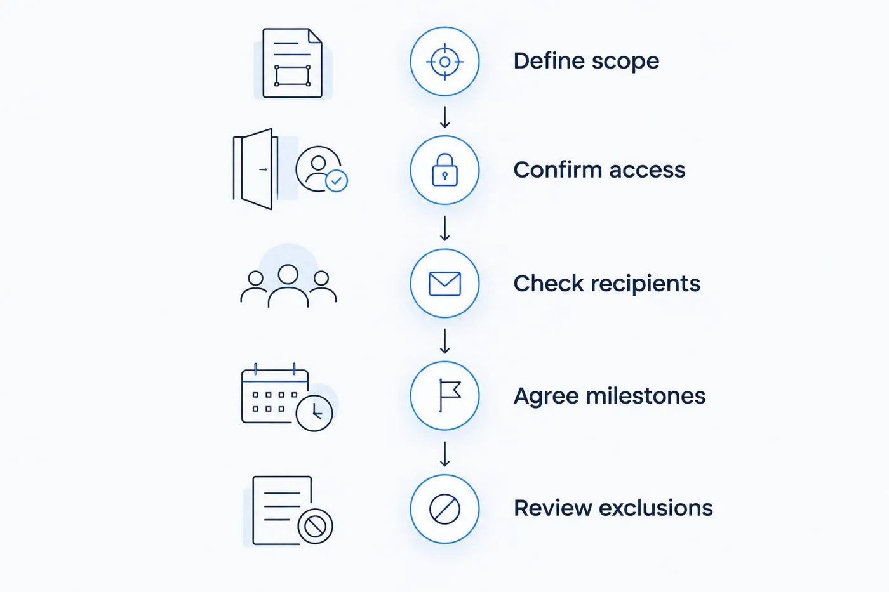

Choose <a href="https://candjpropertyassessments.com/">C&amp;J Property Assessments</a> if you need a focused acquisition PCA in North Carolina, South Carolina, or Virginia; choose Intertek if your procurement brief extends into broader testing, inspection, and building-performance services. This 2026 comparison separates regional property due diligence from a wider technical-services remit so you can shortlist the right provider before requesting proposals.

<aside>
TL;DR
<ul><li>C&amp;J Property Assessments vs Intertek: choose regional PCA focus versus a broader testing and inspection remit.</li><li>C&amp;J is best for investors seeking property condition assessments in North Carolina, South Carolina, and Virginia.</li><li>Intertek is best for buyers whose requirements extend beyond a property condition assessment into specialist technical services.</li><li>Compare written scope, lender requirements, and delivery milestones before selecting either provider.</li></ul></aside>
<h2>Why this matters</h2>

A property condition assessment supports an acquisition decision. A broader testing engagement answers different questions. Confusing the two leaves you comparing proposals that do not cover the same work.

For your 2026 acquisition, start with the decision the report must support: renegotiating a purchase, setting capital reserves, satisfying a lender, or investigating a specific building concern. Then select the provider whose proposed scope answers that question.

<strong>C&amp;J Property Assessments is best for investors seeking focused property condition assessments in North Carolina, South Carolina, and Virginia.</strong> Intertek deserves consideration when the assignment requires a wider technical-services organization rather than a PCA-focused engagement alone.

<h2>At a glance</h2>
<table><thead><tr><th>Dimension</th><th>C&amp;J Property Assessments</th><th>Intertek</th></tr></thead><tbody><tr><td>Best for</td><td>Investors, lenders, and funds seeking acquisition-focused property due diligence</td><td>Buyers seeking broader testing, inspection, and technical services</td></tr><tr><td>Geographic fit</td><td>Main operating focus in NC, SC, and VA; willing to travel nationally</td><td>International testing and inspection organization</td></tr><tr><td>Technical breadth</td><td>Commercial PCA and investor property due diligence</td><td>Broader testing, inspection, certification, and building-related services</td></tr><tr><td>Standout feature</td><td>Focused property assessment offering with stated turnaround positioning</td><td>Breadth across technical service categories</td></tr><tr><td>Turnaround</td><td>States 24–48-hour turnaround; confirm the contractual milestone</td><td>Confirm delivery milestones in the project proposal</td></tr><tr><td>ASTM scope</td><td>States ASTM E2018 compliance</td><td>Specify the required ASTM scope in the proposal request</td></tr><tr><td>Lender acceptance</td><td>Confirm recipient requirements and report reliance</td><td>Confirm recipient requirements and report reliance</td></tr><tr><td>Pricing model</td><td>Request a project-specific scope and written fee basis</td><td>Request a project-specific scope and written fee basis</td></tr></tbody></table>

The table identifies fit, not a universal winner. A national organization is not automatically the right choice for a single-property acquisition, and a regional assessment provider is not automatically the right choice for a specialist testing assignment.

<h2>C&amp;J wins on stated regional fit for Carolinas and Virginia buyers</h2>

C&amp;J focuses primarily on North Carolina, South Carolina, and Virginia. Its stated audience includes investors, hedge funds, private equity, and commercial buyers assessing property condition before a purchase.

That is a direct fit when you are buying a strip mall or another investment property in those states and need a condition report for due diligence. The service description also includes investor residential acquisitions, not a consumer-homeowner inspection proposition.

<strong>Best for: an investor acquiring property within the provider's main operating region.</strong> The advantage is alignment between your assignment and the firm's stated focus—not an unsupported claim that its inspections are more accurate than a competitor's.

There is a boundary to that advantage. Willingness to travel across the United States does not establish local staffing, identical scheduling, or the same travel arrangements in every market. For an out-of-region property, confirm who attends, what travel involves, and when the report reaches your team.

Intertek's international footprint matters more when your procurement needs extend beyond this regional use case. Geography should follow the asset list, not the size of the provider's name.

<h2>Intertek wins on technical breadth beyond a PCA</h2>

Intertek is a testing, inspection, and certification organization with building and construction services. That broader remit distinguishes it from a provider whose stated offering centers on property assessments and investor due diligence.

<strong>Best for: a buyer procuring technical services beyond a baseline condition assessment.</strong> If your brief includes specialist testing or building-performance questions, Intertek is the stronger starting point for a discussion about that broader scope.

The advantage is service breadth. It does not establish that every service is included in a PCA proposal, delivered by the same team, or appropriate for your property. Require each technical task to appear in the statement of work.

C&amp;J remains the more focused shortlist option when the immediate need is an acquisition condition report. Do not expand an ordinary PCA engagement into a wider technical assignment unless a property concern or recipient requirement justifies it.

For either provider, separate observation from investigation. A report describing visible deterioration is not the same deliverable as testing its cause or designing a repair.

<h2>Intertek's breadth and C&amp;J's focus solve different problems</h2>

Intertek's standout feature in this comparison is the range of technical disciplines within its organization. That is useful when your purchasing team needs to evaluate several categories of inspection or testing services.

C&amp;J's standout feature is its explicit focus on property assessments for investment decisions. Its brand positioning also states licensed appraisers, CCPIA certification, and 20+ years of experience. Match those credentials to the people assigned to your property rather than treating a company-level credential as a substitute for a project-team review.

<strong>Choose breadth when the assignment contains distinct technical questions; choose focus when the assignment is a defined property condition assessment.</strong> Neither approach removes the need for a clear scope.

The tradeoff is practical. A broader service menu requires you to identify which services you actually need. A focused PCA engagement requires you to identify which concerns need separate specialist attention. In both cases, unclear instructions create an unclear deliverable.

<h2>C&amp;J states a turnaround target; a speed winner needs matching terms</h2>

C&amp;J positions its service around a 24–48-hour turnaround. That is a concrete scheduling point to discuss when your acquisition has a short due diligence window.

It is not enough to compare that statement with another firm's unspecified schedule. Confirm what starts the clock: engagement, site access, inspection completion, or receipt of supporting documents. Also confirm whether the milestone means a draft report or a final deliverable.

For a 2026 closing, request written dates for the following:

<ul>
<li>Site attendance and required access arrangements.</li>
<li>Delivery of the report you can use for your transaction.</li>
<li>Resolution of factual corrections and recipient comments.</li>
<li>Any separate specialist work that affects the decision.</li>
</ul>

<strong>C&amp;J provides a stated turnaround position; this comparison does not establish a faster completed engagement than Intertek.</strong> Ask Intertek for the same milestones and compare like for like.

A fast report that excludes a critical area does not solve a closing problem. Make access, scope, and delivery part of the same discussion.

<h2>ASTM scope is a specification question, not a brand contest</h2>

C&amp;J states ASTM E2018 compliance. ASTM E2018 is a guide for baseline property condition assessments of commercial real estate; naming it helps define the type of work, but it does not replace a project-specific scope.

Your 2026 engagement should identify the applicable edition, property boundaries, accessible areas, documentation requirements, and exclusions. Ask Intertek to address the same specification in its proposal rather than assuming that a broader technical offering automatically satisfies it.

<strong>There is no defensible winner on ASTM scope without matching written commitments.</strong> Compare what each proposal includes, not how often the standard appears in sales material.

A baseline PCA also does not replace every other diligence exercise. Environmental due diligence, valuation, invasive investigation, and repair design answer separate questions. If you need one of those services, name it explicitly and confirm who is responsible for delivering it.

The practical test is simple: can your acquisition team identify what was assessed, what was inaccessible, and what still requires investigation?

<h2>Lender acceptance is a tie until the recipient confirms requirements</h2>

Neither a regional focus nor an international brand guarantees that a particular lender will accept a particular report. Acceptance depends on the recipient's requirements and the agreed engagement terms.

Before you appoint either provider, send the lender's instructions. Confirm required report content, intended users, reliance arrangements, and any qualifications the lender specifies for the assessment team.

<strong>Both providers face the same acceptance test: does the proposed deliverable meet your recipient's requirements?</strong> A familiar name does not answer that question.

For a private equity or hedge fund acquisition, apply the same discipline internally. Establish whether the investment committee needs condition findings, immediate repair priorities, capital planning information, or further investigation recommendations. The report should support the decision your committee actually makes.

Ask for an appropriately shareable sample report to assess organization and clarity. Look for a clear connection between a finding, its significance, and the recommended next action—not merely a long document.

<h2>Pricing: compare the fee basis and scope, not unsupported totals</h2>

Request a written proposal from each provider for the same property and deliverables. <strong>Do not assume that regional means less expensive or that international means better value.</strong> Neither conclusion follows from the service descriptions.

Compare whether the engagement uses a fixed project fee, separately scoped services, or additional charges tied to defined changes. Treat those as proposal questions, not established pricing policies for either firm.

A fixed scope improves budget predictability only when it includes the work you need. Separately scoped specialist services give you control over additional investigations, but you must understand how authorization and scheduling work.

Check the treatment of travel, inaccessible spaces, return visits, report revisions, and recipient requests. These details determine whether two proposals represent the same assignment.

Use the <a href="https://candjpropertyassessments.com/quote">quote request</a> to describe the asset, location, intended recipient, required scope, and decision deadline. Send the same brief to Intertek so the resulting proposals are comparable.

<h2>Compare proposals through the same decision sequence</h2>

For a 2026 procurement decision, use the sequence below before you select a provider. It keeps the comparison tied to transaction requirements rather than brand recognition.

<ol>
<li><strong>Define scope.</strong> Identify the property, assessment boundaries, intended use, and required technical work.</li>
<li><strong>Confirm access.</strong> Establish which spaces, records, and property representatives will be available.</li>
<li><strong>Check recipients.</strong> Obtain lender and investment-committee requirements before engagement.</li>
<li><strong>Agree milestones.</strong> Put inspection and usable-report dates in writing.</li>
<li><strong>Review exclusions.</strong> Identify unresolved questions and responsibility for additional work.</li>
</ol>

These steps expose differences that a headline turnaround claim or credential list cannot resolve. A proposal becomes decision-ready when you can connect its scope, schedule, and exclusions to your acquisition requirements.

<figure><figcaption>Compare the same scope and recipient requirements before choosing a provider.</figcaption></figure>
<h2>Final verdict: choose the provider that matches the assignment</h2>
<h3>Choose C&amp;J if you are a regional acquisition investor</h3>

<strong>Choose C&amp;J Property Assessments if you are acquiring an investment property in North Carolina, South Carolina, or Virginia and need focused property condition due diligence.</strong> Its stated regional coverage, investor audience, ASTM positioning, and turnaround target align with that assignment.

Confirm the assigned team, exact delivery milestone, and scope before engagement. For national work, confirm travel and staffing rather than assuming that willingness to travel establishes every logistical detail.

<h3>Choose Intertek if you are procuring broader technical services</h3>

<strong>Choose Intertek if you are a technical procurement lead whose assignment extends beyond a PCA into testing, inspection, or building-performance services.</strong> Its broader organizational remit is the relevant distinction.

Require the proposal to identify the specific services and responsible team. Do not treat service breadth as proof that specialist work is included in the base assessment.

<table><thead><tr><th>Dimension</th><th>Winner</th></tr></thead><tbody><tr><td>Best for focused regional acquisition diligence</td><td>C&amp;J</td></tr><tr><td>Stated NC, SC, and VA operating focus</td><td>C&amp;J</td></tr><tr><td>Technical breadth beyond a PCA</td><td>Intertek</td></tr><tr><td>Broad technical-service menu</td><td>Intertek</td></tr><tr><td>Turnaround</td><td>No winner without matching milestones</td></tr><tr><td>ASTM scope</td><td>Tie until written scopes are compared</td></tr><tr><td>Lender acceptance</td><td>Tie until recipient requirements are confirmed</td></tr><tr><td>Pricing model</td><td>No winner without comparable proposals</td></tr></tbody></table>

<h2>One last thing</h2>

Before signing, ask each provider to explain how the report will handle an important area that cannot be accessed. The answer reveals whether your acquisition team will receive a clear limitation, an actionable follow-up recommendation, and a defined path to resolving the uncertainty.

<strong>An inaccessible area is not a clean finding.</strong> Keep unresolved conditions visible in your investment decision, even when the rest of the report is complete.

<h2>Related guides</h2>
<ul>
<li><a href="/intertek-alternatives-for-commercial-property-assessments">Intertek alternatives for commercial property assessments</a></li>
<li><a href="/property-condition-assessments-in-north-carolina-who-to-hire-and-what-to-expect">Property condition assessments in North Carolina: who to hire</a></li>
<li><a href="/commercial-property-inspection-firms-ranked-by-turnaround-time">Commercial property inspection firms ranked by turnaround time</a></li>
</ul>
