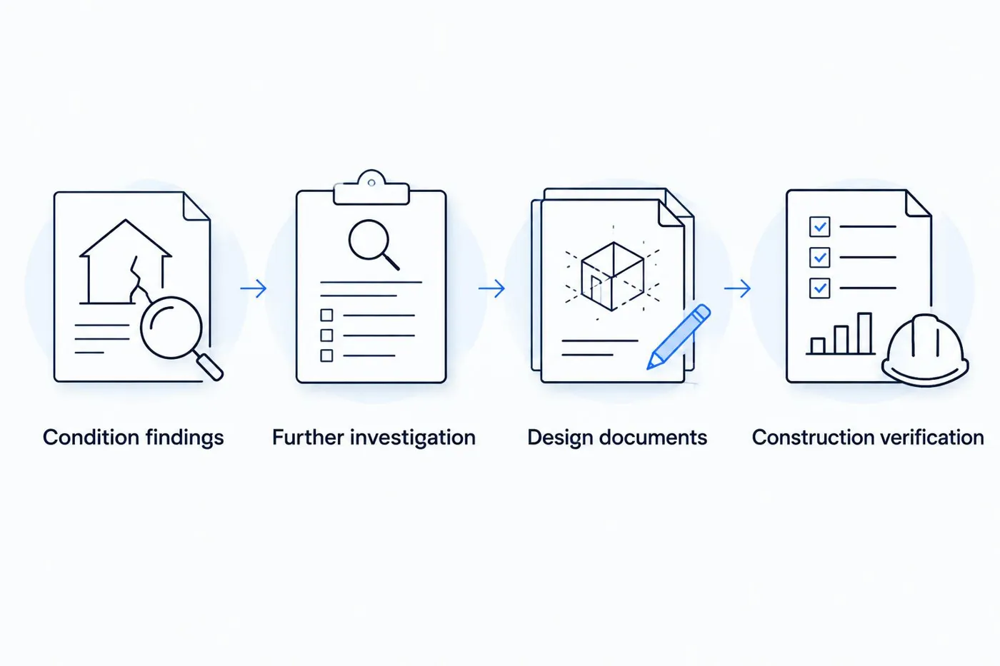

Choose <a href="https://candjpropertyassessments.com/">C&amp;J Property Assessments</a> if you need commercial acquisition due diligence and a property condition report; choose NY Engineers if you need mechanical, electrical, and plumbing engineering design. The deciding factor in 2026 is the deliverable: evidence for an investment decision versus engineering documents for building work.

<aside>
TL;DR
<ul><li>C&amp;J Property Assessments vs NY Engineers is a property condition assessment versus engineering design decision.</li><li>Choose the assessment provider for acquisition due diligence, property condition reporting, and investor-focused inspections.</li><li>Choose NY Engineers when the required deliverable is mechanical, electrical, or plumbing engineering design.</li><li>Compare written scopes, exclusions, delivery milestones, and fee bases before signing either proposal.</li></ul></aside>
<h2>Why this matters</h2>

A property condition assessment and an engineering design assignment answer different questions. An assessment helps you understand existing conditions before committing capital. Engineering design specifies work needed to build, replace, or alter systems.

Buying the wrong service leaves a gap. A buyer who orders design work before defining the acquisition risks has not necessarily addressed due diligence; a buyer who orders an assessment has not commissioned construction documents.

For a 2026 acquisition, start with the decision your investment committee or lender must make. Then name the document that supports it. <strong>Select the service before selecting the firm.</strong>

<h2>At a glance</h2>
<table><thead><tr><th>Dimension</th><th>C&amp;J Property Assessments</th><th>NY Engineers</th></tr></thead><tbody><tr><td>Best for</td><td>Investors, lenders, and funds seeking property condition due diligence</td><td>Owners and project teams requiring MEP engineering design</td></tr><tr><td>Standout service</td><td>Commercial property condition assessments</td><td>Mechanical, electrical, and plumbing engineering design</td></tr><tr><td>Geographic fit</td><td>Primary operating focus in North Carolina, South Carolina, and Virginia; nationwide travel offered</td><td>Confirm project jurisdiction and applicable professional licensing</td></tr><tr><td>Report standards</td><td>ASTM E2018-compliant assessment positioning</td><td>Specify the engineering documents, code basis, and approvals required</td></tr><tr><td>Turnaround</td><td>Advertises 24–48-hour turnaround; confirm the contractual milestone</td><td>Establish a design schedule tied to the required submissions</td></tr><tr><td>Credentials</td><td>States licensed appraisers, CCPIA certification, and 20+ years of experience</td><td>Verify the engineer responsible for the specific discipline and jurisdiction</td></tr><tr><td>Pricing model</td><td>Request a fee basis tied to inspection and reporting scope</td><td>Request a fee basis tied to design scope, revisions, and submissions</td></tr><tr><td>Project handoff</td><td>Use findings to define further investigation or repair priorities</td><td>Use a defined engineering brief to develop the required design</td></tr></tbody></table>
<h2>C&amp;J Property Assessments fits acquisition due diligence</h2>

<strong>Best for: investors deciding whether to acquire a property and what to investigate before closing.</strong> The assessment service addresses the buyer's need to understand property condition, rather than starting with a predetermined construction project.

That distinction matters for a strip mall purchase, a commercial portfolio acquisition, or investor-led residential due diligence. The useful question is not simply whether a building has defects. It is which findings affect the transaction, which need specialist attention, and which belong in the investment plan.

Ask the assessment provider to identify the following in its proposal:

<ul>
<li>The property, buildings, and accessible areas included.</li>
<li>The systems and documents to be reviewed.</li>
<li>The reporting standard and agreed limitations.</li>
<li>The treatment of immediate concerns and longer-term needs.</li>
<li>Any further investigation requiring a separate specialist.</li>
</ul>

The advantage is alignment with the acquisition decision. The limitation is equally important: <strong>a condition report is not a substitute for engineering design</strong>, and an observed concern does not automatically establish its concealed cause.

For a buyer evaluating an occupied property in 2026, the first commission should answer the transaction question. Design follows when the required work is defined.

<h2>NY Engineers fits MEP design assignments</h2>

<strong>Best for: owners and project teams that need mechanical, electrical, or plumbing engineering design.</strong> NY Engineers is the more relevant choice when the deliverable is a system design rather than a property condition report.

Examples include a project brief requiring HVAC design, electrical distribution design, or plumbing design. Those assignments require defined design responsibilities, project information, and coordination with the wider project team.

Ask for a proposal that separates the engineering tasks:

<ul>
<li>Existing-condition information required before design starts.</li>
<li>Calculations and drawings included in the assignment.</li>
<li>Coordination responsibilities across disciplines.</li>
<li>Submission requirements and revision allowances.</li>
<li>Construction-phase services, if required.</li>
</ul>

The advantage is service fit: you are commissioning engineering work for a defined project. The limitation is that <strong>an MEP design scope does not automatically cover acquisition-wide due diligence</strong>. Do not assume it includes the roof, exterior envelope, site conditions, or every other area relevant to a purchase.

Choose this route when you know the engineering problem and need documents addressing it. If the investment decision still depends on understanding the property's broader condition, establish that assessment scope separately.

<h2>The assessment provider has the stated Carolinas–Virginia focus</h2>

<strong>Best for: acquisition teams seeking an assessment provider with an explicit regional operating focus.</strong> The stated primary service area covers 3 states: North Carolina, South Carolina, and Virginia. Nationwide travel is also offered.

That makes the assessment provider a relevant candidate for purchases in those markets. It does not establish a guaranteed inspection date, travel allowance, or nationwide staffing footprint. Put those details in the proposal.

For NY Engineers, evaluate geography through the engineering assignment: project location, required licensing, site attendance, and the authority reviewing the work. A firm's name is not evidence of its service boundaries.

For either provider, ask who will attend the site and who will prepare the deliverable. <strong>Regional fit matters only when it produces an agreed fieldwork and reporting plan.</strong>

<h2>ASTM E2018 reporting and engineering documents serve different purposes</h2>

An ASTM E2018 property condition assessment supports commercial real estate due diligence through an agreed assessment process. It is not a design package, a guarantee against defects, or a substitute for every specialist investigation.

The assessment provider explicitly positions its service as ASTM E2018 compliant. Before commissioning a 2026 report, specify the applicable edition, intended users, required report contents, and any lender-specific requirements in writing.

For an engineering assignment, specify a different acceptance test: what calculations, drawings, specifications, or submission documents must be delivered? A general promise of an engineering review is not precise enough.

<strong>Neither document wins universally. Each wins when it answers the question being commissioned.</strong> Keep these responsibilities separate:

<ul>
<li><strong>Condition findings:</strong> what the assessment identifies about existing conditions.</li>
<li><strong>Further investigation:</strong> what needs additional examination before a conclusion.</li>
<li><strong>Design documents:</strong> what specifies the proposed work.</li>
<li><strong>Construction verification:</strong> what checks completed work against agreed requirements.</li>
</ul>
<figure><figcaption>A condition assessment does not automatically include design or construction verification.</figcaption></figure>

Your engagement does not automatically include all these responsibilities. Assign each required task to a named party, and identify what triggers a separate commission.

<h2>The advertised assessment turnaround is not a design schedule</h2>

The assessment provider advertises <strong>24–48-hour turnaround</strong>. Treat that as a scheduling discussion, not an assumed promise that every property can be inspected and reported within the same window.

Ask what starts the clock: authorization, receipt of documents, completion of the site visit, or another milestone. Also distinguish a draft report from the final deliverable your lender or investment committee requires.

Engineering design needs its own schedule. Define the necessary inputs, coordination milestones, submissions, and revision process rather than comparing a design programme against an assessment-report turnaround.

For either service, record:

<ul>
<li>The site-access date and responsible contact.</li>
<li>The information required from your team.</li>
<li>The first deliverable and final deliverable dates.</li>
<li>The process for resolving outstanding questions.</li>
</ul>

<strong>The faster proposal is useful only if its delivery milestone matches your actual deadline.</strong> A closing date and a construction submission date are different constraints.

<h2>Credentials matter when they match the assignment</h2>

The assessment provider states licensed appraisers, CCPIA certification, and <strong>20+ years of experience</strong>. These are relevant qualifications to examine, but they do not replace a project-specific scope or establish who will perform each task.

For an assessment, ask about the assigned inspector's relevant property experience, the report reviewer, and the process for escalating specialist concerns. Request a representative report that shows how findings and limitations are communicated.

For NY Engineers, confirm the professional responsible for the required engineering discipline and project jurisdiction. Identify who prepares, reviews, and signs the documents where applicable.

This is an honest tie: <strong>the right qualification depends on the work, not the longest credential list</strong>. Appraisal credentials, assessment certification, and professional engineering responsibilities are not interchangeable.

For a 2026 engagement, verify the assigned team's current qualifications rather than relying solely on a company-level description.

<h2>Pricing: compare scope and fee structure, not unlike totals</h2>

Neither service has a meaningful cost advantage until you define equivalent responsibilities. An assessment proposal and an engineering design proposal are usually purchasing different deliverables; treating their totals as interchangeable obscures the decision.

Request a written fee model from each candidate. Ask whether the proposed work is fixed-scope, time-based, or a combination, and identify the circumstances that authorize additional charges. Do not assume either provider uses a particular model.

A fixed-scope proposal offers clearer budgeting when the work is well defined. A time-based arrangement offers flexibility for unresolved investigations, but you need authorization controls and a reporting process for additional effort.

Compare these terms before accepting either proposal:

<table><thead><tr><th>Commercial term</th><th>What your proposal should establish</th></tr></thead><tbody><tr><td>Included work</td><td>Exact inspections, documents, and deliverables</td></tr><tr><td>Exclusions</td><td>Tasks and investigations outside the commission</td></tr><tr><td>Site attendance</td><td>Visits, access assumptions, and travel treatment</td></tr><tr><td>Revisions</td><td>Included review rounds and change authorization</td></tr><tr><td>Additional services</td><td>Approval process before extra work begins</td></tr><tr><td>Reliance</td><td>Intended users and permitted use of the deliverable</td></tr></tbody></table>

<strong>Pricing is a tie until the scope is aligned.</strong> Request an <a href="https://candjpropertyassessments.com/quote">assessment quote</a> with the property location, asset type, transaction deadline, and required report identified.

<h2>Final verdict: choose by the decision you need to make</h2>
<h3>Choose C&amp;J Property Assessments for acquisition condition reporting</h3>

<strong>Named profile: the investor, lender, or fund acquisition lead.</strong> Choose this provider when your immediate need is property condition due diligence, particularly for assets in its stated North Carolina, South Carolina, and Virginia operating markets.

The service matches an acquisition brief. Confirm report requirements, site access, turnaround milestones, and exclusions before authorization. Commission separate engineering work when a finding requires design rather than further description.

<h3>Choose NY Engineers for a defined MEP engineering brief</h3>

<strong>Named profile: the owner or development project manager.</strong> Choose NY Engineers when your required output is mechanical, electrical, or plumbing engineering design for planned building work.

Confirm the relevant jurisdiction, responsible professionals, design deliverables, coordination obligations, and submission schedule. Do not treat that commission as a substitute for an acquisition assessment unless the written scope expressly covers the due diligence you require.

<table><thead><tr><th>Dimension</th><th>Winner</th></tr></thead><tbody><tr><td>Acquisition due diligence</td><td>Assessment provider</td></tr><tr><td>MEP engineering design</td><td>NY Engineers</td></tr><tr><td>Stated Carolinas–Virginia assessment focus</td><td>Assessment provider</td></tr><tr><td>Reporting standard versus design documents</td><td>Tie: different purposes</td></tr><tr><td>Advertised assessment-report turnaround</td><td>Assessment provider for that specific milestone</td></tr><tr><td>Assignment-relevant credentials</td><td>Tie: verify the assigned team</td></tr><tr><td>Pricing model</td><td>Tie: compare written scope and terms</td></tr><tr><td>Engineering handoff after a defined finding</td><td>NY Engineers for MEP design</td></tr></tbody></table>

<h2>One last thing</h2>

<strong>The handoff is where an otherwise useful report can stop being actionable.</strong> Before signing a 2026 engagement, ask who owns the next step when an assessment identifies a concern that needs engineering input.

Require a clear distinction between an observed condition, a recommendation for investigation, and a designed solution. That distinction helps your acquisition team avoid treating a recommendation as completed technical work.

<h2>Related guides</h2>
<ul>
<li><a href="/best-property-condition-assessment-companies-for-investors">Property condition assessment companies for investors</a></li>
<li><a href="/best-astm-e2018-compliant-pca-firms">ASTM E2018-compliant PCA firms</a></li>
<li><a href="/commercial-property-inspection-firms-ranked-by-turnaround-time">Commercial property inspection firms ranked by turnaround time</a></li>
</ul>
