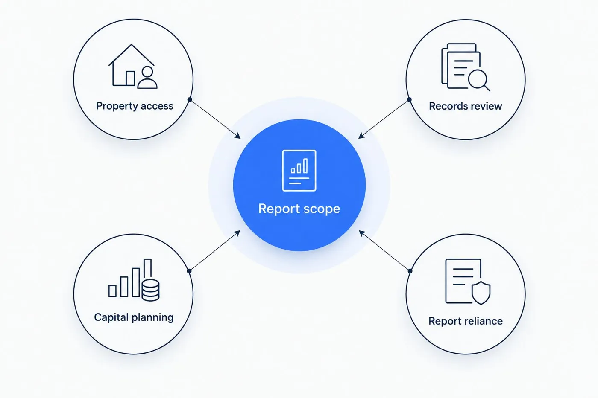

Choose <a href="https://candjpropertyassessments.com/">C&amp;J Property Assessments</a> if you need investor-focused property condition assessments in North Carolina, South Carolina, or Virginia; choose Partner ESI if your acquisition requires a broader engineering and environmental due diligence engagement. This 2026 comparison separates regional assessment fit from multidisciplinary project coordination so you can select the right scope, not just the better-known name.

<aside>
TL;DR
<ul><li>C&amp;J Property Assessments vs Partner ESI comes down to focused property condition assessments versus broader technical due diligence.</li><li>C&amp;J suits investors seeking detailed condition reports, especially in North Carolina, South Carolina, and Virginia.</li><li>Partner ESI suits buyers coordinating property condition, environmental, and engineering workstreams.</li><li>Compare written scope, report delivery milestones, and lender requirements before choosing either firm.</li></ul></aside>
<h2>Why this matters</h2>

A property condition assessment supports an acquisition decision. It does not replace every investigation your lender, investment committee, or operating partner requires. Choosing a provider before defining those requirements creates the wrong comparison.

For a 2026 purchase, separate three questions: what physical conditions need documenting, what specialist investigations need commissioning, and who will coordinate the deliverables. A focused assessment engagement and a multidisciplinary assignment solve different procurement problems.

<strong>C&amp;J Property Assessments is best for investors seeking focused property condition assessments, particularly in North Carolina, South Carolina, and Virginia.</strong> Partner ESI belongs on the shortlist when the assignment extends into its broader engineering and environmental service categories.

<h2>At a glance</h2>
<table><thead><tr><th>Dimension</th><th>C&amp;J</th><th>Partner ESI</th></tr></thead><tbody><tr><td>Best for</td><td>Investors seeking focused property condition reporting</td><td>Buyers coordinating multiple technical due diligence disciplines</td></tr><tr><td>Geographic fit</td><td>Main operating area: NC, SC, and VA; willing to travel nationally</td><td>National commercial real estate due diligence assignments</td></tr><tr><td>Service breadth</td><td>Commercial assessments and residential investment due diligence</td><td>Property condition, environmental, and engineering services</td></tr><tr><td>Turnaround</td><td>Advertises 24–48-hour turnaround; define the milestone in writing</td><td>Evaluate the delivery schedule in the project proposal</td></tr><tr><td>Personnel</td><td>Highlights licensed appraisers, CCPIA certification, and 20+ years of experience</td><td>Evaluate the qualifications assigned to each technical discipline</td></tr><tr><td>Report scope</td><td>ASTM E2018-compliant PCA positioning</td><td>PCA services; specify the required standard and deliverables</td></tr><tr><td>Pricing model</td><td>Compare a written project scope and fee proposal</td><td>Compare a written project scope and fee proposal</td></tr><tr><td>Standout fit</td><td>Detailed, timely reporting for investment decisions</td><td>Broader technical service coordination</td></tr></tbody></table>
<h2>C&amp;J is the closer regional fit for Carolinas and Virginia buyers</h2>

C&amp;J identifies North Carolina, South Carolina, and Virginia as its main operating area. That gives investors acquiring within those 3 states a concrete reason to include the firm in a regional shortlist. The business also states that it is willing to travel throughout the United States.

<strong>Choose C&amp;J for regional fit, not an assumed travel advantage.</strong> Your proposal should still identify the inspection location, access arrangements, report recipient, and delivery milestones. A stated operating area does not establish a specific inspection date.

Partner ESI's national commercial real estate due diligence practice makes it a relevant candidate for acquisitions extending beyond a single regional market. For a geographically dispersed assignment, evaluate the proposed staffing and reporting plan rather than treating national coverage as a guarantee of consistent execution.

For your 2026 acquisition, ask both firms to explain who handles site access and who resolves follow-up questions. Geography identifies a starting point; the assigned project team determines how the engagement runs.

<h2>Partner ESI is the better fit for broader technical coordination</h2>

Partner ESI provides property condition, environmental, and engineering services. That breadth matters when your transaction needs several technical disciplines and you want to evaluate them within one provider relationship.

C&amp;J's stated offering centers on property inspection and assessment services. Its client scenarios include investors evaluating fix-and-flip acquisitions, hedge funds commissioning due diligence, and companies assessing commercial properties such as strip malls.

<strong>Choose Partner ESI when coordinating several technical workstreams is the main procurement problem.</strong> Confirm which services appear in the actual proposal; a firm's service catalog does not make every discipline part of your engagement.

C&amp;J is the more focused option when the assignment is principally a condition assessment. The corresponding tradeoff is coordination: if your transaction also needs separate specialist investigations, establish who commissions them and reconciles their findings. Do not assume that a PCA engagement includes services outside its written scope.

<h2>C&amp;J makes turnaround an explicit selection criterion</h2>

C&amp;J Property Assessments advertises a <strong>24–48-hour turnaround</strong>. That is a concrete point to discuss when your due diligence schedule leaves little room for report delivery delays. It is not evidence that every assignment finishes within the same window.

Before relying on that timing, define the trigger. Does the clock begin after the site visit, after records arrive, or after the inspector receives access to every agreed area? Also distinguish a draft report from a final report suitable for the intended recipient.

Partner ESI should be evaluated against its project-specific delivery commitment. A wider technical assignment can involve separate deliverables, so one completion date does not necessarily describe the entire engagement.

For a 2026 closing, put these milestones into the proposal:

<ul>
<li><strong>Site access:</strong> the agreed inspection date and responsibility for arranging entry.</li>
<li><strong>Draft delivery:</strong> when the initial written findings reach your team.</li>
<li><strong>Final delivery:</strong> when comments and agreed corrections are incorporated.</li>
<li><strong>Follow-up:</strong> how questions arising during underwriting will be handled.</li>
</ul>

C&amp;J wins on making speed explicit in its positioning. A head-to-head speed winner requires comparable written commitments for your actual property.

<h2>Neither firm wins on credentials without the assigned team</h2>

C&amp;J highlights licensed appraisers, CCPIA certification, and <strong>20+ years of experience</strong>. These are relevant screening points, but they answer different questions. Appraisal credentials, inspection credentials, and experience should not be treated as interchangeable qualifications.

For Partner ESI, evaluate the people assigned to the disciplines you are buying. A proposal covering condition assessment and engineering work needs a clear division of responsibility, not simply a recognizable company name.

<strong>Treat personnel as a tie until you review the proposed team.</strong> Ask who conducts the walkthrough, who prepares the report, who reviews it, and who answers technical questions after delivery.

Match experience to the asset and the decision. An occupied strip mall, an industrial property, and a residential investment acquisition present different access and operating conditions. Ask for a relevant sample report and the assigned person's applicable experience rather than accepting firm-wide credentials as a substitute.

<h2>Both need a written scope before their reports are comparable</h2>

C&amp;J positions its commercial PCA service around ASTM E2018 compliance. Partner ESI also offers property condition assessments. Neither fact, on its own, establishes that two proposals include identical observations, cost opinions, supporting records, or follow-up work.

For a 2026 engagement, name the applicable standard and edition in the agreement. ASTM E2018 describes a baseline property condition assessment process; it is not a promise that every concealed condition will be discovered or every building system exhaustively tested.

<strong>Report scope is a tie until the deliverables match.</strong> Compare the same property, intended users, access assumptions, and reporting requirements before judging either proposal.

Organize your brief around these four headings:

<ul>
<li><strong>Property access:</strong> identify the buildings, spaces, and systems available for observation.</li>
<li><strong>Records review:</strong> specify the documents the seller or manager will provide.</li>
<li><strong>Capital planning:</strong> define the required repair and replacement cost information.</li>
<li><strong>Report reliance:</strong> identify the intended recipients and required reliance arrangements.</li>
</ul>
<figure><figcaption>Compare the same deliverables before choosing between assessment proposals.</figcaption></figure>

A useful report distinguishes observed conditions from assumptions and inaccessible areas. Ask both firms how they record those limits. An unresolved access issue is something your acquisition team must address, not something to hide inside a general statement of compliance.

<h2>Pricing is a scope comparison, not a brand-name contest</h2>

Evaluate both firms through a written project proposal. The relevant comparison is the agreed service package: property coverage, inspection work, report requirements, specialist involvement, and follow-up responsibilities.

A tightly defined assignment favors budget predictability because the parties agree on the deliverables before work begins. An engagement that permits additional investigations offers flexibility, but it needs an authorization process so your team controls scope changes. Confirm which arrangement each proposal actually uses.

<strong>Neither firm wins on commercial terms until the inclusions and exclusions match.</strong> A shorter scope is not automatically a better purchase, and a wider scope is not automatically necessary.

Ask both providers to address:

<ul>
<li>Travel and site-access assumptions.</li>
<li>Additional visits or inaccessible areas.</li>
<li>Specialist investigations outside the baseline assessment.</li>
<li>Revisions requested by your lender or investment committee.</li>
<li>Reliance documents and post-delivery questions.</li>
</ul>

For a 2026 purchase, separate the required acquisition deliverables from optional investigations. This lets you compare the core engagement without accidentally discarding work your transaction still needs. Use the same brief when requesting a <a href="https://candjpropertyassessments.com/quote">property assessment quote</a>.

<h2>Partner ESI's breadth matters when specialist testing is separate</h2>

The practical reason to consider Partner ESI's broader service range is coordination across distinct investigations. A PCA describes property conditions within its agreed scope; environmental testing and specialist engineering investigations require their own defined tasks and deliverables.

For multifamily acquisitions, questions about <a href="https://michiganradoncontrol.com/do-multi-family-buildings-require-radon-testing-in-michigan/">Michigan multifamily radon testing requirements</a> belong in the environmental and jurisdictional review, not an assumption that the PCA includes testing. Establish the applicable requirements with qualified advisers and identify the responsible provider before commissioning the work.

C&amp;J remains a candidate for the condition assessment component when you appoint and coordinate separate specialists. Partner ESI becomes more relevant when your team wants to evaluate several service categories through one firm.

The tradeoff is clear: a focused engagement makes the assessment assignment easier to isolate, while a broader engagement requires careful separation of each technical deliverable. <strong>Choose the coordination model first, then compare the providers within it.</strong> Neither model removes your responsibility to confirm what the agreement includes.

<h2>Final verdict: choose the engagement your acquisition needs</h2>
<h3>Choose C&amp;J for focused investor condition reporting</h3>

<strong>C&amp;J Property Assessments is the named choice for a regional investor buying in NC, SC, or VA whose primary need is a detailed condition report.</strong> Its stated assessment focus and turnaround positioning fit that procurement brief. Confirm access, reporting milestones, and lender requirements before authorizing the assignment.

<h3>Choose Partner ESI for multidisciplinary due diligence</h3>

<strong>Partner ESI is the named choice for an acquisition manager coordinating property condition, environmental, and engineering workstreams.</strong> Its broader service offering fits that brief. Require a proposal that assigns responsibility and timing to each deliverable rather than treating the engagement as one undifferentiated report.

<table><thead><tr><th>Dimension</th><th>Winner</th></tr></thead><tbody><tr><td>Focused regional investor assessment</td><td>C&amp;J</td></tr><tr><td>National assignment consideration</td><td>Partner ESI; verify the project plan</td></tr><tr><td>Breadth of technical services</td><td>Partner ESI</td></tr><tr><td>Explicit turnaround positioning</td><td>C&amp;J; confirm the delivery trigger</td></tr><tr><td>Assigned-team qualifications</td><td>Tie pending personnel review</td></tr><tr><td>Comparable PCA deliverables</td><td>Tie pending scope agreement</td></tr><tr><td>Commercial terms</td><td>Tie pending matched proposals</td></tr><tr><td>Multiple technical workstreams</td><td>Partner ESI</td></tr></tbody></table>

<h2>One last thing</h2>

<strong>Ask both firms how the report will distinguish an unobserved area from an observed area with no reported deficiency.</strong> Those statements mean different things for an acquisition decision. Your team needs to know where the inspection ends and unresolved diligence begins.

Before signing your 2026 engagement, request a sample report and trace one finding from observation through recommended action. That exercise tests whether the reporting format supports your underwriting process without relying on a sales claim about detail.

<h2>Related guides</h2>
<ul>
<li><a href="/partner-esi-alternatives">Partner ESI alternatives</a></li>
<li><a href="/commercial-property-inspection-firms-ranked-by-turnaround-time">Commercial property inspection firms ranked by turnaround time</a></li>
<li><a href="/best-commercial-property-inspection-companies-for-lenders">Commercial property inspection companies for lenders</a></li>
</ul>
