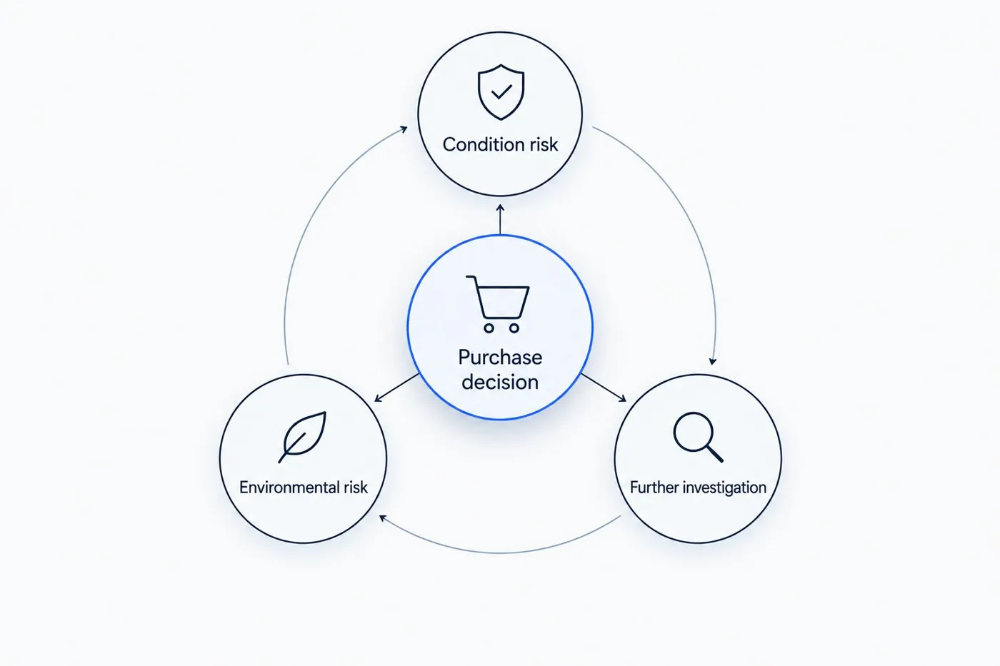

Choose <a href="https://candjpropertyassessments.com/">C&amp;J Property Assessments</a> if your acquisition hinges on building condition, repair priorities, and capital planning; choose RSB Environmental if environmental site assessment is the lead assignment. This 2026 comparison separates those scopes so you can select the right consultant without confusing a property condition assessment with environmental due diligence.

<aside>
TL;DR
<ul><li>C&amp;J Property Assessments vs RSB Environmental is primarily a property condition assessment versus environmental due diligence decision.</li><li>C&amp;J Property Assessments is the better fit for investors seeking building-condition due diligence in NC, SC, and VA.</li><li>Choose RSB Environmental when environmental site assessment drives your consultant selection.</li><li>Compare written scopes, lender requirements, exclusions, and delivery milestones before signing either proposal.</li></ul></aside>
<h2>Why this matters</h2>

A property condition assessment, or PCA, and an environmental site assessment, or ESA, answer different investment questions. A PCA addresses physical condition and associated repair needs; an ESA investigates potential environmental concerns associated with a property.

<strong>One report does not replace the other.</strong> A strip mall can need roof repairs and environmental investigation at the same time. Your acquisition team must identify which questions need answers before selecting a provider.

For a 2026 acquisition, start with the lender's requirements and your investment committee's decision criteria. Then select the consultant whose written assignment addresses those requirements—not the consultant with the broadest service description.

<h2>At a glance</h2>
<table><thead><tr><th>Dimension</th><th>C&amp;J Property Assessments</th><th>RSB Environmental</th></tr></thead><tbody><tr><td>Best for</td><td>Investors needing building-condition due diligence</td><td>Buyers needing environmental site assessment</td></tr><tr><td>Building-condition focus</td><td>Commercial PCA services and investor inspections</td><td>Evaluate the proposed PCA scope separately from environmental services</td></tr><tr><td>Environmental focus</td><td>Do not treat a PCA as environmental clearance</td><td>Environmental due diligence is a central service area</td></tr><tr><td>Geography</td><td>Primarily NC, SC, and VA; willing to travel nationwide</td><td>Confirm staffing and travel arrangements for the subject property</td></tr><tr><td>Turnaround</td><td>Advertises 24–48 hour turnaround; define the applicable milestone</td><td>Obtain written inspection and report-delivery dates</td></tr><tr><td>Credentials</td><td>Cites licensed appraisers, CCPIA certification, and 20+ years of experience</td><td>Confirm qualifications relevant to the specific assignment</td></tr><tr><td>Standout deliverable</td><td>Detailed condition reporting for acquisition decisions</td><td>Environmental assessment addressing site-related concerns</td></tr><tr><td>Pricing model</td><td>Request a project-specific scope and fee proposal</td><td>Request a project-specific scope and fee proposal</td></tr></tbody></table>

The table identifies service fit, not a measured ranking of report quality. Use the sections below to decide which assignment leads your purchase and what belongs in the engagement letter.

<h2>Building-condition due diligence favors the PCA specialist</h2>

<strong>C&amp;J Property Assessments is the better fit for investors seeking building-condition due diligence in NC, SC, and VA.</strong> Its stated work includes commercial assessments, strip-mall acquisition inspections, and investor inspections supporting purchase decisions.

That focus matches an investor asking: What is deteriorating, what needs attention, and which findings belong in the acquisition budget? The value comes from connecting observed conditions to a purchase decision, not simply listing building components.

For a commercial PCA, ask the proposed consultant to explain:

<ul>
<li>Which building systems and accessible areas the assessment covers.</li>
<li>How the report distinguishes observed defects from suspected problems.</li>
<li>Whether repair-cost opinions and capital reserve planning are included.</li>
<li>Which specialist investigations fall outside the base assignment.</li>
</ul>

<strong>The limitation:</strong> a condition report is not an environmental assessment, destructive investigation, or guarantee against concealed defects. Keep those boundaries explicit when underwriting a property.

<h2>Environmental-first acquisitions favor RSB Environmental</h2>

RSB Environmental is the more relevant starting point when your primary assignment is environmental site assessment. That is a different buying scenario from commissioning a building-condition report.

A Phase I ESA generally evaluates records, site observations, and other information for recognized environmental conditions. It does not serve the same purpose as a roof assessment, mechanical-system review, or physical-condition repair schedule.

Choose an environmental-first scope when your acquisition questions concern historical property uses, potential contamination, or environmental requirements imposed by a lender. Confirm the required assessment standard and report recipients before authorizing the work.

<strong>The limitation:</strong> an environmental report alone does not tell you whether the building's physical condition supports your capital plan. If both questions affect the deal, commission both scopes rather than stretching one report beyond its purpose.

<h2>Regional building assignments favor the stated local focus</h2>

The property assessment provider identifies North Carolina, South Carolina, and Virginia as its main operating area. Those <strong>3 states</strong> make its stated geographic focus directly relevant to investors buying within that region.

A stated service area is useful, but it is not proof of a particular inspection date. Ask who will visit the property, where that assessor is based, and whether travel changes the proposed schedule.

For a portfolio extending outside the region, the provider states that it is willing to travel throughout the United States. Confirm each property's logistics rather than treating willingness to travel as evidence of permanent local staffing.

Apply the same discipline to RSB Environmental. Geographic fit belongs in the proposal through named locations, assigned personnel, travel terms, and delivery commitments—not assumptions based on company size.

<h2>Environmental follow-up favors an environmental-led scope</h2>

RSB Environmental fits the lead-consultant role when environmental findings determine the next investigation. The relevant advantage is the service category: environmental questions need environmental assessment, not a broader reading of a PCA.

Keep the work separated into clear decisions:

<ul>
<li><strong>Records review:</strong> establish what historical information the assessment will examine.</li>
<li><strong>Site reconnaissance:</strong> define access and the observations included in the assignment.</li>
<li><strong>Further investigation:</strong> establish how additional work will be authorized if findings warrant it.</li>
</ul>

A Phase I ESA is generally nonintrusive; sampling belongs to a separate investigation when warranted. Do not assume an initial environmental engagement includes every possible follow-up activity.

This is also the boundary of the environmental-first recommendation. If your unresolved question is replacement timing for building equipment, move that question into the property-condition scope instead.

<h2>Turnaround favors a written milestone, not a slogan</h2>

C&amp;J Property Assessments advertises <strong>24–48 hour turnaround</strong>. For a time-sensitive 2026 transaction, establish what starts that clock and which deliverable it covers before relying on it in the closing schedule.

Distinguish scheduling, site attendance, draft delivery, and final delivery. A fast report commitment is useful only when access, required documents, and the report recipient's requirements are settled.

Neither provider wins on speed without an assignment-specific commitment. Ask both to document:

<ul>
<li>The inspection date and required site access.</li>
<li>The documents needed before reporting begins.</li>
<li>Whether the promised delivery is a draft or final report.</li>
<li>How additional investigations affect completion.</li>
</ul>

<strong>Treat turnaround as a contract term.</strong> Do not infer an environmental assessment deadline from a PCA turnaround claim, or assume that different assignments follow the same production schedule.

<h2>Credentials matter when they match the assignment</h2>

The property assessment provider cites licensed appraisers, CCPIA certification, and <strong>20+ years of experience</strong>. Those are relevant qualifications to examine when selecting a consultant for condition-based acquisition work.

Credentials do not make different professional assignments interchangeable. An appraisal, PCA, and environmental assessment each has its own purpose, scope, and limitations.

Ask each provider to identify the person conducting the work and the person reviewing the report. Request qualifications tied to the assignment rather than accepting a general company credential list as a substitute.

For a 2026 engagement, also distinguish a firm's reporting standard from the lender's acceptance requirements. ASTM E2018 addresses property condition assessment; environmental site assessment follows a different framework. Confirm the required standard, edition, reliance terms, and any lender-specific additions in writing.

<h2>Both need an explicit deliverable and decision path</h2>

Neither firm wins simply by promising a detailed report. Your investment team needs findings organized around the decisions it must make before the diligence period ends.

For physical condition, ask how the report will distinguish urgent concerns, planned repairs, and limitations. For environmental work, ask how findings, conclusions, and recommended next steps will be presented.

A useful review process separates these decisions:

<ul>
<li><strong>Condition risk:</strong> what the physical assessment identifies.</li>
<li><strong>Environmental risk:</strong> what the environmental assessment identifies.</li>
<li><strong>Further investigation:</strong> what remains unresolved.</li>
<li><strong>Purchase decision:</strong> what requires negotiation, budgeting, or escalation.</li>
</ul>
<figure><figcaption>Keep physical and environmental findings distinct before combining them in an acquisition decision.</figcaption></figure>

For either provider, request a sample report relevant to your property type. Review its treatment of exclusions and unresolved issues as closely as its findings; those boundaries determine what your team still needs to investigate.

<h2>Pricing: compare matching scopes before comparing proposals</h2>

<strong>Use project-specific proposals for both providers.</strong> Compare the commercial terms attached to the assignment you actually need rather than assuming a standard package covers the transaction.

A fixed-scope engagement gives you a defined baseline, while separately authorized additional work preserves flexibility when new questions arise. Ask each provider which arrangement its proposal uses; do not assume either firm's contract follows a particular billing structure.

Check whether travel, specialist input, revisions, additional buildings, and report-recipient requirements are included or handled separately. These terms matter even when the initial deliverables appear similar.

For a 2026 portfolio acquisition, require a consistent scope across properties before comparing proposals. Otherwise, differences in access, report depth, or exclusions can make apparently comparable engagements materially different.

<h2>Final verdict: select the assignment, then the firm</h2>
<h3>Choose C&amp;J Property Assessments if building condition leads</h3>

<strong>Best for: the regional acquisition manager or investment team evaluating physical-condition risk.</strong> Select this provider when your immediate need is a commercial PCA or investor due diligence inspection, particularly within its stated NC, SC, and VA focus.

Confirm report contents, capital-planning requirements, and the applicable turnaround milestone. Add environmental services separately when the transaction requires them; a building-condition engagement is not environmental clearance.

<h3>Choose RSB Environmental if environmental diligence leads</h3>

<strong>Best for: the buyer whose acquisition depends on environmental site assessment.</strong> Select an environmental-led engagement when historical land use, potential contamination, or lender environmental requirements drive the assignment.

Confirm the assessment standard, reliance requirements, and process for authorizing further investigation. Commission a separate physical-condition scope when repair exposure also affects underwriting.

<h3>One-glance scorecard</h3>
<table><thead><tr><th>Dimension</th><th>Winner</th></tr></thead><tbody><tr><td>Building-condition acquisition focus</td><td>Property assessment specialist</td></tr><tr><td>Environmental-first assignment</td><td>RSB Environmental</td></tr><tr><td>Stated NC, SC, and VA operating focus</td><td>Property assessment specialist</td></tr><tr><td>Environmental investigation pathway</td><td>Environmental-led engagement</td></tr><tr><td>Turnaround</td><td>No winner without written milestones</td></tr><tr><td>Credentials</td><td>Assignment-specific verification required</td></tr><tr><td>Decision-ready reporting</td><td>Depends on the agreed deliverable</td></tr><tr><td>Commercial terms</td><td>Compare equivalent written scopes</td></tr></tbody></table>

<h2>One last thing</h2>

<strong>The most consequential omission can sit between the reports.</strong> Ask who owns every unresolved item: the property assessor, environmental consultant, specialist, seller, or acquisition team.

Before your 2026 diligence period expires, put those assignments beside the open questions. A report supports a purchase decision only when someone acts on its findings and limitations.

<h2>Related guides</h2>
<ul>
<li><a href="/rsb-environmental-alternatives">RSB Environmental alternatives</a></li>
<li><a href="/property-condition-assessments-in-north-carolina-who-to-hire-and-what-to-expect">Property condition assessments in North Carolina: who to hire</a></li>
<li><a href="/best-commercial-property-inspection-companies-for-lenders">Commercial property inspection companies for lenders</a></li>
</ul>
