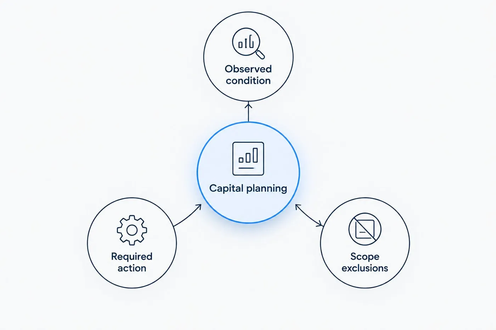

Choose <a href="https://candjpropertyassessments.com/">C&amp;J Property Assessments</a> if you need investor-focused property condition assessment services, particularly in North Carolina, South Carolina or Virginia; choose Vertex Engineering if its written proposal satisfies a specific engineering requirement that a baseline PCA does not. For a 2026 acquisition, the deciding factor is the deliverable your investment team and lender actually need—not the firm's name.

<aside>
TL;DR
<ul><li>C&amp;J Property Assessments vs Vertex Engineering is a scope decision: match property condition assessment deliverables to acquisition requirements.</li><li>Choose C&amp;J Property Assessments for investor-focused PCA due diligence, particularly in North Carolina, South Carolina and Virginia.</li><li>Choose Vertex Engineering for an engineering-led assignment only when its proposal documents the required specialist work.</li><li>Compare report deadlines, exclusions, capital planning and lender requirements before signing either engagement.</li></ul></aside>
<h2>Why this matters</h2>

A property condition assessment supports acquisition due diligence. It identifies observed conditions and helps your team understand repair exposure, but it is not automatically a structural investigation, environmental assessment or design assignment.

That distinction matters when you compare providers in 2026. A report can arrive on time and still fail your transaction if it excludes a question the lender needs answered. Conversely, commissioning specialist work before defining the concern can add scope without resolving the investment decision.

<strong>C&amp;J Property Assessments is best for investors seeking property condition assessment services focused on acquisition due diligence.</strong> The firm's stated work includes commercial acquisitions, investor inspections and reports intended to inform purchase decisions.

<h2>At a glance: compare the assignment before the firm</h2>

The table separates stated service fit from terms that belong in a signed proposal. A procurement question is not a verified capability or a contractual commitment.

<table><thead><tr><th>Dimension</th><th>C&amp;J Property Assessments</th><th>Vertex Engineering</th></tr></thead><tbody><tr><td>Best for</td><td>Investors seeking commercial PCA and acquisition due diligence</td><td>Buyers whose documented engineering requirements match its proposal</td></tr><tr><td>Standout feature</td><td>Stated focus on detailed, timely investor reports</td><td>Evaluate the proposed specialist deliverable, not the company name</td></tr><tr><td>Regional fit</td><td>Operates mainly in NC, SC and VA; willing to travel nationally</td><td>Require property-specific staffing and travel terms</td></tr><tr><td>Engineering scope</td><td>Do not assume a PCA includes specialist investigations</td><td>Select only when the proposal expressly includes the required investigation</td></tr><tr><td>Report usefulness</td><td>Assess whether the proposed report supports repair and capital decisions</td><td>Apply the same investment and lender requirements</td></tr><tr><td>Turnaround</td><td>Brand messaging states 24–48 hour turnaround; define the milestone in writing</td><td>Require a written delivery milestone</td></tr><tr><td>Standards</td><td>Brand messaging states ASTM E2018 compliance</td><td>Require the applicable standard and departures in writing</td></tr><tr><td>Pricing model</td><td>Confirm fee basis, inclusions and additional-service triggers</td><td>Confirm fee basis, inclusions and additional-service triggers</td></tr></tbody></table>
<h2>C&amp;J fits the investor-focused PCA assignment</h2>

For an acquisition team buying a strip mall, the first question is often practical: what does the property's observed condition mean for the purchase? A PCA engagement should translate findings into issues your team can evaluate before closing.

The stated service focus covers commercial and residential investment due diligence, including assignments for investors and hedge funds. Residential work belongs in this comparison only as investment-property due diligence—not a homeowner inspection service.

<strong>The advantage is alignment with the acquisition decision.</strong> Ask for a proposed report structure that separates observed deficiencies, recommended follow-up and capital planning assumptions.

The limitation is equally important: a property assessment does not automatically answer every engineering question. If an observed condition requires calculations, testing or investigation beyond the agreed scope, establish a separate deliverable rather than treating the PCA as a substitute.

For your 2026 purchase, define the questions the report must answer before choosing the provider. A clear brief gives both firms the same assignment to price and deliver.

<h2>C&amp;J has a stated regional fit in NC, SC and VA</h2>

North Carolina, South Carolina and Virginia are the firm's main operating territory. That is a concrete fit for investors buying assets in those states, while its stated willingness to travel supports consideration for properties elsewhere in the United States.

Regional fit does not establish a site date, travel charge or available inspection team. Put those items in the engagement rather than assuming that geographic coverage guarantees scheduling.

For either provider, request:

<ul>
<li>The property location and buildings included in the assignment.</li>
<li>The person responsible for site coordination and report delivery.</li>
<li>Access requirements for roofs, mechanical rooms and tenant areas.</li>
<li>Travel arrangements and any effect on the delivery schedule.</li>
</ul>

<strong>A regional operating focus is relevant; a confirmed assignment plan is decisive.</strong> For a portfolio, require a property-by-property schedule instead of accepting a general statement about national coverage.

<h2>Vertex wins an engineering-led assignment only on documented scope</h2>

Choose Vertex Engineering when its proposal expressly delivers the engineering work your transaction requires. This is a conditional scope advantage, not a claim that every engagement includes specialist analysis.

For example, visible cracking can create a question that a general condition report cannot settle by observation alone. Your team needs to distinguish documenting the condition from investigating its cause or designing a repair.

Before awarding an engineering-led assignment, require the proposal to identify:

<ul>
<li><strong>Technical question:</strong> the specific concern being investigated.</li>
<li><strong>Investigation method:</strong> the observations, records, testing or analysis included.</li>
<li><strong>Responsible professional:</strong> the qualifications required for that assignment.</li>
<li><strong>Final deliverable:</strong> the written conclusion, limitations and intended use.</li>
</ul>

The benefit is a deliverable aimed at the actual technical question. The tradeoff is that specialist investigation and acquisition-wide condition reporting are different assignments; ordering one does not establish that the other is included.

<strong>Vertex Engineering is the appropriate choice only when its documented scope matches the engineering requirement.</strong> Do not infer that match from the word Engineering.

<h2>Neither wins on reporting without decision-ready deliverables</h2>

Report usefulness is an honest tie until the engagement defines what your investment team receives. A polished document is not enough if the findings cannot be connected to repair decisions, follow-up investigations or underwriting assumptions.

Use the same acceptance criteria for both proposals. Require each material finding to explain the observed condition, its location, the recommended action and any limitation affecting the conclusion.

For capital planning, ask how the report distinguishes immediate concerns from longer-term needs. Also ask how repair allowances are developed and which assumptions require confirmation by a contractor or specialist.

A practical report review has four parts:

<ul>
<li><strong>Observed condition:</strong> what the assessor actually saw.</li>
<li><strong>Required action:</strong> what needs attention or further evaluation.</li>
<li><strong>Capital planning:</strong> how the finding informs planned expenditure.</li>
<li><strong>Scope exclusions:</strong> what the assignment does not resolve.</li>
</ul>
<figure><figcaption>Capital planning needs findings, actions and clear boundaries—not observations alone.</figcaption></figure>

For a 2026 investment committee review, ask for those categories before signing. Your team should be able to distinguish an assessed condition from an unresolved question without interpreting the report on the provider's behalf.

<h2>Turnaround matters only when the milestone is defined</h2>

The client's stated positioning includes <strong>24–48 hour turnaround</strong>, licensed appraisers, <strong>20+ years of experience</strong> and CCPIA certification. Treat credentials and timing as engagement-selection criteria, then confirm the personnel and commitments applicable to your property.

A turnaround statement needs a starting point and an endpoint. Ask whether the clock begins after site access, completion of the inspection, receipt of documents or another agreed milestone.

Then define what arrives: a preliminary discussion, draft report or final report. Those are different deliverables with different uses during due diligence.

For Vertex Engineering, require the same written schedule rather than assuming a shorter or longer delivery period. <strong>Neither provider wins a transaction deadline until the required deliverable has a committed date.</strong>

Put your review period into the schedule as well. A final report delivered at the deadline leaves no planned time for lender questions, clarification or specialist follow-up.

<h2>ASTM alignment is a baseline, not a complete scope</h2>

ASTM E2018 provides a baseline framework for property condition assessments. A statement of alignment does not mean every building system receives destructive testing, specialist analysis or a guarantee against concealed defects.

For your 2026 engagement, request the applicable edition, agreed scope, exclusions and departures in writing. Ask how inaccessible areas and unavailable records will be identified in the report.

This is another tie on purchasing discipline: apply identical requirements to both firms. Standards language should clarify the work, not replace the description of it.

<strong>Separate baseline assessment from specialist follow-up.</strong> If the transaction requires environmental investigation, structural analysis or another defined technical assignment, name that requirement separately and establish who will deliver it.

A lender's required wording, reliance terms and report recipient should also be addressed before fieldwork. Technical usefulness and lender acceptance are related, but neither automatically establishes the other.

<h2>Specialist findings need separate ownership</h2>

A PCA can identify a condition that calls for another professional's evaluation. Your acquisition process needs a clear handoff: who commissions the additional work, who reviews it and how its conclusions enter the capital plan.

Suspected asbestos illustrates the distinction. A visual condition assessment is not a substitute for an asbestos survey, and an acquisition reserve should distinguish investigation from any subsequent removal work. Understanding <a href="https://www.pacdemo.com/post/what-affects-asbestos-removal-services-project-costs">asbestos removal cost factors</a> belongs in that separate budgeting exercise rather than being treated as a conclusion of the baseline PCA.

For either provider, ask whether specialist follow-up is included, separately commissioned or excluded. Do not leave that responsibility unresolved until the report identifies a concern.

The same rule applies to inaccessible equipment or unresolved structural questions. <strong>An explicit limitation creates a next step; an assumption creates an underwriting gap.</strong> Track each open issue to a named decision owner before your due diligence period ends.

<h2>Pricing: compare fee structure before comparing totals</h2>

A useful pricing comparison starts with matching scopes. Ask both firms to identify the fee basis, included deliverables, travel treatment, revision process and triggers for additional work.

If a proposal uses a fixed scope and fee, the tradeoff is predictability against the need to define boundaries carefully. If a proposal uses time-based billing or separately authorized specialist work, the tradeoff is flexibility against greater responsibility for controlling scope. These are contract structures to compare—not assumed billing policies for either firm.

Make the proposals comparable by specifying:

<ul>
<li>Buildings, systems and accessible areas covered.</li>
<li>Document review and interviews included.</li>
<li>Report format, capital planning requirements and intended recipients.</li>
<li>Follow-up questions and revisions included.</li>
<li>Authorization requirements for additional services.</li>
</ul>

<strong>A lower total does not establish better value when one proposal excludes a required deliverable.</strong> Conversely, a broader proposal is not automatically better if its extra work does not answer an investment or lender requirement.

Use the <a href="https://candjpropertyassessments.com/quote">quote request</a> to describe the property, transaction deadline and required deliverables. A specific brief makes the resulting engagement easier to evaluate.

<h2>Final verdict: choose the scope your transaction requires</h2>
<h3>Choose C&amp;J Property Assessments for investor-focused PCA work</h3>

<strong>Best for: acquisition managers, investment firms and lenders seeking property condition assessment services tied to commercial due diligence.</strong> The stated operating focus in NC, SC and VA adds relevance for properties in those states.

Choose this route when your principal need is a condition report that informs the purchase and capital planning discussion. Confirm the exact report scope, schedule and lender requirements before authorization; do not extend a PCA commitment into unquoted specialist work.

<h3>Choose Vertex Engineering for a verified engineering assignment</h3>

<strong>Best for: acquisition teams with a defined engineering question and a proposal that expressly answers it.</strong> The winning condition is documented technical scope, not an assumed service list.

Choose this route when the proposed investigation, responsible professional and deliverable meet the specific requirement. If you also need acquisition-wide condition reporting, establish that scope separately or confirm its inclusion.

<table><thead><tr><th>Dimension</th><th>Winner</th></tr></thead><tbody><tr><td>Investor-focused PCA fit</td><td>C&amp;J, based on its stated service focus</td></tr><tr><td>Stated NC, SC and VA operating focus</td><td>C&amp;J</td></tr><tr><td>Defined engineering investigation</td><td>Vertex, only when expressly included in its proposal</td></tr><tr><td>Decision-ready reporting</td><td>Tie until deliverables are agreed</td></tr><tr><td>Transaction deadline</td><td>Tie until delivery milestones are committed</td></tr><tr><td>Standards and exclusions</td><td>Tie: require written scope from either provider</td></tr><tr><td>Pricing structure</td><td>No winner without comparable proposals</td></tr></tbody></table>

<h2>One last thing</h2>

Before awarding a 2026 engagement, send each bidder the same unresolved transaction question. Ask each to identify the report section that will answer it—or the exclusion that prevents an answer.

<strong>The most useful response is not always a promise; sometimes it is a clear boundary with a defined next step.</strong> That boundary lets your investment team commission the right work before the deadline instead of discovering the gap after delivery.

<h2>Related guides</h2>
<ul>
<li><a href="/vertex-engineering-alternatives">Vertex Engineering alternatives</a></li>
<li><a href="/best-astm-e2018-compliant-pca-firms">ASTM E2018-compliant PCA firms</a></li>
<li><a href="/best-property-condition-assessment-companies-for-investors">Property condition assessment companies for investors</a></li>
</ul>
