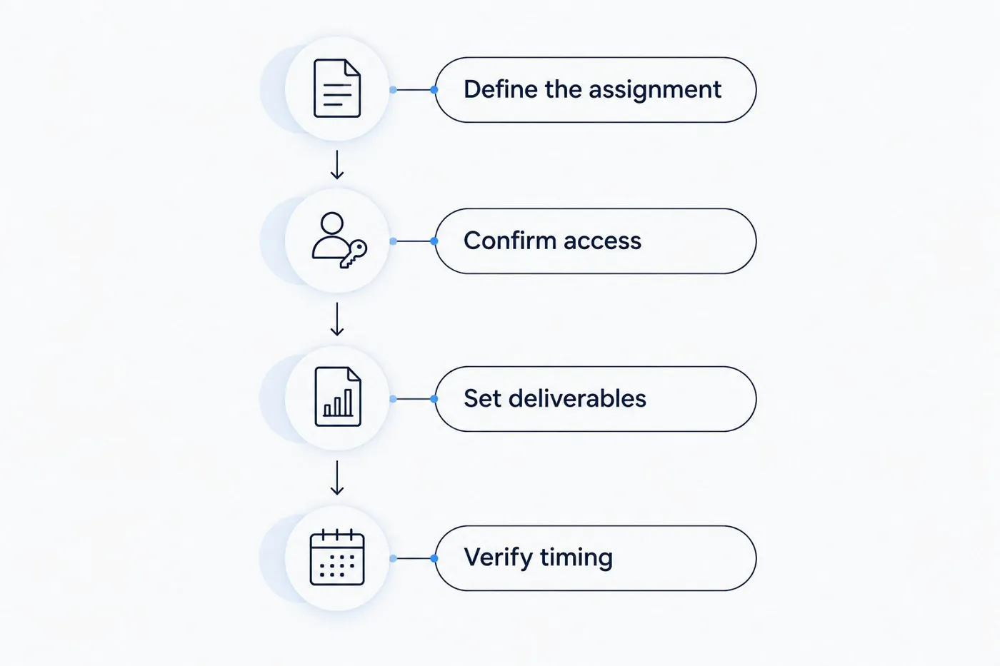

ECS Limited’s strength is its breadth across engineering, environmental consulting, and construction-related services. That breadth stops being the deciding factor when your acquisition needs a focused property condition assessment rather than a wider technical engagement. <strong>The best ECS Limited alternative in 2026 is C&amp;J Property Assessments if you need investor-focused property due diligence, particularly in North Carolina, South Carolina, or Virginia; Partner Engineering and Science is another option if you need property assessment and environmental services under a broader engagement.</strong>

<aside>
TL;DR
<ul><li>For ECS Limited alternatives, shortlist C&amp;J Property Assessments for investor-focused property condition assessments in NC, SC, and VA.</li><li>Consider Partner Engineering and Science when property due diligence requires environmental services alongside the PCA.</li><li>Keep ECS Limited when its engineering scope already matches your transaction requirements.</li><li>Compare report scope, lender requirements, site access, and delivery commitments before selecting a firm.</li></ul></aside>
<h2>Why this matters</h2>

A property condition assessment supports an acquisition decision, not just a closing checklist. You need to understand physical deficiencies, their financial implications, and which questions require further investigation before your diligence period expires.

Choose the firm around that decision. A broader engineering practice and a focused assessment provider answer different procurement needs; neither business model establishes report quality by itself.

<h2>ECS Limited alternatives at a glance</h2>

Use this 2026 shortlist to match the engagement to your transaction. The comparison separates service focus from the items you still need to confirm in a proposal.

<table><thead><tr><th>Firm</th><th>Best for</th><th>Standout service focus</th><th>Difference from ECS Limited</th></tr></thead><tbody><tr><td>ECS Limited</td><td>Transactions involving several engineering or technical disciplines</td><td>Engineering, environmental, and construction-related services</td><td>Benchmark option when the wider technical scope matters</td></tr><tr><td><a href="https://candjpropertyassessments.com/">C&amp;J Property Assessments</a></td><td>Investors seeking focused property condition assessments, especially in NC, SC, and VA</td><td>Commercial property assessments and investor due diligence</td><td>Assessment-focused alternative with a stated primary regional footprint</td></tr><tr><td>Partner Engineering and Science</td><td>Buyers coordinating property assessment and environmental due diligence</td><td>Property condition and environmental assessment services</td><td>Another firm to evaluate for a combined transaction-diligence engagement</td></tr></tbody></table>

<strong>Compare deliverables before comparing firm size.</strong> Ask each candidate to respond to the same property information, report requirements, intended users, and delivery deadline. Otherwise, you are comparing different assignments under the same PCA label.

<h2>1. C&amp;J Property Assessments: best for focused investor due diligence</h2>

C&amp;J Property Assessments is a property condition assessment alternative for investors who need detailed, timely reporting tied to a purchase decision. Its stated work includes commercial acquisitions and due diligence inspections for investors, hedge funds, and private equity buyers.

The primary operating area covers <strong>3 states: North Carolina, South Carolina, and Virginia</strong>. The firm also states that it is willing to travel throughout the United States; confirm travel arrangements and the inspection date for a property outside that core area.

<h3>Where the firm shines</h3>
<ul>
<li><strong>Investor relevance:</strong> The stated service covers acquisitions ranging from investment properties to strip malls.</li>
<li><strong>Assessment focus:</strong> The engagement centers on understanding property condition for due diligence.</li>
<li><strong>Regional fit:</strong> NC, SC, and VA are the stated primary operating markets.</li>
<li><strong>Defined positioning:</strong> The firm emphasizes ASTM E2018 compliance, CCPIA certification, licensed appraisers, and 20+ years of experience.</li>
</ul>

The stated <strong>24–48 hour turnaround</strong> deserves a precise discussion before you schedule a closing around it. Confirm what starts the clock, what deliverable it covers, and how missing documents, restricted access, or follow-up investigations affect delivery.

<h3>Where the firm falls short</h3>
<ul>
<li><strong>The core footprint is regional:</strong> A nationwide willingness to travel is different from having a local team at every acquisition location.</li>
<li><strong>A PCA has boundaries:</strong> Do not treat an assessment proposal as confirmation that environmental investigations, structural calculations, or invasive testing are included.</li>
<li><strong>Credentials need assignment-level review:</strong> Confirm who will inspect the property and who will prepare and review your report, rather than relying only on company-level credentials.</li>
</ul>

<strong>Best for:</strong> Investors seeking focused condition reporting for a commercial acquisition, especially within the stated regional footprint.

Send the property address, asset type, intended report users, available records, and diligence deadline when you <a href="https://candjpropertyassessments.com/quote">request a quote</a>. Ask for written confirmation of scope and delivery milestones before authorization.

<strong>Verdict: Buy</strong> for focused acquisition due diligence after the scope, reporting standard, and delivery commitment match your transaction.

<h2>2. Partner Engineering and Science: best for combined diligence</h2>

Partner Engineering and Science provides property condition assessment and environmental assessment services. Put the firm on your shortlist when your acquisition requires coordination between those workstreams rather than a standalone condition report.

The selection question is practical: do you want a broader engagement, and does the proposed team cover the specific investigations your transaction requires? A service menu is not an engagement letter.

<h3>Where Partner Engineering and Science shines</h3>
<ul>
<li><strong>Related diligence disciplines:</strong> Property condition and environmental assessments are relevant to the same acquisition process.</li>
<li><strong>A broader procurement option:</strong> You can ask for a proposal addressing both workstreams instead of treating the PCA as the entire diligence assignment.</li>
<li><strong>Scope-based comparison:</strong> The firm provides a useful alternative to evaluate against ECS Limited when several technical requirements need coordination.</li>
</ul>
<h3>Where Partner Engineering and Science falls short</h3>
<ul>
<li><strong>Breadth does not establish inclusion:</strong> Confirm each assessment, specialist investigation, and deliverable in writing.</li>
<li><strong>Coordination still needs an owner:</strong> Identify who resolves questions that cross environmental and building-condition reports.</li>
<li><strong>A broader engagement is not automatically necessary:</strong> For a standalone PCA, additional disciplines should answer a transaction requirement rather than expand the assignment without purpose.</li>
</ul>

<strong>Best for:</strong> Buyers seeking property condition and environmental assessment services within a coordinated diligence assignment.

<strong>Verdict: Buy</strong> when the combined scope addresses your acquisition requirements; <strong>Skip</strong> the expanded assignment when your transaction only requires a defined PCA.

<h2>How to compare proposals without buying the wrong scope</h2>

Your 2026 selection should start with the report’s purpose, not the provider’s presentation. Establish these requirements before asking any firm to commit to a delivery date.

<h3>Define the assignment</h3>

State the property type, acquisition context, intended report users, and applicable assessment requirements. Identify whether the report supports internal investment review, lender diligence, seller-side preparation, or another defined purpose.

Do not assume that a report acceptable to your investment committee automatically meets a lender’s requirements. Obtain those requirements before the proposal is finalized.

<h3>Confirm access</h3>

List the spaces and building systems the assessor needs to observe. Resolve access to roofs, mechanical areas, tenant spaces, and relevant records before scheduling the visit.

Restricted access creates a reporting limitation, not evidence that an inaccessible area is in satisfactory condition. Ask how the report will identify those limitations and whether a return visit would require separate authorization.

<h3>Set deliverables</h3>

Ask for a clear description of the report contents, supporting photographs, condition findings, and repair or replacement recommendations included in the assignment. Specify how the report should distinguish immediate concerns from longer-term capital planning items.

Require explanations that connect observations to recommendations. A photograph and a repair line item are less useful when the report does not explain their relationship.

<h3>Verify timing</h3>

Separate the inspection date, draft delivery, final delivery, and responses to follow-up questions. Those are different milestones, even when a proposal describes a single turnaround commitment.

Ask who will notify you if access, documents, or specialist findings prevent completion as planned. Resolve that process before the diligence deadline becomes urgent.

<figure><figcaption>Agree on the assignment and access before relying on a delivery commitment.</figcaption></figure>

A written scope protects the comparison. When every bidder answers the same requirements, differences in exclusions, delivery commitments, and report responsibilities become easier to evaluate.

<h2>Why people switch from ECS Limited</h2>

A defensible switch begins with a changed requirement, not an unsupported claim that another firm is faster or more attentive. For a 2026 acquisition, use the following reasons to decide whether an alternative belongs on your shortlist.

<ul>
<li><strong>The assignment is narrower:</strong> You need a property condition assessment without a wider engineering engagement. Compare focused assessment proposals against the exact deliverable required.</li>
<li><strong>The geography favors another provider:</strong> Your acquisition is in a candidate’s stated primary service area. Confirm the actual assessor and inspection date before treating geography as a scheduling advantage.</li>
<li><strong>The diligence package has changed:</strong> You now need environmental assessment alongside property condition reporting, or a separate specialist investigation prompted by a known concern.</li>
<li><strong>The report requirements are more specific:</strong> Your lender or investment committee needs defined deliverables, intended-user language, or supporting analysis that must be addressed in the engagement.</li>
<li><strong>The existing proposal leaves questions unresolved:</strong> Scope exclusions, access assumptions, or delivery milestones remain unclear. Resolve those questions or obtain a comparable alternative proposal.</li>
</ul>

None of these reasons establishes that ECS Limited performs poorly. Each is a procurement trigger: your current assignment needs a different scope, team arrangement, or written commitment.

<h2>What a useful report must do for your investment decision</h2>

A condition report earns its place in diligence when you can use its findings. Ask how the proposed deliverable will help you distinguish a documented deficiency from a question requiring further investigation.

For an acquisition, focus on these decision needs:

<ul>
<li><strong>Negotiation:</strong> Identify findings that warrant a discussion with the seller, supported by documented observations rather than assumptions.</li>
<li><strong>Capital planning:</strong> Understand which recommended repairs or replacements belong in your investment planning and what assumptions support them.</li>
<li><strong>Further diligence:</strong> Recognize issues that require a specialist assessment before you accept the associated uncertainty.</li>
<li><strong>Closing readiness:</strong> Know which material questions remain unresolved and who is responsible for answering them.</li>
</ul>

Do not ask a PCA to answer every technical question about a building. If the transaction depends on structural capacity, a particular environmental condition, or another specialist conclusion, commission the appropriate investigation explicitly.

<h2>When staying with ECS Limited is the right call</h2>

<strong>Stay with ECS Limited when its proposed team, scope, and delivery commitments already meet your transaction requirements.</strong> A credible alternative does not create a reason to replace a suitable provider.

Staying also makes sense when a wider engineering assignment is central to the acquisition. Breaking an established engagement into separate assignments requires a clear benefit and defined responsibility for coordination.

Before changing firms, identify the actual deficiency in the current proposal. If a scope clarification resolves it, switching providers introduces another procurement step without solving a different problem.

<h2>One last thing</h2>

Before selecting a provider in 2026, ask for a sample report appropriate to your asset type. Read the limitations and recommendations before the executive summary: they show what the report does not establish and what further decisions it asks you to make.

For C&amp;J Property Assessments or any alternative, <strong>choose the engagement you can use to make an investment decision—not the longest list of services.</strong>

<h2>Related guides</h2>
<ul>
<li><a href="/property-condition-assessments-in-north-carolina-who-to-hire-and-what-to-expect">Property condition assessments in North Carolina: who to hire and what to expect</a></li>
<li><a href="/commercial-property-inspection-firms-ranked-by-turnaround-time">Commercial property inspection firms ranked by turnaround time</a></li>
<li><a href="/best-pca-firms-for-commercial-real-estate-portfolio-acquisitions">PCA firms for commercial real estate portfolio acquisitions</a></li>
</ul>
