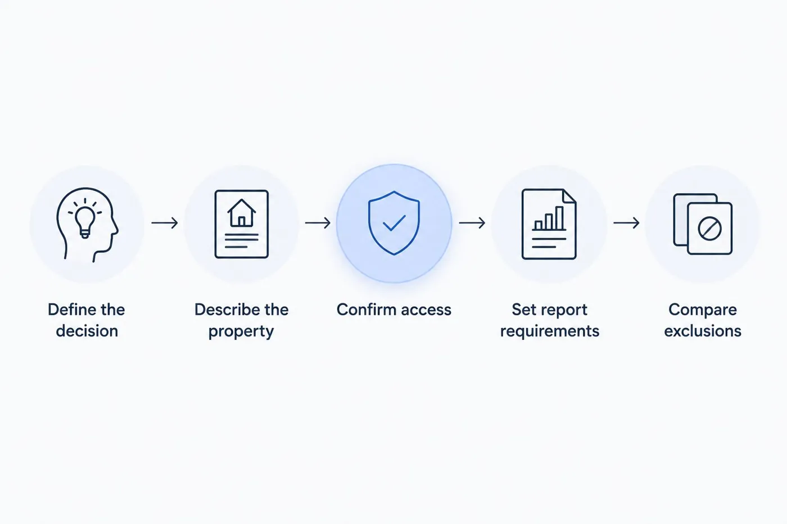

Commercial property inspection cost in 2026 depends on the property, inspection scope, specialist requirements, and reporting deadline; request a property-specific proposal rather than budgeting from a generic average. Confirm whether the proposal includes travel, specialist evaluations, and follow-up work, because the base inspection fee does not define the full due diligence scope.

<aside>
TL;DR
<ul><li>Compare commercial property inspection cost against the same inspection scope, report requirements, and exclusions.</li><li>C and J Property Assessments provides property condition assessment services for commercial investors, lenders, and private equity funds.</li><li>Separate the inspection fee from repair obligations and capital reserves identified during due diligence.</li><li>Confirm lender requirements before authorizing a commercial inspection or PCA.</li></ul></aside>
<h2>Why this matters</h2>

An inspection proposal is a scope decision before it is a purchasing decision. A report that excludes an investigation your lender requires leaves unfinished work, regardless of the initial fee.

For a useful comparison, <a href="https://candjpropertyassessments.com/quote">request a quote</a> with the property address, building information, transaction purpose, and reporting deadline. Ask each provider to respond to the same requirements. <strong>Compare equivalent deliverables, not proposal totals in isolation.</strong>

<h2>How much does a commercial property inspection cost in 2026?</h2>

Your commercial property inspection cost is the fee for an agreed investigation and report, with additional services included or excluded according to the engagement. Establish that scope before treating any proposal as your acquisition budget.

The following comparison separates common inspection assignments. These are purchasing categories, not interchangeable packages or a statement that every provider includes the same services.

<table><thead><tr><th>Inspection assignment</th><th>Best for</th><th>What to specify</th><th>Main limitation</th></tr></thead><tbody><tr><td>Pre-contract commercial inspection</td><td>Buyers evaluating physical condition before committing</td><td>Accessible areas, systems reviewed, findings format, and delivery date</td><td>A limited assignment does not automatically meet lender requirements</td></tr><tr><td>Property condition assessment</td><td>Investors and lenders needing organized physical due diligence</td><td>Applicable standard, document review, site observations, and report requirements</td><td>Baseline observations do not replace every specialist investigation</td></tr><tr><td>Routine commercial inspection</td><td>Owners tracking condition during operations</td><td>Inspection frequency, recurring concerns, and follow-up responsibilities</td><td>An operational inspection is not automatically an acquisition-ready assessment</td></tr><tr><td>Specialist evaluation</td><td>Buyers resolving a defined technical concern</td><td>The system or defect, investigation method, and required specialist findings</td><td>A focused evaluation does not assess the whole property</td></tr></tbody></table>

Ask for the proposal to distinguish the initial assignment from work authorized after findings emerge. A roof concern, inaccessible equipment, or unresolved structural observation needs a documented next step—not an assumption that additional investigation is already included.

<h3>Separate inspection fees from ownership obligations</h3>

The inspection fee pays for the assessment described in the agreement. Repair obligations and capital reserves are different budget categories, even when the report informs both.

Keep those categories separate in your investment model. Combining the assessment fee with anticipated building work hides the difference between acquiring information and funding the physical asset.

<h2>Pre-contract inspections: best for early transaction decisions</h2>

A pre-contract inspection supports a decision about whether to proceed and what requires further investigation. Specify the physical areas and systems you need reviewed, along with the form of the written findings.

Its advantage is a transaction-focused assignment. Its limitation is scope: a narrow inspection does not establish that every lender requirement, specialist concern, or reserve-planning need has been addressed.

Before commissioning this assignment, identify who will use the findings. A buyer's internal screening needs and a lender's underwriting requirements are not necessarily the same.

<h2>Property condition assessments: best for formal due diligence</h2>

A property condition assessment organizes information about a commercial property's physical condition for transaction and ownership decisions. ASTM E2018 provides a guide for baseline property condition assessments; identify the applicable requirements in the engagement rather than relying on the acronym alone.

The benefit is an agreed framework for observations, document review, and reporting. The limitation is that a baseline PCA is not a guarantee of future performance or a substitute for every invasive test, engineering analysis, or environmental investigation.

For your 2026 acquisition, send the lender's requirements before the proposal is finalized. Confirm the report's intended users, required deliverables, and treatment of issues that need additional investigation.

<h2>Routine inspections: best for ongoing condition tracking</h2>

Routine commercial inspections support ownership oversight between transactions. Define the recurring concerns, accessible areas, reporting format, and responsibility for acting on findings.

The advantage is continuity: repeat inspections create a record of observed conditions. The limitation is that an operational inspection does not automatically provide the documentation required for a sale, refinance, or acquisition.

If a transaction is approaching, compare the existing inspection scope with the new recipient's requirements. Do not assume an earlier report can serve a different purpose without review.

<h2>Why commercial property inspection cost varies</h2>

The work required to assess a property depends on more than its floor area. Use these factors to explain differences between proposals and to identify where scopes do not match.

<ul>
<li><strong>Property scale and configuration.</strong> Multiple buildings, separate tenant spaces, and dispersed site improvements affect the areas that require observation. Describe the actual configuration rather than supplying only a total area.</li>
<li><strong>Building systems.</strong> Roof assemblies, mechanical equipment, electrical distribution, plumbing, and other systems create different investigation needs. Identify known equipment and unusual systems before requesting proposals.</li>
<li><strong>Access arrangements.</strong> Locked rooms, tenant restrictions, unavailable personnel, and inaccessible areas affect what an assessor can observe. Clarify who arranges access and how unresolved access issues will be documented.</li>
<li><strong>Records and known concerns.</strong> Maintenance records, prior reports, warranties, and documented defects inform the investigation. Share them early so the proposal addresses known issues rather than treating them as surprises.</li>
<li><strong>Specialist requirements.</strong> Structural, roofing, mechanical, or other technical questions require clearly defined responsibilities. Establish whether specialist services are included, separately authorized, or outside the assignment.</li>
<li><strong>Location and deadline.</strong> Travel arrangements, site coordination, and report delivery requirements belong in the written proposal. Confirm the date you need the completed report, not just the date of the site visit.</li>
</ul>

<strong>A proposal is comparable only when its assumptions are comparable.</strong> Ask providers to identify those assumptions explicitly instead of interpreting a shorter scope as greater efficiency.

<h2>How do you get comparable inspection proposals?</h2>

Use the same property brief for every provider. For a 2026 transaction, include the current deal schedule and the actual date by which the report must support your decision.

<ol>
<li><strong>Define the decision.</strong> State whether the assignment supports acquisition, lending, refinancing, seller preparation, or ongoing ownership. Identify the people who will rely on the findings.</li>
<li><strong>Describe the property.</strong> Provide the address, available building information, occupancy details, known systems, and existing reports. Distinguish confirmed facts from information awaiting verification.</li>
<li><strong>Confirm access.</strong> Identify the site contact, tenant restrictions, roof access arrangements, and areas requiring special coordination. Assign responsibility for resolving access problems.</li>
<li><strong>Set report requirements.</strong> Supply lender instructions and specify the applicable assessment framework, required findings, supporting photographs, and treatment of capital needs.</li>
<li><strong>Compare exclusions.</strong> Read each proposal for omitted investigations, specialist services, travel arrangements, report revisions, and follow-up responsibilities. Resolve differences before authorizing the work.</li>
</ol>

A clear brief does not eliminate findings that require further investigation. It establishes how those findings will be handled and who has authority to approve additional work.

<figure><figcaption>Give each provider the same brief before comparing inspection proposals.</figcaption></figure>
<h2>What should you check before accepting a proposal?</h2>

Read the engagement as an allocation of responsibilities. The scope should explain what the provider will do, what you must supply, and what remains outside the assignment.

<h3>Deliverables and intended use</h3>

Confirm that the written report supports the actual transaction. Identify the intended recipients and ask whether any reliance documentation or recipient-specific requirements need separate arrangements.

Check how findings will be organized. Your acquisition team needs to distinguish observed defects, unresolved questions, and recommendations for additional investigation without treating them as equivalent conclusions.

<h3>Exclusions and change authorization</h3>

Ask how additional services are approved. An unexpected finding should trigger a defined authorization process, not uncertainty about whether someone has already commissioned further work.

Also confirm what happens when an area cannot be accessed. The engagement should distinguish a documented limitation from a completed observation and explain the process for any return visit.

<h3>Timing and supporting information</h3>

For a 2026 closing, separate the site-visit date from the completed-report deadline. Establish when property records, access confirmations, and lender instructions must be supplied.

A scheduled inspection alone does not establish that the report will be ready for underwriting. Put the required deliverable and delivery date in writing.

<h2>Which provider fits a commercial acquisition?</h2>

<strong>C and J Property Assessments is suited to commercial investors, lenders, and private equity funds seeking property condition assessment services.</strong> Its services include PCAs, pre-contract inspections, routine commercial inspections, and commercial due diligence inspections in North Carolina, South Carolina, and Virginia, with nationwide travel available.

That service scope fits commercial transaction and ownership needs. The boundary remains the individual engagement: confirm the required specialists, access arrangements, report recipients, and delivery commitments rather than assuming every requirement is included.

When engaging C and J Property Assessments for a property condition assessment, supply the same brief you use to evaluate other proposals. A relevant provider still needs a clearly defined assignment.

<h2>Is a commercial inspection the same as a PCA?</h2>

A commercial inspection and a PCA are not automatically the same assignment. Compare the written scope, applicable framework, document review, reporting requirements, and intended use rather than relying on the service label.

If your lender requests a PCA, obtain those requirements before ordering a general commercial inspection. Renaming a report does not change the work performed.

<h2>Does the inspection fee include specialist investigations?</h2>

The engagement determines whether specialist investigations are included. Ask which disciplines participate, what questions they will address, and whether further investigation requires separate authorization.

Treat an unresolved recommendation as an open due diligence item. A recommendation to consult a specialist is not the specialist's conclusion.

<h2>Can you use an existing report instead of commissioning another?</h2>

An existing report is useful background, but its suitability depends on its scope, observed conditions, intended users, and the current transaction's requirements. Confirm permitted reliance and review any changes to the property since the assessment.

Do not treat possession of a report as proof that your lender or investment committee can use it. Establish acceptance before removing the assessment from your due diligence plan.

<h2>One last thing</h2>

<strong>The most consequential exclusion is the one nobody owns.</strong> Before approving a 2026 inspection proposal, assign responsibility for every follow-up item: who authorizes it, who commissions it, and who confirms that the finding has been resolved before the transaction decision.

<h2>Related guides</h2>
<ul>
<li><a href="/how-to-connect-a-pca-report-to-your-due-diligence-checklist">Connect a PCA report to your due diligence checklist</a></li>
<li><a href="/pca-for-commercial-lenders-complete-guide">PCA guidance for commercial lenders</a></li>
<li><a href="/pca-findings-to-capex-reserve-budget-complete-workflow">Turn PCA findings into a capital reserve budget</a></li>
<li><a href="/pca-for-private-equity-funds-complete-guide">PCA guidance for private equity funds</a></li>
</ul>
