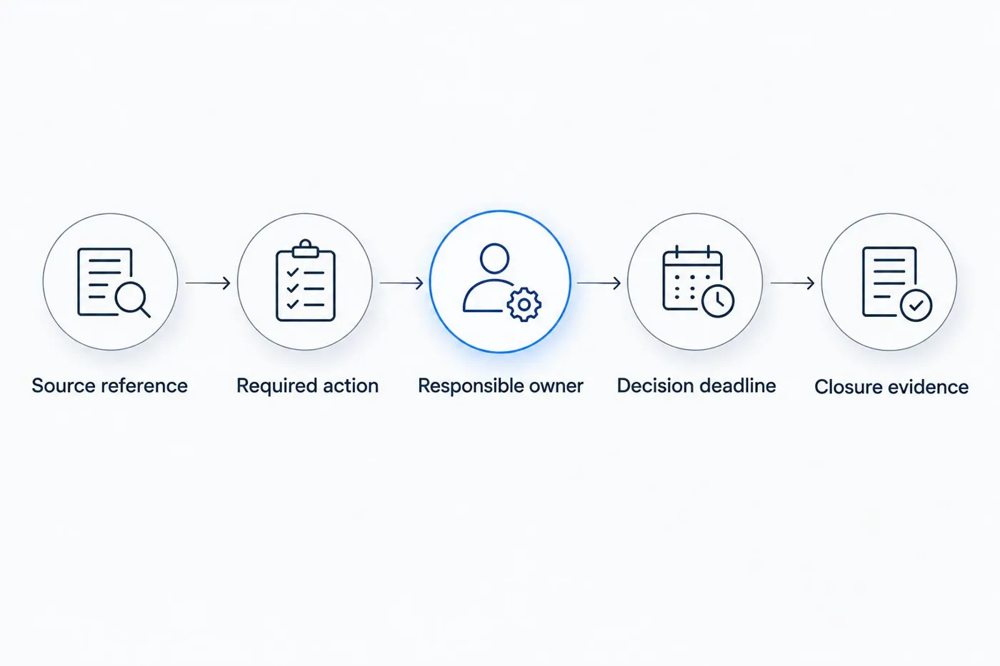

Instead of manually rereading inspection findings before every acquisition meeting, connect your PCA report to your due diligence checklist through a finding-by-finding action register. For a 2026 commercial acquisition, give each finding a source reference, responsible owner, decision deadline, and closure record so the report informs the transaction rather than sitting in a document folder.

<aside>
TL;DR
<ul><li>Connect PCA report to due diligence checklist entries through source references, assigned owners, decision deadlines, and closure evidence.</li><li>C and J Property Assessments provides commercial property condition assessments for investors, lenders, and private equity funds.</li><li>Separate observed conditions, financial assumptions, and transaction decisions; they are not interchangeable.</li><li>Keep unresolved inspection limitations open until the appropriate reviewer accepts the remaining uncertainty.</li></ul></aside>
<h2>Why this matters</h2>

A property condition assessment describes physical conditions within its agreed scope. Your due diligence checklist must turn those observations into decisions about further investigation, capital planning, lender requirements, and closing conditions. Copying a report summary into a checklist does not accomplish that transfer.

<strong>C and J Property Assessments is best for commercial investors, lenders, and private equity funds seeking property condition assessment services.</strong> Its service area includes North Carolina, South Carolina, and Virginia, with nationwide travel available. The workflow below organizes assessment findings; it does not replace technical review or legal advice.

Start with the assessment scope, not just the executive summary. The <a href="https://candjpropertyassessments.com/">C and J Property Assessments</a> service overview provides context for commissioning a commercial assessment before you build the transaction register.

<h2>Before you start</h2>
<ul>
<li><strong>Collect the source materials.</strong> Have the complete PCA report, appendices, available supporting records, purchase agreement deadlines, lender requirements, and your current due diligence checklist. Confirm which report version controls the review.</li>
<li><strong>Assign access and authority.</strong> Give the acquisition lead, technical reviewer, asset manager, and appropriate financing or legal reviewers access to a shared register. Identify who can accept a finding, approve an assumption, and authorize closure.</li>
<li><strong>Check the non-obvious gap: inspection limitations.</strong> An inaccessible area or excluded investigation is not a clean finding. Create an unresolved checklist item for any limitation that affects a transaction decision, even when the report does not identify a confirmed defect there.</li>
</ul>

Use your actual transaction dates. A 2026 template must not carry deadlines copied from another acquisition, and a report delivery date is not automatically the deadline for resolving its findings.

<h2>Source register configuration</h2>

Build the connection in a shared spreadsheet or your existing transaction-management system. The bold labels below are proposed field names for your register, not buttons or built-in settings in a particular application.

<ol>
<li>Create a worksheet or list named <strong>PCA Findings</strong>. Keep the report itself in the controlled document location and record its filename, issue date, and revision identifier.</li>
<li>Add the 12 fields below. Keep source observations separate from your team's conclusions so later reviewers can tell what the assessor reported and what the acquisition team decided.</li>
<li>Assign a stable <strong>Finding ID</strong> to each distinct issue. If a finding affects several checklist categories, reuse its identifier rather than creating competing copies of the underlying issue.</li>
<li>Enter a precise <strong>Source Reference</strong>. Include the report section, page, and photograph reference when available; a link to the entire PDF alone is insufficient for efficient review.</li>
</ol>
<table><thead><tr><th>Register field</th><th>What to record</th></tr></thead><tbody><tr><td>Finding ID</td><td>A stable identifier that survives report revisions</td></tr><tr><td>Source Reference</td><td>Report version, section, page, and relevant photograph</td></tr><tr><td>System / Location</td><td>The affected building system and physical location</td></tr><tr><td>Reported Condition</td><td>The assessor's observation without added conclusions</td></tr><tr><td>Checklist Category</td><td>The due diligence workstream receiving the finding</td></tr><tr><td>Required Action</td><td>The investigation, document request, or decision needed</td></tr><tr><td>Responsible Owner</td><td>The person accountable for the next action</td></tr><tr><td>Decision Deadline</td><td>The transaction date by which a decision is required</td></tr><tr><td>Financial Treatment</td><td>The proposed underwriting treatment, with its basis</td></tr><tr><td>Status</td><td>The current review state</td></tr><tr><td>Closure Evidence</td><td>The document or written decision supporting resolution</td></tr><tr><td>Approver</td><td>The person authorized to accept the disposition</td></tr></tbody></table>

<strong>Expected result:</strong> Every entry can be traced back to the report and forward to a named action. Another reviewer can find the original observation without asking the person who entered it.

<h2>Checklist mapping configuration</h2>

Map findings according to the decision they require, not merely the building system involved. A roof observation belongs in technical review, but its financial implications and contractual treatment require separate consideration.

<ol>
<li>Read the report's findings, supporting detail, and limitations. Enter each decision-relevant issue in <strong>PCA Findings</strong> without converting an observation into a diagnosis the report does not make.</li>
<li>Select the relevant <strong>Checklist Category</strong>: technical review, financial review, transaction documents, lender requirements, or post-acquisition planning. Use your existing category names if your checklist already has an established structure.</li>
<li>Write <strong>Required Action</strong> as an instruction with an identifiable output. Prefer “Obtain the available roof repair records and have the technical reviewer assess the unresolved condition” over “Review roof.”</li>
<li>Assign <strong>Responsible Owner</strong> and <strong>Decision Deadline</strong>. Set the deadline early enough for the responsible reviewer to address the actual contract or financing milestone; do not invent a standard response period.</li>
<li>Record cross-workstream dependencies under the same <strong>Finding ID</strong>. A technical clarification can remain open while the financial team evaluates its implications, but neither review should silently close the other.</li>
</ol>

<strong>Expected result:</strong> Your checklist shows what must happen next, who must act, and which transaction decision depends on that action.

The mapping sequence is <strong>Source reference</strong>, <strong>Required action</strong>, <strong>Responsible owner</strong>, <strong>Decision deadline</strong>, then <strong>Closure evidence</strong>. Keep that sequence visible during the 2026 acquisition review so the team does not jump from a report observation directly to an unsupported closing decision.

<figure><figcaption>A finding is actionable only when its source, owner, deadline, and resolution are connected.</figcaption></figure>
<h2>Financial and approval configuration</h2>

A report finding and a financial assumption serve different purposes. Preserve the assessor's language, then document how the acquisition team treats the issue in underwriting.

<ol>
<li>Complete <strong>Financial Treatment</strong> using the report and any subsequently reviewed information. Identify whether the issue requires further investigation, an underwriting adjustment, a proposed reserve, a transaction discussion, or post-acquisition planning. Do not create an estimate to fill an empty cell.</li>
<li>Record the basis for each financial treatment alongside the entry or in a referenced supporting note. Distinguish report-provided information from contractor input and internal assumptions. Avoid counting the same underlying work in multiple underwriting categories.</li>
<li>Configure 3 statuses: <strong>Open</strong>, <strong>Under Review</strong>, and <strong>Closed</strong>. Use <strong>Open</strong> when action is unassigned or incomplete, <strong>Under Review</strong> when evidence awaits a decision, and <strong>Closed</strong> only after authorized acceptance.</li>
<li>Require <strong>Closure Evidence</strong> and <strong>Approver</strong> before changing a finding to <strong>Closed</strong>. An uploaded document is evidence received, not evidence accepted. Confirm whether the decision also satisfies any separate lender or contractual requirement.</li>
</ol>

<strong>Expected result:</strong> The financial model reflects documented decisions, while the register preserves unresolved conditions and the authority behind accepted outcomes.

<strong>Do not close a physical finding merely because its financial impact has been modeled.</strong> A reserve assumption does not establish that a condition has been investigated or that a lender has accepted its treatment.

<h2>Review and handoff configuration</h2>

Use 2 review passes: a source-to-register check and a register-to-decision check. These are workflow controls, not substitutes for the assessor's professional judgment.

<ol>
<li>Perform the source-to-register check. Compare the complete report against the register, including material limitations, supporting photographs, and recommendations for further investigation. Confirm that concise entries have not changed the report's meaning.</li>
<li>Perform the register-to-decision check. Review every open item against the transaction calendar, financial assumptions, financing requirements, and responsible approver. Escalate unresolved items before the relevant decision deadline.</li>
<li>Save a dated decision snapshot before the applicable approval or closing milestone. Identify the controlling report version and retain the supporting evidence used for that decision.</li>
<li>Transfer accepted post-acquisition actions to the asset-management work plan. Preserve their source references and assigned owners rather than restarting them as disconnected maintenance tasks.</li>
</ol>

<strong>Expected result:</strong> The acquisition file records what the team knew, what it accepted, and what remained unresolved at the decision point.

For financing-specific handoffs, use the <a href="/pca-report-to-loan-underwriting-complete-workflow">PCA report to loan underwriting workflow</a> to organize the next stage of review.

<h2>Update the checklist whenever the PCA changes</h2>

A revised report needs a controlled update, not a wholesale replacement of the register. Preserve existing finding identifiers and compare the revised wording against the version used for prior decisions.

<ol>
<li>Record the revised report's issue information and retain the superseded version in the transaction file.</li>
<li>Identify added findings, changed observations, resolved limitations, and altered recommendations. Do not assume an unchanged executive summary means the supporting detail is unchanged.</li>
<li>Update affected entries while preserving the previous decision record. Reopen a closed item when the new information changes the basis for its acceptance.</li>
<li>Notify the responsible owner and approver of each affected item. Recheck linked underwriting assumptions and transaction deadlines before accepting the revision.</li>
</ol>

<strong>Expected result:</strong> Your 2026 decision record distinguishes the original assessment from subsequent changes without losing accountability.

Choose the workflow that matches the event:

<table><thead><tr><th>Workflow</th><th>Best for</th><th>Advantage</th><th>Limitation</th></tr></thead><tbody><tr><td>Initial report mapping</td><td>First review of a commercial acquisition PCA</td><td>Establishes complete ownership and source references</td><td>Requires careful initial entry and reconciliation</td></tr><tr><td>Revision-based update</td><td>Amended reports and follow-up findings</td><td>Preserves decisions while exposing changed assumptions</td><td>Requires version comparison; replacement alone loses context</td></tr></tbody></table>

Both workflows depend on the same control: <strong>no change to the source should silently change an approved decision.</strong>

<h2>Troubleshooting</h2>
<h3>A finding appears in several checklist categories</h3>

Keep a single master finding and reference it from each affected workstream. Assign separate actions where necessary, but preserve the shared <strong>Finding ID</strong> so technical, financial, and legal reviewers do not reach conflicting conclusions from disconnected copies.

<h3>The report includes an inaccessible area</h3>

Record the access limitation and the decision it prevents. Ask the technical reviewer what additional access or investigation is appropriate, then track that action separately. Do not translate “not observed” into “no deficiency.”

<h3>A financial assumption has no supporting basis</h3>

Leave the amount unresolved and assign the information request. Record who must provide or review the supporting information. An unsupported placeholder creates apparent certainty without resolving the underlying risk.

<h3>The seller says the condition was corrected</h3>

Request relevant documentation and have the appropriate reviewer evaluate it. Keep the finding <strong>Under Review</strong> until an authorized approver accepts the evidence; a seller statement alone does not complete your internal review process.

<h3>A revised report arrives after internal approval</h3>

Compare the revision with the approved version and identify affected decisions. Route material changes back to the relevant approver and preserve both the original approval and the subsequent disposition. Do not overwrite the earlier decision snapshot.

<h2>Customize your workflow</h2>

For portfolio acquisitions, add property identifiers and consolidate unresolved actions across assets. For lender-driven transactions, record lender acceptance separately from internal approval. For post-acquisition planning, transfer approved actions with their supporting evidence intact.

C and J Property Assessments provides commercial property condition assessments; your acquisition team remains responsible for integrating findings into its transaction controls. <strong>The advantage of this workflow is traceability; its limitation is dependence on accurate entry, timely review, and explicit approval.</strong> It does not turn a scoped assessment into an exhaustive investigation.

When commissioning an assessment for a 2026 transaction, describe the property, intended users, decision deadlines, and known access constraints. Align the scope with the decisions you need to make before expecting the report to support them.

<h2>One last thing</h2>

<strong>An empty financial field is not evidence of an insignificant condition.</strong> Before approving the acquisition, filter for findings that lack a responsible owner, supporting evidence, or an explicit disposition. That check exposes unfinished decisions that a completed-looking checklist can conceal.

<h2>Related guides</h2>
<ul>
<li><a href="/pca-for-commercial-lenders-complete-guide">PCA for commercial lenders</a></li>
<li><a href="/pca-for-private-equity-funds-complete-guide">PCA for private equity funds</a></li>
<li><a href="/best-pca-firms-for-commercial-real-estate-portfolio-acquisitions">PCA for commercial real estate portfolio acquisitions</a></li>
</ul>
