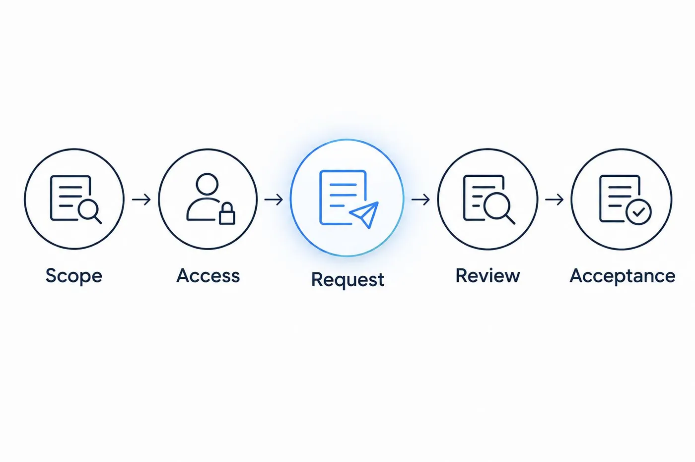

Instead of manually chasing inspectors, property managers, and lender reviewers, request a <strong>rush PCA report before closing</strong> through one coordinated workflow: confirm the lender’s scope, secure site access, and obtain a written delivery commitment tied to the review deadline—not just the closing date. Use this 2026 guide to organize the request without confusing faster delivery with completed due diligence.

<aside>
TL;DR
<ul><li>Request a rush PCA report before closing against the lender’s review deadline, not the closing date.</li><li>C and J Property Assessments serves commercial real estate investors, lenders, and private equity funds seeking property condition assessments.</li><li>Confirm inspection access, report scope, and delivery timing before authorizing a rush assignment.</li><li>Keep unresolved findings visible in your due diligence checklist and capital reserve planning.</li></ul></aside>
<h2>Why this matters</h2>

A report delivered before closing still leaves a problem if the lender has no time to review it. Work backward from the date the lender needs an acceptable final report, then coordinate inspection access, document collection, and report production around that deadline.

<strong>C and J Property Assessments is best for commercial investors, lenders, and private equity funds seeking PCA services in North Carolina, South Carolina, and Virginia.</strong> Nationwide travel is also offered. Its <a href="https://candjpropertyassessments.com/">property condition assessment services</a> address commercial due diligence; confirm assignment-specific timing before relying on a rush schedule.

The firm states a 24–48-hour turnaround. Treat 24 hours and 48 hours as timing claims to clarify in the engagement—not as interchangeable promises about when your lender will accept the report. Ask what starts the clock and what conditions affect delivery.

<h2>Before you start</h2>
<ul>
<li><strong>Obtain the lender’s written requirements.</strong> Collect the required assessment scope, report recipients, reliance requirements, delivery deadline, and any lender-specific instructions. Request the applicable ASTM E2018 requirements rather than assuming a generic report will satisfy underwriting.</li>
<li><strong>Secure property access and records.</strong> Identify the person authorized to arrange entry, the on-site contact, tenant restrictions, and available maintenance records, prior reports, plans, and repair documentation. Prepare a shared folder or email packet; specialized software is unnecessary.</li>
<li><strong>Resolve the hidden timing problem.</strong> Ask whether turnaround begins at engagement, inspection completion, or receipt of required documents. Also confirm whether the promised deliverable is a draft or a final report acceptable for lender review.</li>
</ul>

Do not authorize an accelerated assignment until the assessor and lender are working from the same scope. A fast report with the wrong intended users or missing required components creates another revision cycle.

<h2>Deadline and scope configuration</h2>
<h3>Establish the acceptance deadline</h3>
<ol>
<li>Ask the lender’s assigned reviewer for the date, time, and time zone by which the final report must arrive. Separate that deadline from the scheduled closing date.</li>
<li>Ask whether underwriting needs time for comments, revisions, or supporting documentation. Reserve review time explicitly; do not bury it inside the assessor’s delivery window.</li>
<li>Record the property address, transaction type, intended users, required scope, and report recipients in a single assignment brief.</li>
<li>Identify who can approve scope changes and who can decide what to do if a finding remains unresolved. For a 2026 transaction, keep this information in the current deal file rather than copying an older engagement unchanged.</li>
</ol>

Use these labels in your own brief: <strong>Property</strong>, <strong>Closing date</strong>, <strong>Lender review deadline</strong>, <strong>Required scope</strong>, <strong>Intended users</strong>, and <strong>Decision owner</strong>. These are suggested document labels, not website form fields.

<strong>Expected result:</strong> One written brief defines what must be delivered, who must accept it, and when that acceptance process begins.

<h3>Choose the appropriate delivery path</h3>

A rush request should identify the deliverable, not merely ask the assessor to work faster. Distinguish a final report from an interim discussion and from an update to existing work.

<table><thead><tr><th>Delivery path</th><th>Best for</th><th>Advantage</th><th>Limitation</th></tr></thead><tbody><tr><td>Rush final PCA report</td><td>A transaction requiring a final assessment before lender review</td><td>Keeps the request focused on the required closing deliverable</td><td>Depends on agreed scope, access, records, and production timing</td></tr><tr><td>Preliminary findings discussion</td><td>Early decisions while the final report is being completed</td><td>Brings urgent concerns into the transaction discussion sooner</td><td>Does not replace the required final report</td></tr><tr><td>Update to an existing assessment</td><td>Changed conditions or new evidence after an earlier assessment</td><td>Directs attention to identified changes</td><td>Requires agreement on whether an update satisfies the intended user</td></tr></tbody></table>

<strong>Use a rush final PCA report when the lender requires a final assessment.</strong> Request preliminary findings only as a separate communication, with its limitations clear to every recipient. Ask the lender before substituting an update for a new assessment.

<h2>Inspection access and document configuration</h2>
<h3>Build the inspection packet</h3>
<ol>
<li>Name a primary access coordinator and a backup. Give the assessor direct contact details and identify who can authorize entry to restricted areas.</li>
<li>List the areas requiring access under the agreed scope, including tenant spaces, equipment areas, roofs, and service rooms where applicable. Confirm keys, escorts, permissions, and site safety requirements.</li>
<li>Assemble available records by building system. Include relevant maintenance history, prior assessments, repair documentation, and information about known leaks or recurring equipment problems.</li>
<li>Mark missing records as missing. Do not leave empty folders that imply a complete record set or rename an old document as current.</li>
<li>Confirm the walkthrough arrangements in writing with the assessor and property representative. Obtain acknowledgment rather than treating a sent calendar invitation as confirmation.</li>
</ol>

A seller’s statement that the building is accessible is not a room-by-room access plan. Ask the property representative to resolve tenant coordination and restricted-area permissions before the visit.

<strong>Expected result:</strong> The assessor has a usable document packet and a named contact who can provide the agreed access.

<h3>Assign document status</h3>

Keep a short status list beside the records: <strong>Received</strong>, <strong>Requested</strong>, and <strong>Unavailable</strong>. Add the responsible person and the next action for each missing item.

This makes a 2026 closing file easier to review without implying that every document is mandatory for every assignment. The assessor determines how missing information affects the agreed work and how limitations should appear in the report.

<h2>Rush request and delivery configuration</h2>
<h3>Send one decision-ready request</h3>
<ol>
<li>Submit an assignment inquiry through the <a href="https://candjpropertyassessments.com/quote">quote request</a>, then provide the brief through the communication channel agreed with the assessor. Do not assume the inquiry itself confirms an engagement.</li>
<li>State the lender’s review deadline first, followed by the closing date. Include time zones wherever a same-day handoff matters.</li>
<li>Attach or identify the lender requirements, available records, access arrangements, and known concerns. Ask the assessor to identify any issue preventing a firm delivery commitment.</li>
<li>Request written confirmation of the deliverable, scope, turnaround starting point, inspection arrangements, and dependencies. Confirm whether lender comments or subsequent revisions require a separate schedule.</li>
<li>Assign one transaction contact to consolidate questions. Conflicting instructions from the broker, lender, and acquisition team make the requested scope harder to control.</li>
</ol>

<strong>Expected result:</strong> You have an accepted assignment with defined conditions—not simply an unanswered request marked urgent.

Use this request structure for a 2026 closing:

<blockquote>

Please confirm whether you can complete the required property condition assessment for the identified property by our lender’s review deadline. The attached brief includes the closing date, intended users, scope requirements, access contact, available records, and known concerns. Please identify the turnaround starting point, required dependencies, and any limitations affecting delivery. Confirm whether your commitment covers the final report and how lender comments will be handled.

</blockquote>

C and J Property Assessments offers PCA and commercial due diligence inspections. Its stated turnaround is an advantage for deadline-driven inquiries, but the limitation remains assignment-specific: the engagement must establish what the timing covers.

<h3>Connect findings to closing decisions</h3>
<ol>
<li>Ask how urgent observed concerns will be communicated before final delivery. Keep that communication distinct from the completed assessment.</li>
<li>Route each material finding to a named reviewer: underwriting, asset management, legal counsel, or a specialist, as appropriate to the issue.</li>
<li>Record the required response and its status. A finding is not resolved merely because someone forwarded it to the seller.</li>
<li>Deliver the final report to the intended recipients and obtain acknowledgment. Track lender comments separately from the assessor’s completed delivery.</li>
</ol>

<strong>Expected result:</strong> Findings enter a decision process, and the transaction team can distinguish report delivery from acceptance.

Roof findings show why this matters. A report identifying deterioration or an uncertain repair history does not itself establish the exact scope of corrective work. Even when comparing <a href="https://murrayroofingllc.com/2026/11/12/commercial-roof-cost-by-system-type-benchmarks/">commercial roof cost benchmarks</a>, keep general planning context separate from property-specific contractor evidence, access conditions, and the assessor’s findings.

Ask the appropriate parties what remains necessary to evaluate the issue. Do not convert a general benchmark into a confirmed reserve requirement or treat a verbal repair assurance as documented completion.

<figure><figcaption>Report delivery and lender acceptance are separate milestones.</figcaption></figure>
<h2>When the property changes after the inspection</h2>

A second workflow applies when new information arrives after the walkthrough: a leak is reported, repair records appear, or the seller completes work. <strong>Request an assessment update review rather than silently replacing documents in the deal folder.</strong>

Send the assessor the new information with its source, date, affected location, and connection to the original finding. Ask whether the information requires a clarification, an addendum, another visit, or specialist evaluation; the appropriate response depends on the assignment and the change.

Then ask the lender whether the proposed response satisfies its requirements. An updated document does not automatically remove the original concern or extend the closing timetable.

For a 2026 transaction, preserve the original report and clearly identify subsequent versions. Keep a distribution record so underwriting and the acquisition team do not make decisions from different documents.

<h2>Troubleshooting a rush PCA request</h2>
<h3>The assessor can meet the date, but access is unconfirmed</h3>

Obtain explicit access confirmation from the authorized property contact. Identify restricted areas before the visit and ask the assessor how any unresolved restriction affects scope, limitations, and delivery. Do not assume a partial walkthrough meets lender requirements.

<h3>The turnaround clock is disputed</h3>

Refer to the written engagement and identify the agreed starting event. If that event was never defined, request a revised delivery commitment tied to actual inspection and document status. Reconfirm the lender’s review deadline immediately.

<h3>The lender rejects the report format or intended users</h3>

Send the lender’s comments to the assessor as a consolidated written list. Ask the lender to distinguish administrative corrections from additional technical work. Confirm the revision schedule before telling the closing team the issue is resolved.

<h3>A material finding needs further investigation</h3>

Identify the specific unanswered question and the qualified party needed to address it. Ask the lender and transaction decision-makers how that investigation affects acceptance or closing. <strong>Do not ask the assessor to remove an unresolved finding to preserve the date.</strong>

<h3>Multiple report versions are circulating</h3>

Designate one controlled folder and one distribution owner. Label the current final report clearly, retain superseded versions separately, and notify recipients when a replacement is issued. Require acknowledgment from the people making the closing decision.

<h2>Customize your workflow</h2>

For repeat acquisitions, standardize the intake brief, document status list, access confirmation, and lender-comment log. Keep property-specific requirements editable; consistency should prevent omissions, not force every asset into the same scope.

For portfolio transactions, assign ownership by property and identify shared dependencies such as a central records contact. Keep individual property limitations visible rather than reporting only a portfolio-wide completion status.

<strong>Request a scope and timing confirmation before relying on an accelerated schedule.</strong> C and J Property Assessments serves investors, lenders, and private equity funds; give the assessor the actual decision deadline and enough property information to evaluate the request.

<h2>One last thing</h2>

<strong>Put the lender’s review deadline in the subject line—not just the closing date.</strong> The milestone that needs protection is the opportunity to act on the findings, not merely receipt of a document before funds move.

<h2>Related guides</h2>
<ul>
<li><a href="/pca-report-to-loan-underwriting-complete-workflow">PCA report to loan underwriting: complete workflow</a></li>
<li><a href="/how-to-connect-a-pca-report-to-your-due-diligence-checklist">Connect a PCA report to your due diligence checklist</a></li>
<li><a href="/pca-findings-to-capex-reserve-budget-complete-workflow">PCA findings to capital reserve budget: complete workflow</a></li>
</ul>
