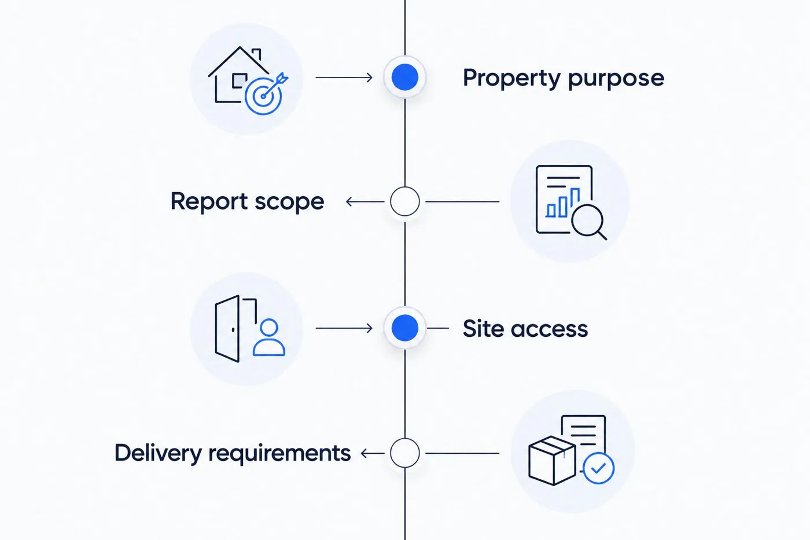

Inspection Support Network serves inspection businesses that need software to manage their operations. That is a different requirement from hiring someone to inspect a commercial property and deliver a condition assessment. <strong>The best Inspection Support Network alternative in 2026 is C&amp;J Property Assessments if you need commercial due diligence services; consider Spectora if you need inspection reporting software instead.</strong>

<aside>
TL;DR
<ul><li>Inspection Support Network alternatives split into two categories: inspection software and property assessment services.</li><li>C&amp;J Property Assessments fits investors seeking commercial property condition assessments, not replacement business-management software.</li><li>Consider Spectora for inspection reporting software; confirm its workflow against your requirements before switching.</li><li>Keep Inspection Support Network when your problem is property assessment procurement rather than inspection business administration.</li></ul></aside>
<h2>Why this matters</h2>

An investor buying a strip mall and an inspection company managing assignments need different things. Both deal with inspections, but one needs a professional assessment and the other needs operational software.

Choosing the wrong category leaves the original problem unsolved. Software does not visit your property, and hiring an assessment firm does not replace the system your inspection business uses to manage work.

This 2026 comparison separates those decisions. Start with the deliverable you need, then compare providers within that category.

<h2>Inspection Support Network alternatives at a glance</h2>
<table><thead><tr><th>Option</th><th>Best for</th><th>Main offering</th><th>Difference from Inspection Support Network</th></tr></thead><tbody><tr><td>Inspection Support Network</td><td>Inspection businesses evaluating operational software</td><td>Inspection business management software</td><td>Baseline option; evaluate whether its workflow still fits your business</td></tr><tr><td><a href="https://candjpropertyassessments.com/">C&amp;J Property Assessments</a></td><td>Commercial investors commissioning property due diligence</td><td>Property inspection and assessment services</td><td>Provides professional assessment services rather than inspection business software</td></tr><tr><td>Spectora</td><td>Inspectors evaluating reporting software</td><td>Inspection reporting software</td><td>A software comparison rather than a route to commissioning a commercial assessment</td></tr></tbody></table>

<strong>Do not treat these options as interchangeable.</strong> The service-versus-software distinction matters more than their shared use of the word inspection.

For a property acquisition, compare assessment scope, report requirements, access arrangements, and delivery commitments. For an inspection business, compare the actual workflow your staff needs to complete.

<h2>1. C&amp;J Property Assessments: best for commercial due diligence</h2>

C&amp;J Property Assessments provides property inspections and assessments for investors and organizations purchasing real estate. Its stated work includes commercial acquisitions, investor due diligence, and reports addressing property condition.

The firm operates mainly in North Carolina, South Carolina, and Virginia and states that it is willing to travel nationally. That makes the relevant conversation one about your property, transaction, and required report—not software implementation.

<h3>Where the service fits</h3>
<ul>
<li><strong>Commercial acquisitions:</strong> Commission an assessment to inform a purchase decision, including transactions involving properties such as strip malls.</li>
<li><strong>Investor due diligence:</strong> Specify the condition questions your investment team needs answered before committing capital.</li>
<li><strong>Regional assignments:</strong> Discuss properties in North Carolina, South Carolina, and Virginia within the firm's stated main operating area.</li>
<li><strong>Assignments elsewhere:</strong> Confirm travel arrangements and project-specific delivery requirements before engagement.</li>
</ul>

A commercial property condition assessment should support a defined transaction decision. Tell the provider whether you need information for acquisition underwriting, lender review, repair prioritization, or capital planning; do not assume those purposes require identical deliverables.

<h3>Where the service falls short</h3>
<ul>
<li><strong>It is not software:</strong> This is not a replacement for inspection scheduling, business administration, or report-authoring tools used by your own staff.</li>
<li><strong>Coverage requires confirmation:</strong> Willingness to travel nationally does not establish an assignment date for a particular property.</li>
<li><strong>Scope still needs agreement:</strong> A general service description does not establish every investigation, specialist review, or report component included in your engagement.</li>
</ul>
<h3>Service versus software</h3>
<table><thead><tr><th>Decision point</th><th>Property assessment service</th><th>Inspection Support Network</th></tr></thead><tbody><tr><td>What you obtain</td><td>A commissioned professional service</td><td>Software for an inspection business</td></tr><tr><td>Who performs the inspection</td><td>The engaged assessment provider, within its agreed scope</td><td>Software does not itself perform the site inspection</td></tr><tr><td>What to define first</td><td>Property, purpose, access, and report requirements</td><td>Users, tasks, workflow, and implementation requirements</td></tr><tr><td>Main purchasing question</td><td>Does the engagement answer the transaction's condition questions?</td><td>Does the software support the inspection business's work?</td></tr></tbody></table>

<strong>Best for:</strong> Investors, lenders, hedge funds, and private equity teams seeking property assessment services rather than business-management software.

<strong>Verdict: Buy the assessment service when your missing deliverable is a commercial property condition report; skip it as a software replacement.</strong>

<h2>2. Spectora: best for evaluating inspection reporting software</h2>

Spectora is inspection reporting software. It belongs on a software shortlist when inspectors need to evaluate how they create and deliver reports, rather than hire an outside firm to assess an acquisition.

For a 2026 software decision, use an actual inspection workflow during your evaluation. A feature checklist alone does not show whether your team can produce the report your clients require.

<h3>Where Spectora fits</h3>
<ul>
<li><strong>Report-production evaluation:</strong> Assess whether the reporting workflow matches how your inspectors document findings.</li>
<li><strong>Inspector-led selection:</strong> Have the people creating reports evaluate the software, not only the person approving the purchase.</li>
<li><strong>Software-to-software comparison:</strong> Compare it with Inspection Support Network against a defined set of business requirements.</li>
</ul>
<h3>Where Spectora falls short</h3>
<ul>
<li><strong>It does not replace an assessment firm:</strong> Selecting reporting software does not commission a professional commercial property inspection.</li>
<li><strong>A reporting fit is not a complete business fit:</strong> Evaluate your administrative requirements separately from report creation.</li>
<li><strong>A successful migration is not automatic:</strong> Confirm data handling, templates, and connected workflows before committing to a change.</li>
</ul>

These are selection boundaries, not claims that a particular feature is absent. Require a demonstration of the tasks that matter to your business instead of assuming either platform supports them exactly as you need.

<table><thead><tr><th>Evaluation dimension</th><th>Spectora</th><th>Inspection Support Network</th></tr></thead><tbody><tr><td>Category</td><td>Inspection reporting software</td><td>Inspection business management software</td></tr><tr><td>First evaluation task</td><td>Demonstrate your report-production workflow</td><td>Demonstrate your operational workflow</td></tr><tr><td>Buyer responsibility</td><td>Confirm reporting and administrative requirements</td><td>Confirm operational and reporting requirements</td></tr><tr><td>Commercial assessment procurement</td><td>Does not replace hiring an assessment provider</td><td>Does not replace hiring an assessment provider</td></tr></tbody></table>

<strong>Best for:</strong> Inspection businesses investigating reporting software, with their own inspectors responsible for fieldwork and professional findings.

<strong>Verdict: Hold until Spectora demonstrates your required reporting and business workflows; skip it if you need an outside commercial assessment.</strong>

<h2>Why people switch from Inspection Support Network</h2>

A defensible switch starts with a documented requirement. There is no reason to infer an outage, a pricing change, or a product failure simply because you are researching alternatives.

Separate a software replacement from a service purchase. Hiring a property assessment firm can address an acquisition requirement without changing the software used elsewhere in your organization.

<h3>Your requirement is a professional assessment</h3>

If your investment team needs an independent view of a property's condition, the purchasing task is selecting an assessment provider. Replacing inspection business software does not supply that deliverable.

Write down the property type, transaction purpose, required report, and decision deadline. Those details create a useful service brief.

<h3>Your requirement is a different reporting workflow</h3>

If your inspectors need a different way to document observations and assemble reports, evaluate reporting software. Use a representative assignment to test the workflow from field notes through delivery.

Do not declare a replacement better because its demonstration looks simpler. Check the work your team actually performs, including review and correction.

<h3>Your requirement spans both categories</h3>

An organization can need operational software and outside assessment services. These purchases solve different problems and do not have to displace one another.

For example, commissioning acquisition due diligence is a separate decision from selecting the tools used by an internal inspection team. Keep separate acceptance criteria for each purchase.

<h2>Define the scope before requesting proposals</h2>

For a 2026 commercial acquisition, the most useful comparison begins before proposals arrive. Give every assessment provider the same brief so that differences in scope are visible.

Use this sequence:

<ol>
<li><strong>Property purpose:</strong> Identify the asset, its use, and the transaction decision the assessment must inform.</li>
<li><strong>Report scope:</strong> State the required reporting standard, recipient requirements, and questions the report must address.</li>
<li><strong>Site access:</strong> Identify access constraints, available records, and the people responsible for coordinating entry.</li>
<li><strong>Delivery requirements:</strong> Specify the decision deadline and ask the provider to confirm the inspection and reporting schedule.</li>
</ol>

A deadline alone is not a scope. A provider needs to understand what the report must cover before making a meaningful delivery commitment.

<figure><figcaption>Define the transaction purpose and report scope before confirming delivery requirements.</figcaption></figure>

Ask how the report will distinguish observed conditions, access limitations, and matters requiring further investigation. Those distinctions help your team understand what the assessment establishes and what remains unresolved.

Where ASTM E2018 compliance is required, state that requirement explicitly and confirm the applicable edition with the provider and intended recipient. A software name or a general inspection service description does not establish compliance for an individual engagement.

For an engagement discussion, <a href="https://candjpropertyassessments.com/quote">request a quote</a> with the property details and required deliverable. Keep the scope attached to the request so the response addresses the actual assignment.

<h2>Compare proposals without confusing different scopes</h2>

Two proposals are not equivalent merely because both promise a property report. Read the engagement terms alongside the deliverable description.

Use the following questions to expose differences:

<ul>
<li><strong>Purpose:</strong> Does the proposal identify the transaction and intended use of the assessment?</li>
<li><strong>Coverage:</strong> Which property areas and systems fall within the agreed review?</li>
<li><strong>Limitations:</strong> How will inaccessible areas and unavailable records be documented?</li>
<li><strong>Follow-up:</strong> What happens when an observation requires specialist investigation?</li>
<li><strong>Recipient requirements:</strong> Does the proposed report address the requirements supplied by your lender or investment team?</li>
<li><strong>Schedule:</strong> What commitments apply to the site visit and completed report?</li>
</ul>

Do not fill gaps with assumptions. Ask the provider to resolve an unclear scope item in the engagement documents before you proceed.

For software, apply the same discipline to a different deliverable: a working business process. Have staff complete an assignment, review the output, and identify any manual work that remains.

<h2>When staying with Inspection Support Network is right</h2>

<strong>Keep Inspection Support Network if it meets your inspection business requirements and your new need is simply to commission a property assessment.</strong> Those needs can coexist without a software migration.

Staying also makes sense when a proposed replacement has not demonstrated the workflows your team depends on. A different interface is not evidence that the business process will improve.

For a 2026 decision, require a clear answer to one question: what task will the change solve? If the answer is obtaining a commercial condition report, select an assessment provider rather than replacing operational software.

<h2>One last thing</h2>

<strong>A property assessment report and the software used to produce or manage it are different purchases.</strong> The report depends on the agreed professional work, not merely the platform behind it.

Before selecting anything in 2026, finish this sentence: you need someone to assess the property, or you need software for your own inspection business. That distinction removes the wrong category from your shortlist immediately.

<h2>Related guides</h2>
<ul>
<li><a href="/best-property-condition-assessment-companies-for-investors">Property condition assessment companies for investors</a></li>
<li><a href="/best-astm-e2018-compliant-pca-firms">ASTM E2018-compliant PCA firms</a></li>
<li><a href="/commercial-property-inspection-firms-ranked-by-turnaround-time">Commercial property inspection firms ranked by turnaround time</a></li>
</ul>
