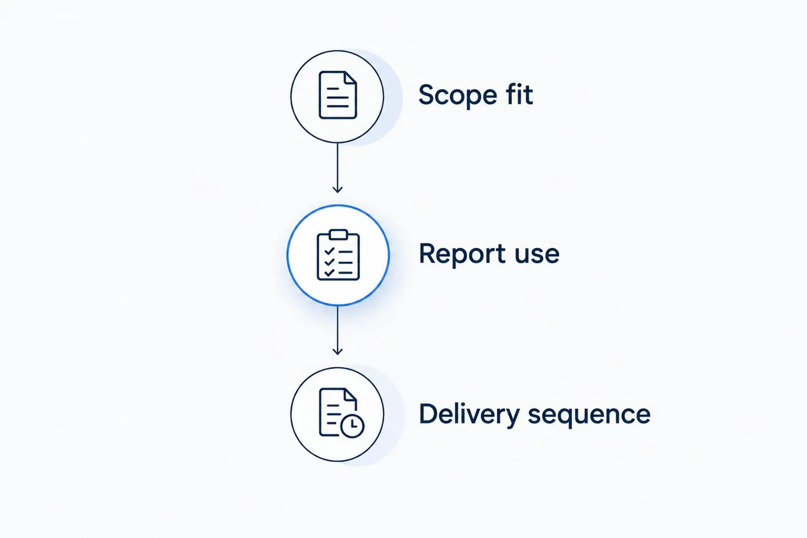

PCA Consultants belongs on your shortlist when its proposed property condition assessment meets your acquisition and lender requirements. That proposal stops being enough when the written scope leaves your decision-critical questions unresolved. <strong>The best PCA Consultants alternative in 2026 is C&amp;J Property Assessments if you need investor-focused property due diligence in North Carolina, South Carolina, or Virginia; a specialist-led engagement if your transaction turns on a specific technical question.</strong>

<aside>
TL;DR
<ul><li>For PCA Consultants alternatives, shortlist C&amp;J Property Assessments for investor-focused property condition assessments in NC, SC, and VA.</li><li>Choose specialist-led due diligence when a defined technical question requires investigation beyond a baseline assessment.</li><li>Compare written scope, access requirements, reporting deadlines, and intended users before appointing any property assessment provider.</li><li>Keep PCA Consultants when its proposal answers your transaction requirements without leaving critical scope gaps.</li></ul></aside>
<h2>Why this matters</h2>

A property condition assessment supports an acquisition decision. It does not replace every investigation your property might require. Your selection should follow the questions that affect underwriting, repair planning, and acceptance of the report.

For a 2026 acquisition, compare the engagement you will receive rather than the consultant's name alone. A report delivered before closing is useful only if its scope covers the issues you need to resolve.

<h2>PCA Consultants alternatives at a glance</h2>

This comparison separates a named assessment provider from alternative engagement structures. Specialist-led and coordinated portfolio engagements are ways to commission work, not names of competing companies.

<table><thead><tr><th>Option</th><th>Best for</th><th>Defining feature or selection criterion</th><th>Difference from selecting PCA Consultants</th></tr></thead><tbody><tr><td>PCA Consultants</td><td>Buyers whose requirements match its written proposal</td><td>Assess the proposed scope, deliverables, and intended users</td><td>Your benchmark; retain it when the engagement fits</td></tr><tr><td><a href="https://candjpropertyassessments.com/">C&amp;J Property Assessments</a></td><td>Investors seeking property due diligence, particularly in NC, SC, and VA</td><td>Commercial assessments and investor-focused inspections</td><td>An alternative provider with stated regional operating emphasis</td></tr><tr><td>Specialist-led engagement</td><td>A transaction with a defined engineering or building-system question</td><td>Investigation directed at a specific technical issue</td><td>Changes the scope and expertise rather than merely changing providers</td></tr><tr><td>Coordinated portfolio engagement</td><td>Buyers assessing multiple properties together</td><td>Shared instructions and consistent reporting requirements</td><td>Changes how the assessment program is managed</td></tr></tbody></table>

<strong>Do not choose an alternative until you can identify what changes: the provider, the technical scope, or the management of the assignment.</strong> Changing only the name on the proposal does not resolve an unclear brief.

<h2>1. C&amp;J Property Assessments: best for investor due diligence</h2>

C&amp;J Property Assessments provides property inspection and assessment services for commercial properties and investor acquisitions. Its stated work includes due diligence for investors and hedge funds, from investment-property inspections to commercial acquisitions such as strip malls. Its main operating areas are North Carolina, South Carolina, and Virginia, with travel across the United States also offered.

For property condition assessments, C&amp;J Property Assessments is a direct alternative when your objective is to understand physical condition before committing acquisition capital. Define the property, intended report users, and decision deadline before agreeing to the assignment.

<h3>Where C&amp;J Property Assessments shines</h3>
<ul>
<li><strong>Investor-oriented scope:</strong> The service addresses acquisition due diligence rather than a homeowner maintenance review.</li>
<li><strong>Commercial applicability:</strong> The stated offering includes assessments for commercial real estate purchases.</li>
<li><strong>Regional operating focus:</strong> NC, SC, and VA are the company's main operating markets.</li>
<li><strong>Broader travel:</strong> Nationwide travel is offered, allowing you to discuss assignments beyond those core markets.</li>
</ul>
<h3>Where this option falls short</h3>

A general assessment appointment does not automatically resolve a specialist investigation. If your acquisition depends on structural calculations, concealed-condition investigation, or another defined technical question, specify that work separately and establish who will perform it.

For properties outside the main operating region, confirm travel arrangements and inspection scheduling before relying on a delivery date. An offer to travel is not the same as a confirmed assignment schedule.

<table><thead><tr><th>Decision dimension</th><th>This alternative</th><th>PCA Consultants benchmark</th></tr></thead><tbody><tr><td>Geographic fit</td><td>Main operating areas are NC, SC, and VA; nationwide travel offered</td><td>Confirm coverage for the actual property</td></tr><tr><td>Acquisition purpose</td><td>Stated investor and commercial due diligence services</td><td>Require the proposal to name your transaction purpose</td></tr><tr><td>Report use</td><td>Identify investor, lender, and other intended users in the engagement</td><td>Apply the same requirement</td></tr><tr><td>Additional investigation</td><td>Define technical questions and additional scope before appointment</td><td>Apply the same requirement</td></tr></tbody></table>

<strong>Best for:</strong> Investors, hedge funds, and commercial buyers seeking a property-condition report for acquisition due diligence.

<strong>Verdict: Buy the engagement when the written scope, property access, and delivery commitment match your transaction.</strong>

<h2>2. Specialist-led engagement: best for a defined technical issue</h2>

A specialist-led engagement starts with a specific question rather than a general survey brief. Examples include determining the significance of observed structural movement or investigating a building-system concern that affects the acquisition decision. Choose the professional discipline and investigation method around that question.

This is not automatically a substitute for a property-wide assessment. You can resolve a roof concern and still lack information about the rest of the building.

<h3>Where this approach shines</h3>
<ul>
<li><strong>Focused instructions:</strong> The appointment identifies the issue that needs an answer.</li>
<li><strong>Defined expertise:</strong> You select the relevant professional discipline for the problem.</li>
<li><strong>Decision relevance:</strong> The requested conclusion connects directly to a purchase condition, repair decision, or further investigation.</li>
</ul>
<h3>Where this approach falls short</h3>
<ul>
<li>A narrow investigation leaves unrelated building systems outside its scope.</li>
<li>Testing, opening concealed areas, or accessing tenant spaces requires appropriate authorization.</li>
<li>Separate technical reports need to be reconciled with the acquisition team's broader assessment.</li>
</ul>
<table><thead><tr><th>Decision dimension</th><th>Specialist-led engagement</th><th>PCA Consultants benchmark</th></tr></thead><tbody><tr><td>Starting point</td><td>A defined technical question</td><td>Check whether the proposed assessment addresses that question</td></tr><tr><td>Deliverable</td><td>Findings within the specialist's agreed scope</td><td>Check the proposed report's investigation limits</td></tr><tr><td>Property-wide coverage</td><td>Not automatic</td><td>Confirm which systems and areas are included</td></tr></tbody></table>

<strong>Best for:</strong> Buyers whose decision depends on resolving a specific technical concern.

<strong>Verdict: Buy the specialist scope when the unresolved issue requires it; hold off on treating it as complete property due diligence.</strong>

<h2>3. Coordinated portfolio engagement: best for multiple acquisitions</h2>

A coordinated portfolio engagement applies shared instructions across several properties. The objective is comparable reporting: consistent terminology, clearly identified exclusions, and findings organized so your investment team can review assets together.

For a 2026 portfolio acquisition, specify the reporting structure before inspections begin. Consistency is an instruction to establish, not a benefit to assume from any provider's size.

<h3>Where this approach shines</h3>
<ul>
<li>Common instructions make the requested deliverables explicit across properties.</li>
<li>Central coordination gives your team one process for access, questions, and report review.</li>
<li>Shared reporting categories help distinguish property-specific findings from differences in presentation.</li>
</ul>
<h3>Where this approach falls short</h3>
<ul>
<li>A common template does not eliminate differences between buildings.</li>
<li>A portfolio deadline does not resolve access restrictions at an individual property.</li>
<li>Uniform reporting cannot replace property-specific technical judgment.</li>
</ul>

<strong>Best for:</strong> Investment teams that need to review multiple assets under a common reporting brief.

<strong>Verdict: Buy the coordinated approach for a portfolio; skip the extra management structure when a single-property appointment meets your needs.</strong>

<h2>Why people switch from PCA Consultants</h2>

A defensible reason to switch is a mismatch between your requirements and the proposed engagement. Do not infer a service failure from a search for alternatives. Apply these decision tests to PCA Consultants and every other candidate.

<ul>
<li><strong>Scope mismatch:</strong> Switch when the proposal excludes a condition or system that your investment decision requires you to assess.</li>
<li><strong>Report-use mismatch:</strong> Switch when the proposed intended users or reliance arrangements do not meet your transaction requirements.</li>
<li><strong>Schedule mismatch:</strong> Switch when the agreed inspection and delivery sequence does not fit your due diligence period.</li>
<li><strong>Assignment mismatch:</strong> Switch when your property requires a specialist investigation or portfolio structure that the proposed engagement does not provide.</li>
</ul>

These are proposal-level reasons, not claims about PCA Consultants' performance. In 2026, make the decision against written commitments rather than assumptions about what a consultant normally includes.

<h2>Use 3 decision gates before appointing a consultant</h2>

A clear selection process prevents an attractive proposal from concealing an unsuitable scope. Use 3 decision gates, in this order: Scope fit, Report use, and Delivery sequence.

<h3>Scope fit</h3>

Describe the asset and the acquisition question. Identify known concerns, available records, inaccessible areas, and any work that requires a separate specialist. Ask the consultant to state exclusions alongside included services.

<h3>Report use</h3>

Name the parties expected to use the report. Establish whether your lender has specific requirements and whether those requirements are incorporated into the engagement. Do not assume the buyer's appointment automatically satisfies every other party.

<h3>Delivery sequence</h3>

Set out inspection access, document delivery, draft review if included, and final reporting. Put the required dates in the engagement. Distinguish completion of the site visit from completion of the report.

<figure><figcaption>Resolve scope and report use before relying on the delivery schedule.</figcaption></figure>

The same gates apply whether you appoint a regional assessment provider or assemble separate specialists. A failed gate means the engagement needs revision before acceptance.

<h2>Ask 4 scope questions before accepting a proposal</h2>

Use these 4 scope questions to turn a general description of services into an appointment your acquisition team can manage:

<ol>
<li><strong>What is included?</strong> Identify the buildings, site features, systems, records, and accessible areas covered by the assignment.</li>
<li><strong>What is excluded?</strong> Separate visual observations from testing, concealed-condition investigation, and other additional services.</li>
<li><strong>Who can use it?</strong> Name the intended users and resolve lender requirements before the work begins.</li>
<li><strong>What starts delivery?</strong> Establish the relationship between site access, receipt of documents, and the reporting deadline.</li>
</ol>

For C&amp;J Property Assessments, confirm how its stated 24–48-hour turnaround applies to your proposed assignment, including the event that starts that period. Do not treat that interval as the entire due diligence window without an agreed inspection date and scope.

If your 2026 closing timetable leaves little room for follow-up, identify unresolved questions before appointing the consultant. A fast report cannot answer a question excluded from the assignment.

<h2>When staying with PCA Consultants is the right call</h2>

<strong>Stay with PCA Consultants when its written proposal meets your scope, report-use, access, and delivery requirements.</strong> An alternative is not an improvement merely because it appears on another shortlist.

Before replacing an acceptable appointment, identify the unresolved requirement the change would address. If there is none, concentrate on preparing property records, arranging access, and communicating known concerns. Those tasks support the assessment regardless of the provider.

<h2>One last thing</h2>

Ask every candidate to state what remains unresolved after the report is delivered. That question exposes the boundary between the assessment you are buying and the investigations your acquisition still needs. <strong>A useful proposal defines its limits as clearly as its deliverables.</strong>

<h2>Related guides</h2>
<ul>
<li><a href="/best-property-condition-assessment-companies-for-investors">Property condition assessment companies for investors</a></li>
<li><a href="/best-commercial-property-inspection-companies-for-lenders">Commercial property inspection companies for lenders</a></li>
<li><a href="/best-commercial-property-inspection-companies-for-strip-malls">Commercial property inspection companies for strip malls</a></li>
</ul>
