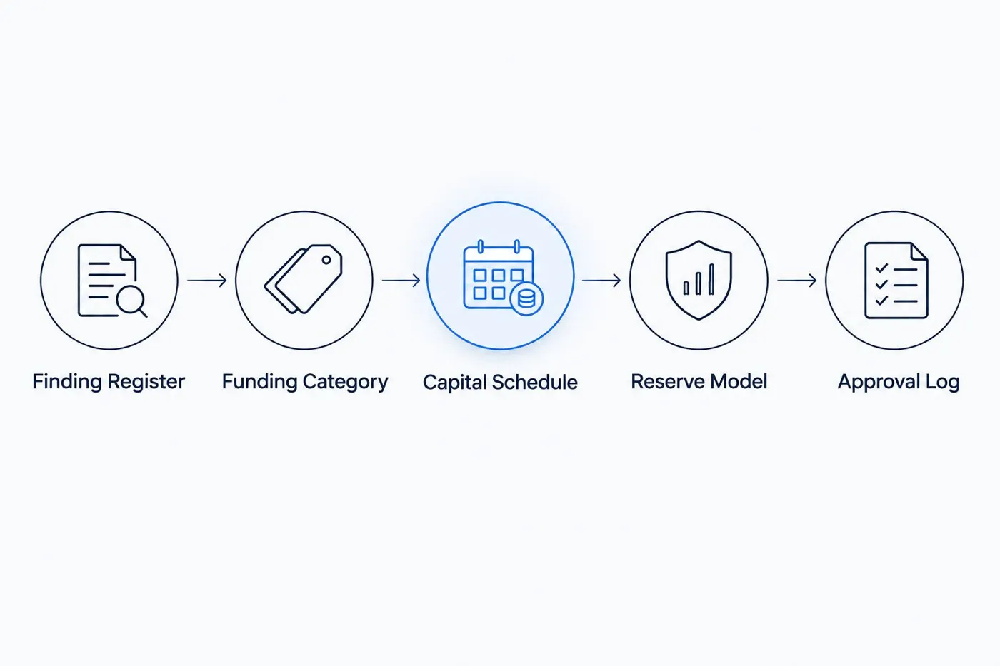

Instead of manually copying inspection deficiencies into disconnected spreadsheets, use a <strong>PCA findings to CapEx reserve budget</strong> workflow that assigns each finding a funding category, timing assumption, and approval owner. Build the reserve schedule from traceable report findings, then reconcile it with immediate repairs, operating expenses, and lender requirements before approving your 2026 capital plan.

<aside>
TL;DR
<ul><li>C and J Property Assessments provides property condition assessments for commercial investors, lenders, and private equity funds.</li><li>Your PCA findings to CapEx reserve budget workflow must separate immediate repairs, recurring maintenance, and future replacements.</li><li>Preserve report references, cost assumptions, and timing decisions for every funded item.</li><li>Calculate reserve contributions from projected spending and opening funds, not from the report total alone.</li></ul></aside>
<h2>Why this matters</h2>

A property condition assessment identifies physical-condition issues within its agreed scope. Your capital budget answers a different question: which obligations will ownership fund, when will the cash leave, and what balance must remain afterward?

<strong>C and J Property Assessments is a property condition assessment provider for commercial investors, lenders, and private equity funds seeking acquisition due diligence.</strong> Its services cover North Carolina, South Carolina, and Virginia, with nationwide travel available. Start with the agreed <a href="https://candjpropertyassessments.com/">C and J Property Assessments</a> assessment scope, then translate the findings into your investment model rather than treating the report as an approved spending plan.

The benefit of a PCA-led budget is traceability: a reviewer can connect a planned expenditure to an observed condition. The limitation is scope. A condition assessment does not replace contractor procurement, specialist investigations, or your accounting policy.

<h2>Before you start</h2>
<ul>
<li><strong>Gather the source materials:</strong> the final PCA report, appendices, available maintenance records, existing capital commitments, and relevant contractor proposals. Confirm which report revision governs the budget.</li>
<li><strong>Confirm decision access:</strong> assign someone who can approve capital classifications, someone who controls the financial model, and someone who can confirm lender reserve requirements. These responsibilities can belong to the same person, but none should remain unassigned.</li>
<li><strong>Resolve the hidden gotcha:</strong> report timing and budget timing are not automatically equivalent. An estimated remaining useful life describes an assessment assumption; it is not a promised replacement date or proof that an item can safely wait.</li>
</ul>

Use a spreadsheet or your existing asset-management system. The bold field names below are labels you create for this workflow, not menu names in a particular software product.

<h2>Source register configuration</h2>
<h3>Establish the finding record</h3>
<ol>
<li>Create a worksheet named <strong>Finding Register</strong>. Add <strong>Finding ID</strong>, <strong>Property</strong>, <strong>System</strong>, <strong>Location</strong>, <strong>Report Reference</strong>, <strong>Observed Condition</strong>, and <strong>Recommended Action</strong>.</li>
<li>Enter each distinct actionable finding as its own record. Preserve the report's meaning; do not rewrite an uncertain observation as a confirmed failure.</li>
<li>Add <strong>Assessment Date</strong>, <strong>Report Revision</strong>, <strong>Access Limitation</strong>, and <strong>Supporting Document</strong>. Record inaccessible areas and missing documentation alongside the affected finding.</li>
<li>Add <strong>Budget Owner</strong> and <strong>Review Status</strong>. Assign responsibility for resolving each item before it becomes an approved budget commitment.</li>
</ol>

<strong>Expected result:</strong> every proposed expenditure has an identifiable physical issue, source reference, and accountable reviewer.

Keep the original finding separate from your response. A report might recommend further evaluation, while ownership ultimately approves a repair after that evaluation. Those are different records of judgment and should remain distinguishable.

For a 2026 acquisition, retain the assessment date even when you import the report into a newer budget version. Otherwise, a refreshed spreadsheet can make an old condition assumption appear current.

<h3>Establish the supporting evidence</h3>

Attach or reference the relevant report page, photograph identifier, proposal, or maintenance record. Do not use a document link as a substitute for a readable summary: an investment committee should understand the issue without opening every attachment.

Flag unresolved scope explicitly. If the assessment identifies a concern that needs specialist evaluation, enter the investigation as an action and keep the downstream repair scope unresolved until supported. An empty estimate is not evidence of no expenditure.

<h2>Classification and timing configuration</h2>
<h3>Separate the funding categories</h3>
<ol>
<li>Add <strong>Funding Category</strong>, <strong>Responsibility</strong>, <strong>Timing Basis</strong>, <strong>Target Period</strong>, and <strong>Dependency</strong> to the register.</li>
<li>Classify each action as an immediate repair, planned capital item, operating expense, or unresolved scope. Apply your accounting policy rather than assuming every PCA recommendation is capital expenditure.</li>
<li>Confirm whether ownership, a tenant, a seller, or another party bears the obligation. Read the governing agreement before excluding an item from ownership's budget.</li>
<li>Set the target period using the report recommendation, observed condition, follow-up evidence, and transaction requirements. Record the reason for any departure from the assessor's timing.</li>
<li>Identify dependencies, including investigations, design, tenant access, permits, or related work that must precede the expenditure.</li>
</ol>

<strong>Expected result:</strong> each finding has a funding route and a defensible timing decision, with unresolved responsibilities still visible.

Use this classification table to prevent incompatible obligations from entering the same reserve calculation.

<table><thead><tr><th>Funding category</th><th>Best for</th><th>Budget treatment</th><th>Benefit</th><th>Limitation</th></tr></thead><tbody><tr><td>Immediate repairs</td><td>Conditions requiring prompt action or transaction-specific resolution</td><td>Track separately from recurring reserve contributions</td><td>Keeps near-term obligations visible</td><td>Does not fund later replacements</td></tr><tr><td>Planned capital</td><td>Ownership-funded renewal or replacement</td><td>Schedule in the capital cash-flow model</td><td>Connects physical needs to funding periods</td><td>Timing and scope need periodic review</td></tr><tr><td>Operating expense</td><td>Recurring service and maintenance</td><td>Route through the operating budget</td><td>Separates maintenance from capital planning</td><td>Classification requires accounting review</td></tr><tr><td>Unresolved scope</td><td>Findings needing investigation or responsibility confirmation</td><td>Maintain an explicit exception record</td><td>Prevents uncertainty from disappearing</td><td>Does not establish a final funding amount</td></tr></tbody></table>

<strong>Do not defer an urgent condition merely to smooth the reserve schedule.</strong> Financing convenience does not change physical risk.

For your 2026 plan, define the immediate-repair window in the engagement and transaction documents. Do not assume a universal deadline applies to every property or lender.

<h2>Capital schedule configuration</h2>
<h3>Build the expenditure schedule</h3>
<ol>
<li>Create a worksheet named <strong>Capital Schedule</strong>. Bring in <strong>Finding ID</strong>, <strong>Recommended Action</strong>, <strong>Funding Category</strong>, and <strong>Target Period</strong> from the reviewed register.</li>
<li>Add <strong>Quantity Basis</strong>, <strong>Estimate Source</strong>, <strong>Estimate Date</strong>, <strong>Scope Allowance</strong>, and <strong>Approved Budget</strong>. Distinguish a report estimate from a contractor proposal or an executed commitment.</li>
<li>Document included and excluded work. Identify whether related access, removal, design, permitting, disposal, and restoration are included, excluded, or unresolved.</li>
<li>Add <strong>Escalation Assumption</strong> and <strong>Contingency Basis</strong> only where your model requires them. Identify the approving party and avoid applying an allowance twice when the underlying estimate already includes it.</li>
<li>Place approved expenditures into the relevant budget periods. Keep immediate repairs visible in acquisition or near-term funding rather than burying them in a long-term average.</li>
</ol>

<strong>Expected result:</strong> the capital schedule shows what ownership expects to fund, when, and on what evidence.

Choose a planning horizon deliberately. For example, you can model <strong>10 years</strong> of capital needs while maintaining a more detailed <strong>12-month</strong> execution view. These are planning choices, not prescribed PCA requirements; use the horizon required by your investment mandate or lender.

<figure><figcaption>Keep the finding reference attached as each item moves into the funding model.</figcaption></figure>
<h3>Prevent overlap before totaling</h3>

Compare related findings by system, location, and project scope. A roof repair and a roof replacement can both be legitimate, but the model must explain whether the repair extends service life, addresses an immediate problem, or becomes unnecessary when replacement occurs.

Likewise, do not add a broad replacement allowance to component-level replacements covering the same work. Retain the source records and designate which record controls the approved expenditure.

<strong>A smaller total is not automatically a better budget. A total without overlapping scope is a more defensible budget.</strong>

<h2>Reserve model and approval configuration</h2>
<h3>Calculate funding by period</h3>
<ol>
<li>Create a worksheet named <strong>Reserve Model</strong>. Add <strong>Opening Balance</strong>, <strong>Scheduled Expenditure</strong>, <strong>Reserve Contribution</strong>, <strong>Other Funding</strong>, <strong>Closing Balance</strong>, and <strong>Required Minimum</strong> for each period.</li>
<li>Enter the opening funds actually assigned to the modeled obligations. Exclude restricted funds that cannot pay those obligations under the governing agreement.</li>
<li>Calculate <strong>Closing Balance</strong> as opening balance plus reserve contributions plus other funding, less scheduled expenditures. Carry that closing balance into the next period's opening balance.</li>
<li>Flag any period in which the closing balance falls below the approved minimum. Adjust funding, investigate scope, or revisit supported timing assumptions; do not simply remove the flag.</li>
<li>Create an <strong>Approval Log</strong> containing the approved version, reviewer, decision date, and outstanding exceptions. Reconcile its totals with the investment model before circulation.</li>
</ol>

<strong>Expected result:</strong> the reserve model demonstrates whether the proposed funding remains sufficient throughout the schedule, not just at its endpoint.

A level contribution can be convenient, but dividing total expenditure by the planning horizon ignores when spending occurs. A project due early in the hold period needs funding before later contributions accumulate.

If you collect contributions monthly but model spending annually, document the convention. Dividing an annual contribution by <strong>12 months</strong> establishes a monthly collection amount; it does not prove cash is sufficient before a project payment falls due.

For debt-financed transactions, keep ownership's capital plan distinct from lender-controlled reserves. The <a href="/pca-report-to-loan-underwriting-complete-workflow">PCA report to loan underwriting workflow</a> addresses the handoff between physical findings and credit review. Your loan documents determine deposit obligations and release conditions.

A C and J Property Assessments property condition assessment supports the physical-condition side of this process. Your asset manager, financial reviewer, and lender still own their respective funding decisions.

<h2>Update the budget whenever a finding changes</h2>

The adjacent workflow is an exception-driven update after a contractor proposal, completed repair, new inspection, or changed project scope. <strong>Best for operating assets:</strong> update the affected finding without rebuilding the entire acquisition model.

<ol>
<li>Locate the existing <strong>Finding ID</strong> and retain its original assessment reference.</li>
<li>Record the new evidence and date. Change the estimate, timing, or status only where that evidence supports the revision.</li>
<li>Recalculate the affected capital periods and reserve balances. Review downstream consequences for linked projects.</li>
<li>Record the decision in <strong>Approval Log</strong> and issue a new approved version.</li>
</ol>

<strong>Expected result:</strong> changes remain auditable, and an updated project does not become an unexplained new obligation.

The benefit of event-driven updates is responsiveness. The limitation is fragmentation: individual updates can miss related systems. Pair this workflow with a scheduled review of the whole capital plan, including items that have not recently changed.

Keep the original 2026 baseline available for comparison. A revision should explain the change in scope, timing, or funding rather than overwrite the history that supports your investment decision.

<h2>Troubleshooting</h2>
<h3>The reserve looks sufficient, but an early project is unfunded</h3>

<strong>Fix the cash-flow timing.</strong> Inspect each period's closing balance rather than the average annual contribution. Include committed acquisition funding only when it is actually assigned to the project.

<h3>The same system appears in several budget rows</h3>

<strong>Reconcile scope before deleting anything.</strong> Compare locations, quantities, and recommended actions. Keep separate records where work is genuinely distinct; remove duplicate funding where scopes overlap.

<h3>The budget differs from the PCA estimate</h3>

<strong>Document the bridge between the figures.</strong> Record scope changes, proposal evidence, escalation treatment, and allowances. Preserve both the source estimate and approved budget so the reviewer can understand the difference.

<h3>A tenant obligation disappears from the ownership model</h3>

<strong>Verify responsibility and retain the exposure record.</strong> A lease allocation does not establish that the work has been completed. Track the obligation and any ownership exposure identified through legal review.

<h3>An inaccessible system has no budget entry</h3>

<strong>Track the limitation as unresolved scope.</strong> Assign investigation responsibility and a decision deadline. Do not present an unassessed system as having no capital requirement.

<h2>Customize your workflow</h2>

For a portfolio, use consistent funding categories while keeping property-level timing and responsibility distinct. Roll up approved schedules, not unreviewed report totals. Shared labels make comparison easier without implying that different buildings have identical risk.

For an acquisition committee, add decision fields for seller action, ownership funding, and further investigation. For an operating asset, connect approved projects to commitments and completion evidence. Neither variation changes the underlying rule: preserve the path from finding to funding decision.

When commissioning C and J Property Assessments for a 2026 transaction, specify the intended budget horizon, report users, access arrangements, and known lender requirements before the assessment. Agree the deliverable scope rather than assuming every financial-model field belongs in the inspection report.

<h2>One last thing</h2>

<strong>Track resolved findings as carefully as open ones.</strong> A paid invoice establishes expenditure, not necessarily completion of the recommended scope. Require appropriate completion evidence before retiring the finding, and reconcile any unspent allocation with the remaining project obligations.

That final control keeps the reserve model tied to the building's condition rather than just its payment history.

<h2>Related guides</h2>
<ul>
<li><a href="/pca-for-commercial-lenders-complete-guide">PCA for commercial lenders: complete guide</a></li>
<li><a href="/pca-for-private-equity-funds-complete-guide">PCA for private equity funds: complete guide</a></li>
<li><a href="/best-pca-firms-for-commercial-real-estate-portfolio-acquisitions">PCA for commercial real estate portfolio acquisitions</a></li>
</ul>
