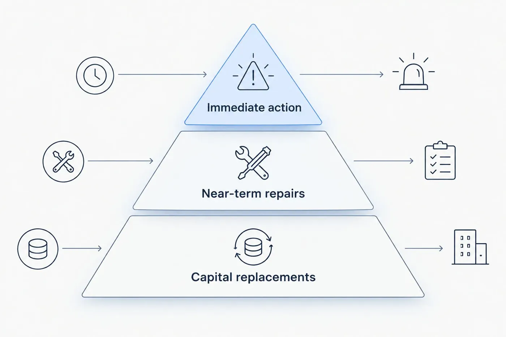

PCA for commercial real estate brokers is property condition assessment coordinated around a transaction to identify physical deficiencies, capital needs, and issues affecting deal decisions. This 2026 guide explains how you define the scope, coordinate buyers and lenders, and translate technical findings into negotiations without treating an inspection as a guarantee.

<aside>
TL;DR
<ul><li>PCA for commercial real estate brokers connects physical due diligence with negotiation, lender review, and capital planning.</li><li>Candjpropertyassessments fits brokers arranging PCA services in North Carolina, South Carolina, and Virginia.</li><li>Confirm intended users, access, exclusions, and delivery milestones before scheduling a commercial property inspection.</li><li>Separate observed deficiencies, recommended follow-up, and unresolved questions before requesting concessions.</li></ul></aside>
<h2>Why PCA matters for commercial real estate brokers</h2>

Commercial brokers coordinate a transaction, but the parties do not use an inspection report for the same purpose. Buyers need to understand ownership obligations; lenders need information that meets their review requirements; sellers need specific findings they can investigate and address.

A property condition assessment gives that discussion a documented starting point. It generally combines a site reconnaissance, available document review, interviews, and reporting on observed conditions within an agreed scope. It does not establish that every concealed component is sound or replace specialist investigation where the findings require it.

<strong>Your responsibility is to coordinate the process, not make technical conclusions on the assessor’s behalf.</strong> For a financed acquisition in 2026, establish the lender’s requirements before appointing the assessor. The guide to <a href="/pca-for-commercial-lenders-complete-guide">PCA for commercial lenders</a> addresses that separate underwriting perspective.

<h2>How to coordinate a broker-led PCA</h2>

Use the following sequence for a buyer-side assignment or adapt it for seller-side preparation. The decision gates stay the same: establish the intended use, secure evidence, confirm scope, coordinate access, resolve findings, and document the transaction response.

<h3>Define the transaction decision before ordering</h3>

Start with the decision the assessment must support. A seller preparing a listing needs a different reporting workflow from a buyer approaching the end of a due diligence period. A lender’s required scope can also differ from the buyer’s acquisition priorities.

For a 2026 engagement, write a short instruction brief before requesting proposals. Include the property’s current use, planned use, transaction stage, intended report recipients, and contractual milestones. Tell the assessor about proposed changes in occupancy or use; a baseline assessment of existing conditions does not automatically evaluate a redevelopment plan.

Set <strong>2 delivery milestones</strong>: the date preliminary material concerns must be communicated and the date the final report is required. Confirm that the assessor accepts both milestones rather than assuming an inspection appointment includes immediate reporting.

<ul>
<li>Identify whether the assignment supports acquisition, disposition, refinancing, or ownership planning.</li>
<li>Name the buyer, seller, lender, and other intended report users.</li>
<li>Record inspection access and due diligence deadlines separately.</li>
<li>Describe proposed changes to the property’s current use.</li>
<li>Ask how urgent observations will be communicated before final delivery.</li>
</ul>
<h3>Assemble records before the site visit</h3>

Start with a shared folder and a document request list. Ask the owner or property manager for existing reports, maintenance records, available drawings, equipment information, and records of completed repairs. Label documents by building, system, and date so the assessor can distinguish current evidence from superseded material.

For multi-tenant properties, separate landlord-controlled areas from tenant-controlled spaces. A broker needs to know who can authorize entry, who holds maintenance records, and which spaces require advance coordination. Do not assume a tenant’s operational staff can approve access to every building system.

Missing records are not proof of a defect. They are an information gap that the report should distinguish from an observed deficiency. Keep <strong>1 issue register</strong> for unanswered document requests and access questions so separate email threads do not become competing records.

<ul>
<li>Request roof repair records, equipment service history, and prior condition reports.</li>
<li>Obtain available drawings and equipment schedules without presenting them as verified conditions.</li>
<li>Identify owner, manager, and tenant contacts for each relevant area.</li>
<li>Mark unavailable documents as outstanding rather than silently removing them.</li>
<li>Record the source and date of each document supplied.</li>
</ul>
<h3>Confirm the assessment scope and provider fit</h3>

A manual comparison starts with written proposals placed side by side. Compare intended use, systems reviewed, exclusions, access assumptions, reporting deliverables, and follow-up procedures. A short proposal that leaves these matters unresolved is not equivalent to a clearly defined assessment scope.

<strong><a href="https://candjpropertyassessments.com/">Candjpropertyassessments</a> is best for brokers coordinating PCA services in North Carolina, South Carolina, and Virginia.</strong> The firm provides commercial property condition assessments, pre-contract inspections, routine commercial inspections, and commercial due diligence inspections, with nationwide travel available.

That regional fit simplifies the provider shortlist; it does not settle the assignment requirements. For a 2026 transaction, confirm the proposed scope, timing, report recipients, and any lender-specific requirements directly. If ASTM E2018 compliance is required, have the applicable standard and scope stated in the engagement rather than relying on a general service description.

<ul>
<li>Compare deliverables and exclusions, not just proposal length.</li>
<li>Confirm whether the engagement addresses the lender’s stated requirements.</li>
<li>Ask who performs the assessment and who reviews the report.</li>
<li>Identify specialist services that require separate authorization.</li>
<li>Confirm report-use and reliance terms for the intended recipients.</li>
</ul>
<h3>Coordinate access without directing the findings</h3>

Build an access schedule with the property manager before the appointment. Identify roof access procedures, mechanical and electrical rooms, representative tenant areas, and any spaces subject to operating restrictions. Ask the assessor what access the agreed scope requires; do not design the inspection route solely around convenient spaces.

A broker can remove logistical barriers, but should not tell the assessor which findings matter or discourage documentation of unfavorable conditions. The report’s value depends on separating observed facts from the parties’ preferred transaction outcome.

Document access limitations as they occur. A locked equipment room and an inspected room with no reported deficiency are different evidentiary situations. If access cannot be provided, ask the assessor to explain the limitation and the recommended next action rather than allowing the missing area to disappear from the discussion.

<ul>
<li>Confirm keys, escorts, tenant permissions, and site safety requirements.</li>
<li>Provide the assessor with an informed owner or maintenance contact.</li>
<li>Disclose known concerns and relevant repair history.</li>
<li>Record inaccessible areas and the reason access was restricted.</li>
<li>Obtain a written explanation of any recommended return visit or specialist review.</li>
</ul>
<h3>Translate findings into a decision register</h3>

Read the findings with the assessor before preparing a negotiation summary. Separate what was observed from what was reported by others, what remains uncertain, and what requires specialist investigation. Do not convert a preliminary observation into a definitive diagnosis.

Use <strong>3 decision buckets</strong>: Immediate action, Near-term repairs, and Capital replacements. These are transaction-management categories, not substitutes for the assessor’s technical classifications. Retain the report’s wording and timing assumptions alongside your summary so urgency does not change as information moves between parties.

For a 2026 acquisition, attach a decision owner and supporting document to every material item. A roof concern requiring further investigation needs a different response from a documented repair with an accepted scope. Keep both visible, but do not present them as equally resolved.

<figure><figcaption>Keep transaction priorities separate from the assessor’s technical classifications.</figcaption></figure>
<ul>
<li>Preserve the original finding and its report reference.</li>
<li>Assign each item to Immediate action, Near-term repairs, or Capital replacements.</li>
<li>Record unresolved questions separately from confirmed deficiencies.</li>
<li>Name the party responsible for obtaining follow-up evidence.</li>
<li>Identify which decisions require the buyer’s, lender’s, or counsel’s approval.</li>
</ul>
<h3>Connect findings to negotiation and ownership planning</h3>

Begin with a simple decision register rather than drafting a concession request from the report’s executive summary alone. For each material finding, connect the evidence, proposed response, responsible party, and completion condition. The broker coordinates that record; the buyer decides what risk to accept.

Separate recurring <a href="https://blog.ozlinkfs.com.au/how-much-does-property-maintenance-cost-for-a-commercial-building-in-brisbane">commercial building maintenance costs</a> from identified repair and replacement needs when building the ownership plan. An operating maintenance allowance and a planned capital replacement serve different purposes. Do not treat maintenance examples from another market as local contractor estimates.

A documented concern can lead to further investigation, a repair agreement, revised transaction terms, or acceptance with an ownership plan. The assessment informs that choice but does not dictate a concession. Have counsel document contractual obligations, and have the assessor address technical clarification requests within the engagement.

<ul>
<li>Tie each negotiation item to a specific report finding.</li>
<li>Obtain specialist input where the assessment recommends it.</li>
<li>Keep recurring maintenance separate from repair and replacement planning.</li>
<li>Define evidence required to consider an agreed repair complete.</li>
<li>Confirm unresolved findings with the buyer and lender before closing.</li>
</ul>

<h2>Compare assessment options for your transaction</h2>

<strong>Choose the assessment by the decision it must support, not the document’s label.</strong> A broker walkthrough, a property condition assessment, and a specialist investigation answer different questions. They can complement one another, but none automatically includes the others.

<table><thead><tr><th>Option</th><th>Best for</th><th>Main advantage</th><th>Key limitation</th></tr></thead><tbody><tr><td>Broker walkthrough and document review</td><td>Early transaction screening</td><td>Organizes visible concerns and questions before engagement</td><td>Does not replace an independent technical assessment</td></tr><tr><td>Buyer-commissioned PCA</td><td>Acquisition due diligence</td><td>Aligns the engagement with the buyer’s intended use</td><td>Lender requirements and reliance still need confirmation</td></tr><tr><td>Seller-commissioned PCA</td><td>Pre-marketing preparation</td><td>Identifies issues the seller can investigate before negotiations</td><td>Buyers and lenders must confirm whether they can use the report</td></tr><tr><td>Specialist investigation</td><td>A defined concern needing deeper evaluation</td><td>Addresses a specific technical question</td><td>Does not replace a whole-property assessment</td></tr><tr><td>Candjpropertyassessments PCA services</td><td>Brokers coordinating regional commercial due diligence</td><td>Service coverage includes North Carolina, South Carolina, and Virginia, with nationwide travel available</td><td>Assignment scope, delivery milestones, and recipient requirements need confirmation</td></tr></tbody></table>

These options are not a ranking. Start with the appropriate baseline assessment, then commission additional investigation when the evidence or transaction requirements call for it.

<h2>Common mistakes commercial real estate brokers make</h2>
<h3>Ordering before asking the lender</h3>

A buyer’s preferred report is not automatically acceptable for lender review. Get the lender’s requirements before engagement and send them to the assessor. Confirm any differences in writing rather than discovering them after delivery.

<h3>Treating seller reports as automatically transferable</h3>

Possession of a report does not establish permission to rely on it. Check the intended users, report-use restrictions, inspection date, and property changes since the assessment. Ask the assessor and lender how any required reliance arrangement should be handled.

<h3>Negotiating from a summary without reading limitations</h3>

An executive summary condenses findings; it does not erase inaccessible areas, assumptions, or exclusions. Read those sections before presenting a repair demand. A finding that needs investigation should remain an open question until the supporting work is complete.

<h3>Treating repair estimates as contractor commitments</h3>

Planning estimates and contractor proposals serve different purposes. Use the assessment to identify what needs evaluation, then obtain the supporting scope required for the transaction decision. Do not promise a buyer that a report estimate guarantees the final work requirement.

<h3>Confusing inspection completion with issue resolution</h3>

A completed site visit does not close the due diligence register. Track the final report, clarification responses, specialist recommendations, and outstanding access limitations. Close an item only when the responsible decision-maker accepts the documented response.

<h2>One last thing</h2>

<strong>An inaccessible system is not a clean finding.</strong> Before closing a 2026 transaction, ask which material areas were not observed and what evidence remains outstanding. That question targets a report limitation that a repair summary alone can miss.

Whether you engage Candjpropertyassessments or another provider, preserve the distinction between inspected conditions, reported information, and unresolved questions. Your transaction summary should make uncertainty visible, not convert it into an assurance the assessment never provided.

<h2>Related guides</h2>
<ul>
<li><a href="/best-pca-firms-for-seller-side-due-diligence">Best PCA firms for seller-side due diligence</a></li>
<li><a href="/pca-for-private-equity-funds-complete-guide">PCA for private equity funds</a></li>
<li><a href="/best-commercial-property-inspection-companies-for-brokers">Commercial property inspection companies for brokers</a></li>
</ul>
