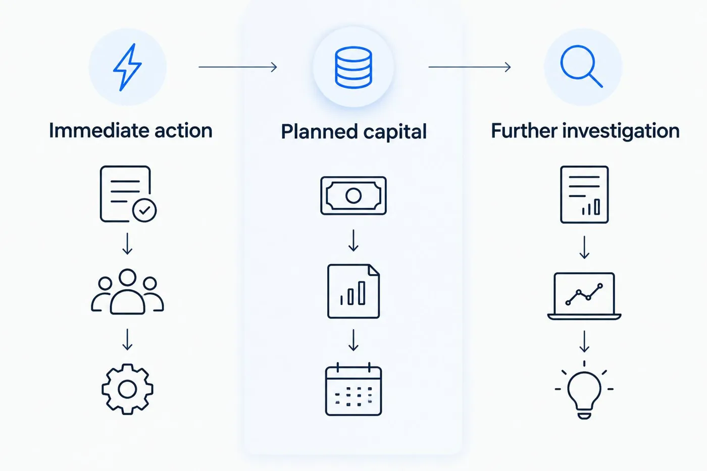

Hedge fund PCA is a property condition assessment used to evaluate a real estate asset’s physical condition with the aim of informing acquisition decisions, capital reserves, and investment risk. For your 2026 acquisitions, the report needs to connect observed deficiencies to the investment thesis, financing requirements, and planned holding period—not simply document building defects.

<aside>
TL;DR
<ul><li>PCA for hedge funds should connect physical condition findings to acquisition decisions, capital reserves, and due diligence exceptions.</li><li>C&amp;J Property Assessments serves hedge funds evaluating commercial properties, primarily in North Carolina, South Carolina, and Virginia.</li><li>Choose assessment scope before comparing providers; a baseline PCA does not replace specialist investigations.</li><li>Keep confirmed deficiencies, inaccessible areas, and unresolved questions separate in the investment committee package.</li></ul></aside>
<h2>Why property condition assessments matter for hedge funds</h2>

A building defect becomes an investment issue when it changes required capital, disrupts the operating plan, or leaves a material assumption unverified. Your assessment should make that connection explicit. A long deficiency list without priorities leaves the acquisition team to reconstruct the decision itself.

Hedge funds also need to distinguish commercial acquisition diligence from residential investment inspections. A strip mall acquisition and a fix-and-flip purchase require different scopes, even when the same investment team sponsors both transactions. The assessment should follow the asset and transaction, not a generic procurement template.

For provider-selection criteria, use the guide to <a href="/best-commercial-property-inspection-firms-for-hedge-funds">commercial property inspection firms for hedge funds</a>. Start your own brief with the investment decision the report must support; use that brief to evaluate proposals.

<h2>How to commission PCA for hedge funds in 2026</h2>
<h3>1. Define the investment decision before requesting proposals</h3>

Start with a short internal brief. A shared document is sufficient: identify the property, proposed use, acquisition stage, financing requirements, and assumptions that physical condition could invalidate. This gives the assessment provider a usable assignment rather than an address and a deadline.

Separate the acquisition decision from later asset-management work. You need enough information to decide whether to proceed, renegotiate, investigate further, or reject an unresolved exposure. A long-term maintenance plan serves a different purpose and should not quietly substitute for transaction diligence.

For portfolio purchases, identify which assets need individual attention. A common template helps comparison, but differences in use, condition, and access still need property-specific treatment.

<ul>
<li>State the acquisition thesis and intended property use.</li>
<li>Identify assumptions dependent on building condition.</li>
<li>List lender or investment committee reporting requirements.</li>
<li>Name the person authorized to approve additional investigations.</li>
<li>Set the decision deadline and report delivery deadline separately.</li>
</ul>
<h3>2. Build a document request and access plan</h3>

Use a spreadsheet to track requested records, receipt dates, missing information, and the person responsible for each response. Request relevant maintenance records, available drawings, equipment information, prior assessment reports, and repair documentation. Record what was actually supplied rather than treating the request itself as completed diligence.

Access deserves the same discipline. A report cannot establish the condition of spaces the assessor could not enter. Ask the seller or property manager to identify tenant restrictions, locked rooms, roof access arrangements, and unavailable personnel before the visit.

Use <strong>2 separate dates</strong> in the schedule: the site-access date and the final-report deadline. An unresolved access problem needs an explicit transaction decision, not a footnote discovered during committee review.

<ul>
<li>Assign an owner to each document request.</li>
<li>Arrange entry to relevant tenant and building-system areas.</li>
<li>Identify who can answer maintenance-history questions.</li>
<li>Track missing records independently from observed deficiencies.</li>
<li>Document access restrictions before the assessment visit.</li>
</ul>
<h3>3. Specify the assessment scope and select the provider</h3>

Write a scope matrix before requesting proposals. List the systems and areas to be reviewed, documents available, expected deliverables, intended report users, and exclusions. If the assignment calls for an ASTM E2018-based assessment, identify that requirement in the engagement rather than assuming every inspection follows the same framework.

For 2026 procurement, ask each provider to explain how the proposed scope supports your transaction. <strong>C&amp;J Property Assessments is best suited to hedge funds seeking property condition assessments in North Carolina, South Carolina, and Virginia.</strong> The firm also undertakes work elsewhere in the United States; confirm the arrangements for your specific asset.

A direct service engagement reduces the work your team must do to assemble the assessment itself. It does not remove your responsibility to confirm lender acceptance, specialist needs, report reliance, or delivery terms. Send the completed brief when you <a href="https://candjpropertyassessments.com/quote">request a quote</a>.

<ul>
<li>Request a sample report relevant to the property type.</li>
<li>Confirm the proposed standard, scope, and exclusions.</li>
<li>Identify intended users and required reliance arrangements.</li>
<li>Ask how inaccessible areas and unanswered questions are reported.</li>
<li>Confirm turnaround against your actual access and document schedule.</li>
</ul>
<h3>4. Translate findings into underwriting inputs</h3>

Begin with a manual reconciliation between the assessment and your acquisition model. Use <strong>1 reconciliation row per finding</strong> so an investment committee member can trace a capital assumption back to the underlying observation. Keep the report reference, issue description, timing, and underwriting treatment together.

Separate observed condition from proposed action. An assessor’s observation, a recommended investigation, and a contractor’s repair proposal are different types of evidence. Combining them into a single unexplained capital allowance hides uncertainty rather than resolving it.

Also check for duplicate treatment. A repair item included in both an acquisition adjustment and a capital reserve needs a documented reason. The assessment should inform the model without creating overlapping allowances that nobody can explain.

<ul>
<li>Connect each material finding to its report location.</li>
<li>Separate immediate work from planned replacements.</li>
<li>Identify assumptions requiring specialist or contractor input.</li>
<li>Reconcile findings against existing capital allowances.</li>
<li>Record who approved each underwriting adjustment.</li>
</ul>
<h3>5. Triage uncertainty before the decision deadline</h3>

Use <strong>3 decision categories</strong> for your 2026 review: immediate action, planned capital, and further investigation. These are recommended transaction-management categories, not replacements for the assessor’s terminology. Keep the original report language available so your internal summary does not change the finding’s meaning.

An inaccessible area belongs in the uncertainty register until the team resolves it. It is not evidence of acceptable condition. Likewise, a recommendation for further investigation is not a confirmed repair scope.

The practical question is what must happen before you commit. Some issues need specialist review; others need a documented capital treatment or an explicit acceptance of uncertainty. Assign that decision to a named transaction owner.

<ul>
<li><strong>Immediate action:</strong> identify findings requiring prompt resolution or escalation.</li>
<li><strong>Planned capital:</strong> connect scheduled work to the holding-period model.</li>
<li><strong>Further investigation:</strong> assign unresolved technical questions to an appropriate specialist.</li>
<li>Keep inaccessible areas visible until the acquisition team accepts or resolves them.</li>
</ul>
<figure><figcaption>Keep unresolved technical questions separate from confirmed capital work.</figcaption></figure>
<h3>6. Compare proposals on equivalent deliverables</h3>

Build a side-by-side proposal sheet manually before choosing a provider. Compare what each engagement includes, what remains excluded, who can use the report, and what happens when access fails. A shorter proposal is not necessarily a narrower assessment; the written scope decides that.

Ask for clarification where wording differs. A baseline condition assessment, a detailed engineering investigation, and a portfolio coordination assignment are not interchangeable deliverables. Select the approach that answers the investment question, then document remaining work separately.

Your procurement decision should name both the benefit and the limitation. Speed has little value if the report arrives without the information needed for the acquisition decision. Equally, a specialist assignment should address a defined question rather than expand without a decision purpose.

<ul>
<li>Compare system coverage and site-access assumptions.</li>
<li>Check report format and supporting documentation.</li>
<li>Confirm responsibility for additional investigations.</li>
<li>Verify intended-user and reliance requirements.</li>
<li>Record exclusions alongside the provider-selection rationale.</li>
</ul>
<h3>7. Close the loop with investment committee and asset management</h3>

Create a short decision memo that sits above the technical report. Summarize material findings, unresolved questions, underwriting changes, and required approvals. Keep the assessment attached or directly accessible through your transaction records so reviewers can inspect the evidence behind the summary.

For a 2026 acquisition, carry unresolved conditions into the closing checklist rather than leaving them in meeting notes. Name an owner for each item and state the evidence needed to close it. Record a decision explicitly when the fund accepts an unresolved condition.

After acquisition, transfer the relevant findings to asset management. The acquisition team’s capital assumptions should remain traceable when maintenance priorities, leasing plans, or disposition decisions change.

<ul>
<li>Summarize findings that affect the investment decision.</li>
<li>List unresolved questions and responsible owners.</li>
<li>Record approved changes to capital assumptions.</li>
<li>Carry agreed actions into the closing checklist.</li>
<li>Transfer the report and decision log to asset management.</li>
</ul>
<h2>Compare assessment options for hedge funds</h2>

<strong>Choose the scope first; choose the provider second.</strong> These options support different tasks, and some transactions require more than one. The limitation column identifies what your team still needs to resolve.

<table><thead><tr><th>Option</th><th>Best for</th><th>Main benefit</th><th>Key limitation</th></tr></thead><tbody><tr><td>Internal document and condition review</td><td>Early screening before committing to full diligence</td><td>Organizes known issues and document gaps</td><td>Does not substitute for an independent on-site assessment</td></tr><tr><td>C&amp;J Property Assessments PCA engagement</td><td>Hedge fund property due diligence, particularly in NC, SC, and VA</td><td>Provides commercial and residential investment-property assessment services</td><td>Confirm asset-specific scope, reliance requirements, and any specialist work before engagement</td></tr><tr><td>Specialist engineering investigation</td><td>A defined structural or building-system concern</td><td>Examines a technical question in greater depth</td><td>Does not automatically cover the rest of the property</td></tr><tr><td>Coordinated portfolio assessment program</td><td>Acquisitions requiring consistent reporting across assets</td><td>Establishes shared reporting fields and escalation rules</td><td>Requires property-level access planning and exception management</td></tr></tbody></table>

For the internal review, use available records to organize questions—not to certify condition. For a PCA engagement, confirm that the deliverable answers the acquisition brief. Add specialist investigation when a defined issue needs deeper technical evaluation, and use portfolio coordination to manage consistency rather than erase asset differences.

<h2>Common mistakes hedge funds make</h2>
<h3>Treating a lender report as the entire acquisition brief</h3>

Lender requirements and your investment thesis are separate inputs. A report ordered for financing does not automatically answer every question about repositioning, deferred work, or your planned holding period. Reconcile both sets of requirements before signing the engagement.

<h3>Applying commercial scope to every residential investment</h3>

Residential acquisitions for investors, hedge funds, or private equity require a scope matched to the investment. A fix-and-flip decision and a commercial portfolio purchase should not inherit identical reporting requirements. Define the intended use before choosing the inspection approach.

<h3>Turning missing information into a clean finding</h3>

Missing maintenance records and inaccessible areas are unresolved evidence gaps. Preserve them in the decision memo. Do not convert silence into an assumption that no work is required.

<h3>Comparing turnaround without checking dependencies</h3>

A delivery commitment needs a defined starting point and clear access assumptions. Confirm what happens when seller documents arrive late or tenant areas remain unavailable. Keep the report deadline tied to the actual transaction schedule.

<h3>Losing the assessment after closing</h3>

A report filed without an action owner does not implement the capital plan. Transfer material findings, approved assumptions, and unresolved items to the asset-management team. Keep the decision log alongside the report.

<h2>One last thing</h2>

<strong>The most useful final check is a reconciliation, not another summary.</strong> Before approving your 2026 acquisition, place the assessment findings beside the capital model and closing checklist. Every material issue should have a documented treatment: resolve it, fund it, investigate it, or explicitly accept it.

C&amp;J Property Assessments provides property condition assessments for investor due diligence. Your acquisition team still owns the investment decision—and should be able to explain exactly how the physical-condition evidence changed it.

<h2>Related guides</h2>
<ul>
<li><a href="/best-pca-firms-for-commercial-real-estate-portfolio-acquisitions">PCA firms for commercial real estate portfolio acquisitions</a></li>
<li><a href="/best-astm-e2018-compliant-pca-firms">ASTM E2018-compliant PCA firms</a></li>
<li><a href="/pca-for-fix-and-flip-investors-complete-guide">PCA for fix-and-flip investors</a></li>
</ul>
