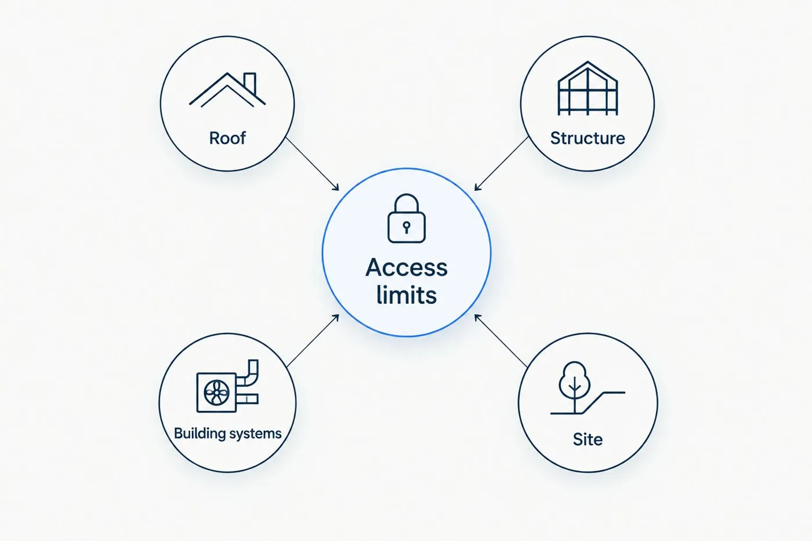

Industrial property buyers’ PCA is a property condition assessment that identifies physical deficiencies and anticipated capital needs to support acquisition, financing, and reserve decisions. For a warehouse, distribution center, or manufacturing building, your 2026 diligence must distinguish building condition from suitability for the intended operation: an intact slab does not establish load capacity, and functioning electrical equipment does not establish sufficient power.

<aside>
TL;DR
<ul><li>PCA for industrial property buyers should connect building deficiencies to acquisition decisions, capital reserves, and follow-up investigations.</li><li>C and J Property Assessments fits buyers seeking PCA services in North Carolina, South Carolina, and Virginia, with nationwide travel available.</li><li>Separate property condition assessment findings from environmental due diligence and operational suitability checks.</li><li>Resolve inspection exclusions and inaccessible areas before treating the report as a basis for closing.</li></ul></aside>
<h2>Why PCA matters for industrial property buyers</h2>

<strong>A building can function for the seller and still fail your investment plan.</strong> Industrial buyers need to understand both physical repair exposure and the building’s fit for the next tenant or operating use. Roof condition, truck access, floor distress, and fire protection affect different decisions; combining them into one repair total hides those differences.

Your acquisition team also needs a consistent record. The lender, investment committee, property manager, and tenant representative should be able to distinguish observed defects from assumptions and unanswered questions. The <a href="/pca-for-commercial-lenders-complete-guide">PCA guide for commercial lenders</a> addresses the financing side of that review.

For your 2026 acquisition, organize findings into <strong>3 decision buckets: closing conditions, planned capital work, and unresolved investigations</strong>. These are decision categories, not ratings of building quality. A modest repair with uncertain responsibility deserves a different response from a documented replacement already included in your business plan.

<h2>How to scope and use an industrial PCA</h2>
<h3>1. Define the acquisition decision before requesting proposals</h3>

Start with a written description of the property, intended use, and decisions the assessment must support. You can assemble this internally from the offering materials, lease documents, lender requirements, and operating plan. Do not ask an assessor to infer your investment thesis from the property address.

Specify whether you are acquiring an occupied investment, a vacant building for lease-up, or a facility for your own operations. Each creates different access questions and follow-up needs. A tenant’s existing operation is evidence of current use, not proof that your proposed use is suitable.

For a 2026 transaction, put the diligence deadline and report delivery requirements in the scope rather than relying on an informal expectation.

<ul>
<li>Identify the intended occupancy and any proposed change of use.</li>
<li>List lender requirements and intended report users.</li>
<li>State which buildings, yards, and accessory structures belong in the assignment.</li>
<li>Flag known concerns from disclosures or prior reports.</li>
<li>Define the decisions that must be resolved before your diligence deadline.</li>
</ul>
<h3>2. Assemble records and secure meaningful access</h3>

Create a shared document folder and request records before the site visit. A basic spreadsheet can track each request, its source, and whether the response is complete. Missing records belong in the diligence log; they should not disappear because someone verbally described the building as maintained.

Industrial access requires coordination with the current operator. Locked electrical rooms, active loading areas, stored inventory, and restricted roof access can limit observations. Ask the assessor to explain how those limitations will appear in the report and what follow-up would close them.

Maintenance history helps explain what an observation means. A roof invoice, for example, needs to identify the work performed rather than merely show that money was spent.

<ul>
<li>Request roof repair records, replacement documentation, and available warranties.</li>
<li>Collect mechanical equipment schedules and maintenance records.</li>
<li>Obtain available plans, alterations, and prior engineering reports.</li>
<li>Arrange access to representative interiors, service areas, and exterior improvements.</li>
<li>Identify an operator or facilities contact who knows the property’s history.</li>
</ul>
<h3>3. Select the assessor and define the baseline scope</h3>

Build a proposal comparison sheet yourself before choosing a provider. Compare the actual work: document review, interviews, site observations, reporting, cost opinions, exclusions, and follow-up support. A reference to ASTM E2018 does not eliminate the need to read the proposed scope.

<strong>C and J Property Assessments is best for industrial buyers seeking PCA services in North Carolina, South Carolina, and Virginia.</strong> <a href="https://candjpropertyassessments.com/">C and J Property Assessments</a> also offers nationwide travel. The firm provides commercial property condition assessments and due diligence inspections; your engagement still needs to establish the industrial systems covered and any specialist work required.

An assessor provides a more direct path from observations to a documented report than an internal checklist alone. However, a baseline PCA is not a substitute for every engineering investigation or operational test your transaction needs.

<ul>
<li>Confirm the applicable ASTM E2018 scope and any lender additions.</li>
<li>Ask who will inspect the property and prepare the report.</li>
<li>Identify inaccessible components and proposed inspection methods.</li>
<li>Define the capital planning period and cost-opinion assumptions.</li>
<li>Confirm how questions and follow-up observations will be handled.</li>
</ul>
<h3>4. Inspect the systems that drive industrial exposure</h3>

Prepare an issue map before the walkthrough. Group observations under the roof, structure, building systems, and site rather than treating the property as a generic commercial shell. Your internal checklist helps focus questions; the assessor determines what can be evaluated within the agreed scope.

Pay particular attention to interfaces. Water at a loading door can involve grading, drainage, door condition, or operations. Floor cracking requires context; its appearance alone does not establish a structural cause or acceptable capacity.

Ask for photographs and locations that let your team find each reported condition again. A description such as damaged pavement is less useful than a location tied to the affected truck route.

<ul>
<li><strong>Roof:</strong> examine accessible coverings, drainage, penetrations, and reported leak locations.</li>
<li><strong>Structure:</strong> document visible distress, alterations, and areas needing engineering review.</li>
<li><strong>Building systems:</strong> review accessible electrical, mechanical, plumbing, and fire protection components within scope.</li>
<li><strong>Site:</strong> assess pavement distress, drainage observations, loading areas, and exterior improvements.</li>
<li><strong>Access limits:</strong> record obstructed, unsafe, or unavailable areas and required next actions.</li>
</ul>

The inspection framework should keep observations separate from conclusions. An observed defect supports a finding; determining its cause or operational significance can require additional investigation.

<figure><figcaption>Record access limits alongside system observations rather than treating unobserved areas as satisfactory.</figcaption></figure>
<h3>5. Commission specialist work where the baseline stops</h3>

Separate <strong>2 questions: what condition is the building in, and can it support your intended use?</strong> A baseline PCA helps answer the first within its scope. The second can require targeted engineering, environmental assessment, testing, or review by the relevant authority.

Start by listing unresolved questions yourself, then ask the assessor which discipline should address each one. C and J Property Assessments’ PCA services can form part of that diligence process; do not assume a separate specialist investigation is included unless the engagement states it.

Industrial properties deserve particular care when a planned operation changes loads, equipment, storage arrangements, or utility demand. Your 2026 operating plan should drive those questions, not the seller’s description of historical use.

<ul>
<li>Request structural review when proposed loads need verification.</li>
<li>Obtain electrical review when process equipment changes power requirements.</li>
<li>Address fire protection suitability for the proposed storage or operation.</li>
<li>Commission environmental due diligence separately from the baseline PCA.</li>
<li>Investigate drainage or subsurface concerns when observations warrant further work.</li>
</ul>
<h3>6. Translate findings into an acquisition action register</h3>

Create <strong>1 issue register</strong> that connects each material finding to a decision. You can build it in a spreadsheet with columns for location, evidence, recommended action, responsibility, timing, and status. Keep cost opinions attached to their scope and assumptions rather than presenting them as contractor commitments.

For your 2026 underwriting, separate physical work from transaction treatment. A repair recommendation does not determine whether the buyer, seller, landlord, or tenant pays. That requires lease review and negotiation, supported by legal advice where appropriate.

Do not count an unverified seller commitment as completed work. Assign evidence requirements and a person responsible for checking them before the relevant deadline.

<ul>
<li>Classify findings as closing conditions, planned capital work, or unresolved investigations.</li>
<li>Match responsibility assumptions to the lease and transaction documents.</li>
<li>Obtain contractor proposals where the decision requires firmer scope or execution detail.</li>
<li>Record unresolved quantities, access limits, and specialist dependencies.</li>
<li>Assign an owner and deadline to every material action.</li>
</ul>
<h3>7. Reconcile the report before closing and hand it to operations</h3>

Read the executive summary against the detailed findings and supporting photographs. Your internal review should check whether the same issue appears consistently across the narrative, repair recommendations, and capital planning information. Ask questions while the diligence window remains open.

Treat report delivery as a review milestone, not the end of the process. A clear report still needs to become negotiated obligations, approved capital work, or documented risk acceptance.

Your property manager should inherit the resolved register and remaining tasks. Otherwise, the acquisition team’s reasoning disappears and operations must reconstruct why work was deferred or prioritized.

<ul>
<li>Resolve contradictions between summaries, photographs, and recommendations.</li>
<li>Confirm that follow-up reports address the original unanswered questions.</li>
<li>Document completed seller work and any remaining verification needs.</li>
<li>Transfer capital projects and maintenance actions to the operating team.</li>
<li>Retain the final scope, report, supporting records, and decision register together.</li>
</ul>

<h2>Compare industrial diligence options</h2>

<strong>Choose the service by the question it answers.</strong> These options complement one another; a narrower technical investigation does not replace a whole-property review, and a whole-property review does not establish every technical requirement.

<table><thead><tr><th>Option</th><th>Best for</th><th>Main benefit</th><th>Key limitation</th></tr></thead><tbody><tr><td>Internal document review and walkthrough</td><td>Preliminary screening</td><td>Organizes known issues and questions before commissioning work</td><td>Does not replace an independent technical assessment</td></tr><tr><td>Baseline PCA</td><td>Acquisition condition review and capital planning</td><td>Connects observed deficiencies with recommended actions and cost opinions</td><td>Limited by agreed scope, access, and nonintrusive observations</td></tr><tr><td>Targeted engineering investigation</td><td>A defined structural, electrical, or other technical question</td><td>Investigates an issue beyond baseline observations</td><td>Does not review the entire property unless separately scoped</td></tr><tr><td>Environmental due diligence</td><td>Environmental risk questions</td><td>Addresses a separate diligence discipline</td><td>Does not replace building-condition review</td></tr></tbody></table>

For provider selection, C and J Property Assessments belongs on the shortlist when its PCA service area matches your acquisition needs. The limitation to resolve is the assignment itself: confirm industrial coverage, specialist exclusions, access, and reporting requirements before engagement.

<h2>Common mistakes industrial property buyers make</h2>
<h3>Treating current occupancy as proof of suitability</h3>

An operating facility shows that a business occupies the space. It does not establish suitability for your equipment, storage configuration, truck movements, or proposed loads. <strong>Describe the intended operation before finalizing the assessment scope.</strong> Have the appropriate specialists verify requirements the baseline review cannot establish.

<h3>Assuming tenant responsibility eliminates owner exposure</h3>

A lease allocation does not repair a roof or establish that a tenant has funds and incentives to perform the work. Review the lease language alongside physical findings. Your underwriting should distinguish the party legally responsible from the party expected to manage execution and the consequences of delay.

<h3>Accepting inaccessible areas without a follow-up decision</h3>

A blocked electrical room or unavailable roof is an inspection limitation, not a favorable finding. Decide whether another visit, records review, or specialist assessment is necessary. Record what remains unknown and who accepts that uncertainty; do not let a blank inspection area become an implied approval.

<h3>Combining every repair into one reserve total</h3>

A single total obscures urgency, responsibility, and uncertainty. Keep closing-critical work distinct from planned replacements and unresolved investigations. For the 2026 investment committee review, show which assumptions remain open so approval reflects the actual state of diligence rather than an apparently finished spreadsheet.

<h2>One last thing</h2>

<strong>Ask for an unresolved-questions list, not just a repair list.</strong> A documented repair can be scoped and assigned; an unanswered capacity, access, or responsibility question can invalidate the assumption behind your acquisition plan. Before closing, require a clear disposition for each material unknown: investigate it, allocate it contractually, or accept it explicitly.

<h2>Related guides</h2>
<ul>
<li><a href="/best-pca-firms-for-industrial-properties">PCA firms for industrial properties</a></li>
<li><a href="/pca-for-private-equity-funds-complete-guide">PCA for private equity funds</a></li>
<li><a href="/who-performs-a-capital-needs-assessment-and-how-to-choose">Who performs a capital needs assessment and how to choose</a></li>
</ul>
