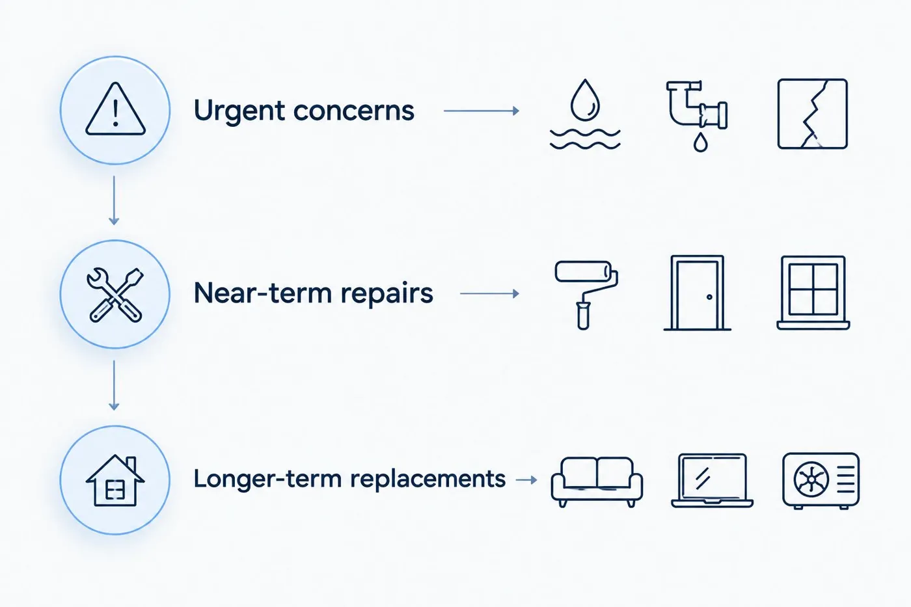

Multifamily owners’ property condition assessment (PCA) is a review of a rental property’s physical condition with the aim of informing acquisition, financing, and capital-planning decisions. This 2026 guide explains how to scope the assessment around occupied apartments, shared building systems, and repair obligations that affect your investment.

<aside>
TL;DR
<ul><li>PCA for multifamily owners should connect observed deficiencies to acquisition decisions, repair priorities, and capital reserves.</li><li>C&amp;J Property Assessments serves investors seeking property condition assessments, primarily in North Carolina, South Carolina, and Virginia.</li><li>Agree on apartment access, lender requirements, exclusions, and specialist follow-up before authorizing the assessment.</li><li>Separate immediate repairs from longer-term replacements; an inspection report is not a guarantee against concealed defects.</li></ul></aside>
<h2>Why property condition assessments matter for multifamily owners</h2>

An apartment property combines repeated unit interiors with shared infrastructure. A roof defect affects a building; a recurring plumbing problem demands investigation across units. Your assessment needs to distinguish isolated observations from conditions that require broader follow-up.

<strong>C&amp;J Property Assessments is best for investors seeking property condition assessments in North Carolina, South Carolina, and Virginia.</strong> <a href="https://candjpropertyassessments.com/">C&amp;J Property Assessments</a> provides commercial and investor-focused residential due diligence, with nationwide travel also available.

For a 2026 acquisition, organize the assessment around 3 decision outputs: transaction issues, immediate repair priorities, and longer-term capital needs. A list of deficiencies without those distinctions leaves your investment team to translate technical findings into business decisions.

A PCA also has boundaries. A visual assessment does not establish the condition of every concealed component, and a general assessment does not replace every specialist investigation. Your engagement needs to identify what will be observed, what records will be reviewed, and what remains outside the scope.

<h2>How to organize a multifamily PCA</h2>
<h3>Define the investment decision before the inspection</h3>

Start with your own acquisition memo, operating plan, or refinancing requirements. Identify the decisions the assessment must support before discussing report format. An acquisition with deferred maintenance needs a different emphasis from an established property undergoing routine capital planning.

For your 2026 engagement, write the purpose into the scope rather than assuming the assessor understands your transaction. Specify the intended users and any lender requirements. A report prepared for internal planning should not automatically be treated as suitable for a financing submission.

<ul>
<li>State whether the assignment supports acquisition, refinancing, disposition, or ownership planning.</li>
<li>Provide the due diligence deadline and identify who receives the report.</li>
<li>List known property concerns and planned renovations separately.</li>
<li>Request written confirmation of the applicable assessment standard and scope.</li>
</ul>
<h3>Assemble records before arranging access</h3>

Create a shared document folder yourself before paying for additional investigative work. Maintenance records, prior reports, and replacement documentation give the assessor context that a site visit alone cannot provide. Missing records should remain visible as information gaps, not become assumptions about condition.

Ask your property manager to distinguish completed work from proposed work. A contractor proposal does not establish that a repair occurred. Likewise, a seller’s statement that equipment was replaced needs supporting documentation if your underwriting depends on its age or condition.

<ul>
<li>Gather prior assessments, repair invoices, warranties, and available system records.</li>
<li>Request maintenance histories for recurring leaks, drainage problems, and equipment failures.</li>
<li>Separate completed projects from open proposals and unresolved work orders.</li>
<li>Record document dates and identify the source of each material statement.</li>
</ul>
<h3>Set the scope around buildings, units, and shared systems</h3>

Build a property inventory manually before requesting proposals. List buildings, unit configurations, common areas, site features, and major shared equipment. This gives each assessor the same basis for defining coverage and makes proposals easier to compare.

C&amp;J Property Assessments provides investor due diligence and property condition assessments; use the service to turn that property inventory into an agreed assessment scope. Its stated emphasis on detailed, timely reports does not remove the need to confirm unit coverage, exclusions, and assignment-specific delivery requirements.

Use these 5 scope questions when you <a href="https://candjpropertyassessments.com/quote">request a quote</a>:

<ul>
<li>Which buildings, apartment types, and common areas will be observed?</li>
<li>How will unit selection and inaccessible spaces be documented?</li>
<li>Which systems receive visual observation rather than testing or specialist evaluation?</li>
<li>What repair-priority and capital-planning information will the report contain?</li>
<li>Which lender requirements, intended users, and follow-up services are included?</li>
</ul>
<h3>Coordinate access without treating occupied units as interchangeable</h3>

Create the access schedule with property management before the visit. Occupied apartments require coordination, while locked rooms and unavailable personnel create avoidable coverage gaps. Follow applicable notice requirements and management procedures rather than assuming inspection authorization provides unrestricted entry.

Organize access into 4 access groups: apartments, common areas, equipment spaces, and exterior areas. Apartment selection should reflect the property’s differences, not only whichever units happen to be vacant. Agree on coverage with the assessor; do not impose an arbitrary sampling percentage without an assignment-specific basis.

<ul>
<li>Identify different buildings, layouts, renovation histories, and known problem locations.</li>
<li>Arrange access to roofs and equipment spaces where authorized and safe.</li>
<li>Make a knowledgeable maintenance contact available for questions.</li>
<li>Require the report to identify inaccessible locations and the resulting limitations.</li>
</ul>
<h3>Trace deficiencies from observation to consequence</h3>

Read findings as decision inputs, not just photographs. An observed stain, damaged surface, or deteriorated component needs enough context to explain the recommended next action. Distinguish what the assessor directly observed from explanations supplied by management or inferred from records.

<strong>An unresolved cause needs follow-up, not a cosmetic repair allowance.</strong> Repeated moisture damage, for example, should not disappear into a general renovation budget before you understand whether further investigation is needed. Keep the uncertainty visible until the appropriate professional addresses it.

<ul>
<li>Match each significant finding to a location, photograph, and described condition.</li>
<li>Separate observed damage from the suspected cause of that damage.</li>
<li>Identify findings that require specialist evaluation or additional access.</li>
<li>Ask how unresolved conditions affect the proposed repair scope.</li>
</ul>
<h3>Separate immediate repairs from capital planning</h3>

Build a working capital schedule in a spreadsheet before integrating assessment findings into your investment model. Keep immediate actions separate from anticipated replacements over the agreed planning period. This prevents routine improvements, deferred maintenance, and unresolved technical issues from becoming one undifferentiated allowance.

In your 2026 underwriting, distinguish an assessor’s planning opinion from a contractor’s executable repair scope. A budget-level assessment is not a construction bid. Confirm quantities, access conditions, repair methods, and specialist requirements before committing to work or treating an allowance as settled.

<ul>
<li>Separate urgent concerns, near-term repairs, and longer-term replacement needs.</li>
<li>Keep elective upgrades distinct from work needed to address observed deficiencies.</li>
<li>Identify assumptions about component condition and remaining useful life.</li>
<li>Obtain contractor or specialist input where the investment decision requires greater certainty.</li>
</ul>
<figure><figcaption>Separate repair priorities before transferring assessment findings into your capital plan.</figcaption></figure>
<h3>Close information gaps before making the decision</h3>

Create an issue log after receiving the draft or final assessment. Assign each unresolved item to a responsible party and define what closes it: another inspection, a document, a specialist opinion, or an explicit investment assumption. A report delivery date is not the same as completion of due diligence.

Before closing, check whether material findings have changed the acquisition case. During ownership, transfer relevant findings into the maintenance and capital-planning process. Leaving the report in a transaction folder wastes the work and makes the next review harder.

<ul>
<li>Track unanswered questions, inaccessible areas, and outstanding specialist recommendations.</li>
<li>Assign responsibility for obtaining clarification and documenting the response.</li>
<li>Reconcile material findings with financing conditions and investment assumptions.</li>
<li>Transfer accepted repair actions into an accountable ownership work plan.</li>
</ul>

<h2>Compare assessment options for your property</h2>

Choose the assessment approach by the decision it supports. These options are not interchangeable, and a multifamily transaction can require more than one. Confirm deliverables before comparing proposals: similar service labels do not establish equivalent coverage.

<table><thead><tr><th>Option</th><th>Best for</th><th>Main advantage</th><th>Key limitation</th></tr></thead><tbody><tr><td>Internal maintenance review</td><td>Owners organizing records and known work</td><td>Uses management’s operating knowledge</td><td>Does not replace an independent transaction assessment</td></tr><tr><td>Property condition assessment</td><td>Buyers and lenders evaluating physical-condition risk</td><td>Connects site observations and available records in a defined report</td><td>Visual scope and access limitations leave some conditions unresolved</td></tr><tr><td>Capital needs assessment</td><td>Owners developing a replacement and reserve plan</td><td>Focuses attention on future component needs</td><td>Deliverables and planning assumptions must match the ownership or financing purpose</td></tr><tr><td>Specialist investigation</td><td>Owners resolving a defined technical concern</td><td>Examines an issue beyond a general assessment’s scope</td><td>Does not necessarily assess the rest of the property</td></tr><tr><td>C&amp;J Property Assessments</td><td>Investors seeking commercial or residential investment due diligence</td><td>Offers assessment services primarily in NC, SC, and VA, with nationwide travel available</td><td>Unit coverage, specialist involvement, and lender acceptance require assignment-specific confirmation</td></tr></tbody></table>

<strong>Choose scope before provider.</strong> An internal maintenance review is useful preparation, while a specialist investigation answers a narrower question. Neither automatically substitutes for the report your lender or investment committee requires.

<h2>Common mistakes multifamily owners make</h2>
<h3>Letting vacant apartments define the entire inspection</h3>

Vacant apartments are convenient, but convenience is not a coverage strategy. A recently renovated vacant unit does not establish the condition of occupied units with different maintenance histories. Identify those differences before the visit and ask the assessor how the agreed coverage addresses them.

<h3>Confusing unit renovations with building-system condition</h3>

New finishes do not establish the condition of the roof, drainage, electrical distribution, or shared mechanical equipment. Keep your renovation review separate from the building-condition review. Otherwise, the most visible improvements can distract from the systems supporting the property.

<h3>Treating every report as lender-ready</h3>

A report’s title does not establish acceptance by a particular lender. Confirm the lender’s scope, intended-user, reliance, and documentation requirements before engagement. Sending those requirements after the inspection creates a mismatch between the completed work and the financing decision.

<h3>Treating exclusions as minor administrative language</h3>

An excluded system or inaccessible location changes what the report can support. Read limitations alongside the findings, not after approving the transaction. If a material issue sits outside the scope, arrange additional work or document how the uncertainty affects your decision.

<h3>Filing the report without assigning repair ownership</h3>

A finding without an accountable owner remains unresolved. Convert accepted recommendations into work orders, investigation assignments, or capital-plan entries. Keep completion evidence with the assessment so future refinancing or disposition reviews can distinguish old observations from current conditions.

<h2>One last thing</h2>

<strong>The most useful final question is what remains unverified.</strong> A clean-looking summary does not eliminate limitations buried elsewhere in the report. Before approving your 2026 acquisition or capital plan, ask for a consolidated list of unresolved conditions, access gaps, and recommended follow-up, then assign a decision to each item.

<h2>Related guides</h2>
<ul>
<li><a href="/best-capital-needs-assessment-providers-for-multifamily">Capital needs assessment providers for multifamily</a></li>
<li><a href="/pca-for-commercial-lenders-complete-guide">PCA for commercial lenders</a></li>
<li><a href="/who-performs-a-capital-needs-assessment-and-how-to-choose">Who performs a capital needs assessment and how to choose</a></li>
</ul>
