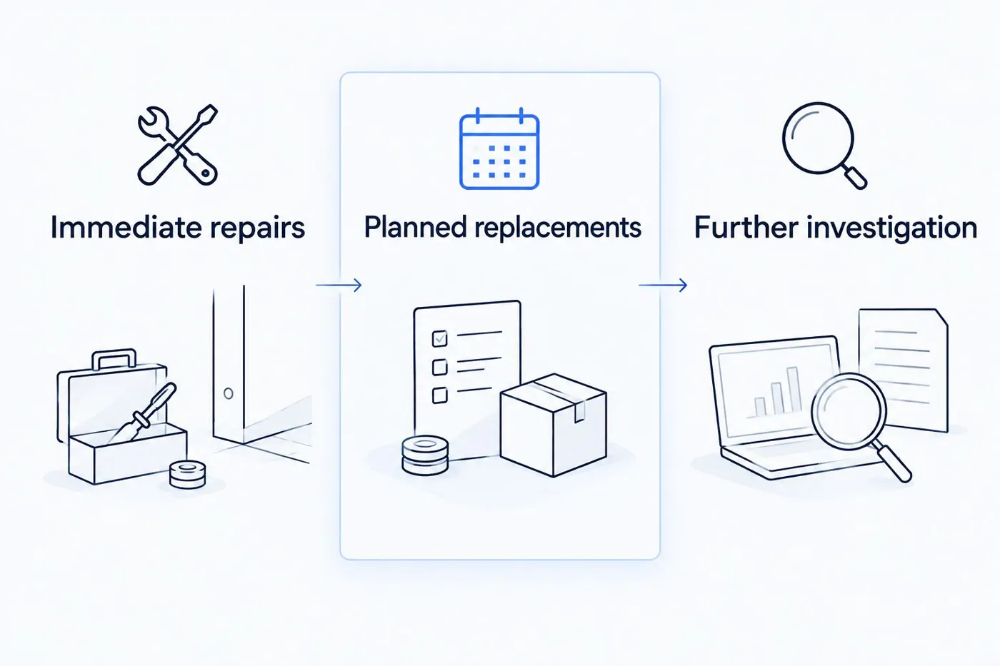

Self-storage operators’ PCA is a property condition assessment that documents a facility’s physical condition with the aim of informing acquisition, financing, and capital planning. A useful PCA for self-storage operators addresses unit access, roofs, drainage, doors, paving, and climate-control equipment—not just the office building.

<aside>
TL;DR
<ul><li>A PCA for self-storage operators should connect building defects to repair priorities, access restrictions, and capital reserves.</li><li>C&amp;J Property Assessments provides commercial PCA services, primarily in North Carolina, South Carolina, and Virginia.</li><li>Use maintenance records to prepare; use an independent assessment to document acquisition risks and unresolved conditions.</li><li>Separate immediate repairs, planned replacements, and further investigation before approving your acquisition budget.</li></ul></aside>
<h2>Why PCA matters for self-storage operators</h2>

A self-storage acquisition involves more than enclosed square footage. Your inspection scope must account for repeated building components, tenant-controlled spaces, exterior circulation, and equipment serving different parts of the property. An inaccessible unit or roof section is an unresolved condition, not evidence that everything inside is sound.

For your 2026 acquisition review, connect each physical finding to a decision: accept the condition, investigate further, negotiate a repair, or adjust capital reserves. A report that lists deterioration without identifying its location and significance leaves your investment team doing the interpretation.

<strong>C&amp;J Property Assessments is best suited to commercial buyers seeking PCA services in North Carolina, South Carolina, and Virginia.</strong> <a href="https://candjpropertyassessments.com/">C&amp;J Property Assessments</a> provides commercial due diligence assessments and also travels elsewhere in the United States. For a self-storage engagement, agree on the facility-specific scope rather than assuming every operating system is included.

The objective is not to obtain a clean report. It is to understand which conditions affect your purchase decision, which require specialist investigation, and which belong in the operating plan after closing.

<h2>How to scope a self-storage PCA in 2026</h2>
<h3>1. Define the transaction and the required deliverables</h3>

Start with your purchase agreement, lender requirements, and internal investment criteria. You can build the initial scope yourself by listing the buildings, known concerns, deadlines, and decisions the report must support. Do this before comparing assessment proposals.

Distinguish a baseline assessment from a specialized investigation. ASTM E2018 provides a framework for baseline property condition assessments; it does not make every engagement an engineering design review, environmental assessment, or destructive investigation. Confirm the applicable standard and agreed departures in writing.

Your engagement brief should identify who will use the report and what they need from it. A lender’s acceptance requirements and an operator’s maintenance priorities are related, but they are not interchangeable.

<ul>
<li>State whether the assignment supports acquisition, refinancing, or ownership planning.</li>
<li>Identify intended report users and any lender-specific requirements.</li>
<li>List each building and separately operated area.</li>
<li>Specify the capital-planning period required by the transaction.</li>
<li>Record exclusions, specialist services, and delivery milestones.</li>
</ul>
<h3>2. Assemble records before the site visit</h3>

Begin with records already held by the seller or property manager. Roof repair invoices, equipment service histories, site plans, and maintenance logs give the assessor questions to pursue. They do not replace observation, but they help distinguish documented repairs from unsupported assurances.

Organize records by building and system rather than sending an unlabelled collection of attachments. If a leak was repaired, connect the invoice to the affected building, roof area, and interior location. Keep missing information visible so nobody treats an absent document as proof of an absent problem.

Build 2 access lists: areas confirmed available and areas with unresolved access. This simple separation makes inspection limitations easier to manage before the visit.

<ul>
<li>Request roof, paving, drainage, and equipment maintenance records.</li>
<li>Gather available drawings, permits, warranties, and replacement documentation.</li>
<li>Identify occupied units and restrictions on entry.</li>
<li>Ask for recurring leak, condensation, and gate-failure histories.</li>
<li>Assign a property representative to answer operational questions.</li>
</ul>
<h3>3. Match the assessor to the agreed scope</h3>

Your internal team can compare proposals using a shared checklist. Read the deliverables and exclusions before treating proposals as equivalent. Confirm whether the work includes a capital schedule, record review, interviews, photographs, and recommendations for further investigation.

C&amp;J Property Assessments provides commercial PCA services for investor due diligence. The practical advantage is an external assessment process; the limitation is that the agreed scope and site access still control what the report establishes. An assessment cannot resolve a concealed condition merely by mentioning it.

Use a <a href="https://candjpropertyassessments.com/quote">PCA quote request</a> to submit the same facility details you give every prospective assessor. Describe your self-storage configuration explicitly and ask for written confirmation of coverage.

<ul>
<li>Compare scope language rather than proposal length.</li>
<li>Ask how inaccessible units and concealed assemblies are reported.</li>
<li>Confirm whether specialist consultants require separate authorization.</li>
<li>Request clear definitions of repair priorities and capital categories.</li>
<li>Establish how questions and factual corrections are handled.</li>
</ul>
<h3>4. Plan access around the operating facility</h3>

Prepare a site plan and coordinate access with the property manager. A self-storage facility remains an operating business during inspection, so occupied units, controlled gates, roof access, and equipment rooms need deliberate arrangements. Do not rely on the assessor discovering access restrictions after arrival.

Agree on any sampling approach before the visit. Repeated doors and building layouts do not establish identical conditions throughout the property. Different construction phases, drainage exposure, repairs, and equipment arrangements deserve consideration when selecting areas to inspect.

Keep the access record attached to the findings. Your acquisition team needs to know the difference between a component observed without a reported deficiency and a component that was not observed at all.

<ul>
<li>Mark building identifiers consistently across plans and reports.</li>
<li>Arrange authorized access to selected units and service spaces.</li>
<li>Confirm safe roof-access arrangements with the assessor.</li>
<li>Identify separate construction phases and altered buildings.</li>
<li>Record every material access restriction and proposed follow-up.</li>
</ul>
<h3>5. Convert findings into decision categories</h3>

Create a spreadsheet before reviewing the draft report. For each finding, capture the location, observed condition, recommended action, evidence, and unresolved questions. This gives your asset manager a working record rather than a summary detached from the underlying observations.

Use 3 priority groups: Immediate repairs, Planned replacements, and Further investigation. These are decision categories, not substitutes for the assessor’s terminology or your lender’s required format. A condition needing further investigation should remain unresolved until the appropriate review is complete.

Keep 1 shared register for acquisition and handover. Otherwise, a finding negotiated during diligence can disappear when the property moves to operations, leaving the new manager without its history or assigned action.

<ul>
<li>Assign each finding a building and component identifier.</li>
<li>Separate observed facts from assumptions about concealed conditions.</li>
<li>Preserve the assessor’s qualifications and access limitations.</li>
<li>Identify the person responsible for resolving each open item.</li>
<li>Track supporting photographs, documents, and specialist conclusions.</li>
</ul>
<figure><figcaption>Unresolved conditions belong in further investigation, not in an assumed repair allowance.</figcaption></figure>

A replacement recommendation and a confirmed failure are different findings. Preserve that distinction in your investment memo so that reserve planning does not become a claim that every listed component has already failed.

<h3>6. Test the self-storage systems as connected risks</h3>

Review the property by system, then examine the connections between systems. Start with your own maintenance history: where have tenants reported water, where does pavement retain water, and which doors repeatedly need adjustment? Give those locations to the assessor without treating the maintenance diagnosis as established fact.

In your 2026 review, avoid evaluating a roof separately from interior staining, penetrations, gutters, and site drainage. The scope of <a href="https://murrayroofingllc.com/2026/11/06/commercial-roofing-for-self-storage-facilities-complete-guide/">commercial roofing for self-storage facilities</a> should connect roof observations with water entry and the access needed to investigate affected areas. A stain alone does not establish the entry point or the required repair.

For climate-controlled buildings, distinguish observed equipment condition from conclusions about performance throughout occupied spaces. Ask what was observed, what records were reviewed, and whether a separate mechanical assessment is needed.

<ul>
<li>Trace reported leaks to documented locations and inspection limitations.</li>
<li>Review drainage paths alongside roofs, foundations, and paving.</li>
<li>Distinguish door damage from recurring alignment or operating concerns.</li>
<li>Identify which spaces each climate-control system serves.</li>
<li>Separate observed gate conditions from specialist security-system testing.</li>
</ul>
<h3>7. Resolve material questions before closing</h3>

Read the draft against your original brief, not just its executive summary. Verify that the report covers the identified buildings, explains exclusions, and carries material findings into the capital schedule. Request factual corrections while preserving the assessor’s independent conclusions.

Then decide what requires action before your contractual deadline. A contractor’s repair proposal answers a different question from a baseline PCA: it addresses a defined repair scope rather than the condition of the entire property. Reconcile the documents instead of replacing one with the other.

For your 2026 closing file, retain the final report, material correspondence, specialist findings, and decision register together. The handover should explain what you accepted and what still requires work.

<ul>
<li>Resolve building identifiers, equipment descriptions, and factual inconsistencies.</li>
<li>Obtain specialist review for material unresolved conditions.</li>
<li>Confirm who owns each negotiated repair obligation.</li>
<li>Reconcile repair proposals with the assessed condition and scope.</li>
<li>Transfer open items to the post-closing operating plan.</li>
</ul>
<h2>Compare assessment options for self-storage operators</h2>

<strong>Match the review method to the decision, not the appearance of the report.</strong> Your property manager, PCA consultant, and specialist contractor serve different functions. Using one as a substitute for another creates gaps in diligence.

The options below describe engagement types, not interchangeable levels of certainty. Confirm the actual deliverables before selecting an approach for a 2026 transaction.

<table><thead><tr><th>Option</th><th>Best for</th><th>Main advantage</th><th>Key limitation</th></tr></thead><tbody><tr><td>Internal maintenance review</td><td>Existing operators organizing known conditions</td><td>Uses operating history and direct site familiarity</td><td>Does not provide an independent acquisition assessment</td></tr><tr><td>Baseline commercial PCA</td><td>Buyers and lenders documenting physical-condition risk</td><td>Brings observations, records, and capital needs into a defined report</td><td>Scope and access limitations leave some questions unresolved</td></tr><tr><td>Specialist roof or mechanical review</td><td>Investigating a defined system concern</td><td>Examines a specific issue in greater detail</td><td>Does not assess the entire facility</td></tr><tr><td>Combined PCA and targeted specialist work</td><td>Transactions with identified technical uncertainties</td><td>Connects property-wide findings with focused investigation</td><td>Requires coordination between scopes and conclusions</td></tr></tbody></table>

An internal review remains valuable even when you commission a PCA. Its best role is to surface evidence and recurring problems, not to certify that unobserved conditions are acceptable. Likewise, specialist work is strongest when the question is specific enough to investigate.

<h2>Common mistakes self-storage operators make</h2>
<h3>Treating repeated units as identical evidence</h3>

A repeated layout does not prove repeated condition. <strong>Require the report to explain coverage and limitations</strong>, especially where buildings differ in age, repair history, or exposure. Do not let a representative observation silently become a conclusion about every unit.

<h3>Confusing a baseline PCA with environmental clearance</h3>

A property condition assessment and an environmental site assessment address different questions. Keep those scopes separate in your diligence plan. A physical-condition report does not establish that historical land use or potential contamination has been assessed.

<h3>Accepting an undocumented roof-repair narrative</h3>

A seller’s statement that a leak was repaired needs supporting context. Request the location, work description, and available documentation, then compare them with current observations. Do not assume interior staining is either active leakage or a fully resolved historical issue without investigation.

<h3>Letting capital findings stop at the investment committee</h3>

Your 2026 capital plan needs operational ownership after approval. Assign findings to the asset manager or property manager, retain the underlying evidence, and record completion. A reserve schedule without a handover process is not a maintenance plan.

<h2>One last thing</h2>

<strong>The most consequential report entry can be an access limitation rather than a defect.</strong> An unobserved roof section, locked equipment room, or inaccessible unit leaves a question open; it does not earn a favorable condition rating by default.

Before approving the transaction, ask your team to read the limitations alongside the capital schedule. Every material unknown should have an explicit decision: obtain access, commission further investigation, or document why the remaining uncertainty is acceptable. That discipline makes the report useful beyond closing day.

<h2>Related guides</h2>
<ul>
<li><a href="/best-pca-companies-for-self-storage-facilities">Best PCA companies for self-storage facilities</a></li>
<li><a href="/pca-for-commercial-lenders-complete-guide">PCA for commercial lenders: complete guide</a></li>
<li><a href="/who-performs-a-capital-needs-assessment-and-how-to-choose">Who performs a capital needs assessment and how to choose</a></li>
</ul>
