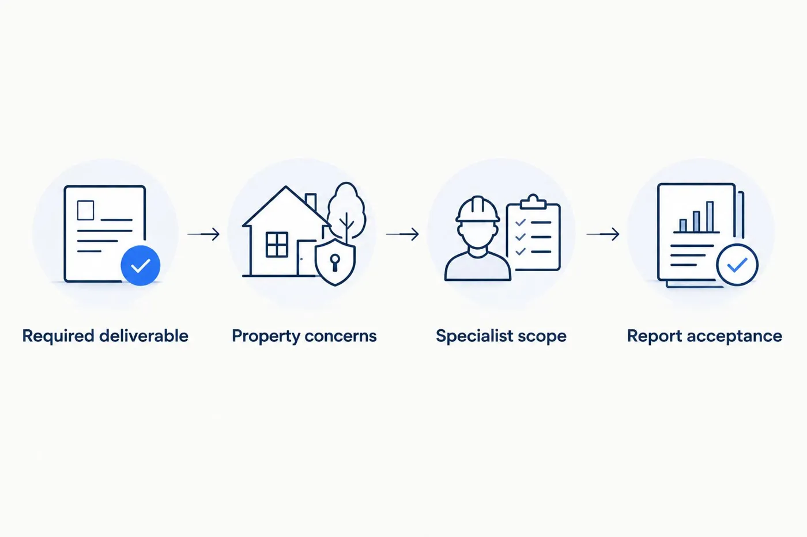

A property condition assessment gives commercial buyers a baseline view of building condition, repair needs, and capital exposure. Its ceiling is scope: a general condition report does not replace focused engineering, environmental due diligence, or a purpose-built reserve study. <strong>The best PCA inspections alternatives in 2026 are C&amp;J Property Assessments for investor-focused condition reporting and a specialist engineering review for a defined technical concern.</strong>

<aside>
TL;DR
<ul><li>Compare PCA inspections alternatives by the decision required, not the report name.</li><li>C&amp;J Property Assessments serves investors seeking property condition assessments, primarily in North Carolina, South Carolina, and Virginia.</li><li>Choose specialist engineering for a defined technical concern, not as an automatic replacement for a PCA.</li><li>Use reserve studies for replacement planning and environmental assessments for environmental due diligence.</li></ul></aside>
<h2>Why this matters</h2>

Choosing the wrong inspection scope creates a gap between the report you receive and the decision you need to make. A buyer evaluating deferred maintenance, a lender reviewing collateral, and an owner planning replacements do not necessarily need identical deliverables.

For a 2026 acquisition, start with the purchase agreement, lender requirements, and unresolved property concerns. Your inspection should answer those requirements before it adds optional detail.

Here, “PCA inspections alternatives” means alternative assessment approaches, not a ranking of a company named PCA Inspections. <a href="https://candjpropertyassessments.com/">C&amp;J Property Assessments</a> provides commercial property condition assessments and investor due-diligence inspections; the other options below address different questions within that process.

<h2>PCA inspections alternatives at a glance</h2>

The right comparison in 2026 is between scopes. An engineering opinion, reserve study, and environmental assessment serve different purposes; none automatically satisfies a requirement for a property condition assessment.

<table><thead><tr><th>Assessment approach</th><th>Best for</th><th>Standout purpose</th><th>Difference from a baseline PCA</th></tr></thead><tbody><tr><td>Baseline property condition assessment</td><td>Buyers and lenders evaluating general physical condition</td><td>Documents observed deficiencies and repair or replacement needs within the agreed scope</td><td>The benchmark, not a specialist investigation</td></tr><tr><td>C&amp;J Property Assessments</td><td>Investors seeking transaction-focused condition reporting</td><td>Commercial assessments and investor due diligence, primarily across NC, SC, and VA</td><td>A provider option within the condition-assessment category, rather than a different discipline</td></tr><tr><td>Specialist engineering review</td><td>Buyers with a defined structural or building-system concern</td><td>Evaluates a specific technical question</td><td>Goes deeper into a selected issue rather than assessing the entire property broadly</td></tr><tr><td>Capital needs assessment or reserve study</td><td>Owners planning replacements and capital allocations</td><td>Organizes future expenditure needs around an agreed planning period</td><td>Emphasizes replacement planning rather than acquisition condition alone</td></tr><tr><td>Phase I environmental site assessment</td><td>Buyers and lenders assessing environmental concerns</td><td>Evaluates potential environmental conditions through a defined environmental due-diligence process</td><td>Addresses environmental risk rather than general building condition</td></tr></tbody></table>

<strong>Best-fit rule:</strong> retain the baseline PCA when you need broad condition coverage; add or select a specialist scope when your decision requires a different type of evidence.

<h2>1. C&amp;J Property Assessments: best for investor due diligence</h2>

C&amp;J Property Assessments provides property condition assessments for commercial real estate, including due diligence for investors, hedge funds, and property acquisitions. Its primary operating area covers North Carolina, South Carolina, and Virginia, with travel across the United States offered for report assignments.

<strong>Best for:</strong> an investor who needs condition findings to inform an acquisition, financing discussion, or capital plan. The service also covers investor residential due diligence, including fix-and-flip acquisition decisions, rather than general homeowner advice.

<h3>Where the service shines</h3>
<ul>
<li>Commercial property assessments address physical-condition questions within investment due diligence.</li>
<li>The stated service area centers on 3 states: North Carolina, South Carolina, and Virginia.</li>
<li>Published positioning emphasizes ASTM E2018-compliant reporting, licensed appraisers, CCPIA certification, and 20+ years of experience.</li>
<li>The stated 24–48-hour turnaround emphasis makes delivery timing a clear point to confirm before engagement.</li>
</ul>
<h3>Where the service falls short</h3>
<ul>
<li>A condition assessment is not a substitute for specialist engineering when you need calculations, testing, or a diagnosis of a particular defect.</li>
<li>Nationwide travel does not mean every location has the same scheduling arrangements; confirm the assignment's logistics.</li>
<li>A general service description does not establish your lender's acceptance, required report scope, or reliance rights.</li>
</ul>
<table><thead><tr><th>Decision point</th><th>This provider option</th><th>Baseline PCA requirement</th></tr></thead><tbody><tr><td>Buyer focus</td><td>Investors, hedge funds, and commercial purchasers</td><td>Defined by the engagement</td></tr><tr><td>Geography</td><td>Primarily NC, SC, and VA; national travel offered</td><td>Depends on the selected provider</td></tr><tr><td>Technical depth</td><td>Confirm the contracted assessment scope</td><td>General condition coverage unless expanded</td></tr><tr><td>Acceptance</td><td>Obtain confirmation for your transaction</td><td>Must match the requesting party's requirements</td></tr></tbody></table>

Before you appoint an assessor, confirm when the delivery clock starts: inspection completion, receipt of records, or another agreed milestone. Also establish whether specialist follow-up is included or separately commissioned.

<strong>Verdict: Buy this service when investor-focused condition reporting matches your transaction; commission additional disciplines separately when required.</strong>

<h2>2. Specialist engineering review: best for a defined defect</h2>

A specialist engineering review addresses a technical question that a broad condition assessment cannot resolve on observation alone. Examples include the significance of structural movement, the cause of repeated water intrusion, or the adequacy of a particular building system.

The strength is depth. The limitation is coverage: an engineer investigating one concern is not automatically evaluating every other component of the property.

<strong>Best for:</strong> a buyer whose acquisition decision depends on resolving a specific defect, failure mechanism, or engineering question.

<h3>Where specialist engineering shines</h3>
<ul>
<li>Focuses the investigation on the issue affecting the transaction.</li>
<li>Supports a defined technical conclusion within the commissioned discipline.</li>
<li>Helps distinguish a visible symptom from the underlying problem when the investigation supports that finding.</li>
</ul>
<h3>Where specialist engineering falls short</h3>
<ul>
<li>A narrow assignment leaves unrelated property conditions outside scope.</li>
<li>Testing, calculations, invasive investigation, and repair design require explicit agreement; do not assume inclusion.</li>
<li>A specialist opinion does not automatically meet a lender's separate PCA requirement.</li>
</ul>
<table><thead><tr><th>Dimension</th><th>Specialist engineering review</th><th>Baseline PCA</th></tr></thead><tbody><tr><td>Primary question</td><td>What explains this technical concern?</td><td>What is the property's general physical condition?</td></tr><tr><td>Coverage</td><td>Selected discipline or issue</td><td>Broad building and site scope</td></tr><tr><td>Investigation</td><td>Defined by the technical assignment</td><td>Typically based on observations and document review</td></tr><tr><td>Best relationship</td><td>Follow-up or parallel investigation</td><td>Initial condition baseline</td></tr></tbody></table>

Ask the engineer to state the question being answered, the investigation methods, and the limits of the conclusion. A report that describes cracking without resolving the transaction's actual concern leaves the buyer with the same decision problem.

<strong>Verdict: Buy specialist engineering for a defined technical question; retain the PCA if broad condition coverage is still required.</strong>

<h2>3. Capital needs assessment: best for replacement planning</h2>

A capital needs assessment organizes physical-condition information around future expenditure planning. Reserve studies also support replacement funding decisions, particularly where ownership or association responsibilities require a structured view of common components.

These services overlap with parts of a PCA, but the assignment's planning horizon, component inventory, and funding analysis determine what you actually receive. The label alone is not enough.

<strong>Best for:</strong> an owner, asset manager, or association planning replacements rather than deciding only whether to acquire a property.

<h3>Where capital planning shines</h3>
<ul>
<li>Connects component condition with anticipated replacement needs.</li>
<li>Creates a framework for reviewing future capital allocations.</li>
<li>Supports discussion of ownership responsibilities and planning assumptions.</li>
</ul>
<h3>Where capital planning falls short</h3>
<ul>
<li>A planning model is not a guarantee of component life or future expenditure.</li>
<li>An existing study needs review for scope, condition changes, and current assumptions before acquisition use.</li>
<li>Reserve planning does not replace a required lender-accepted condition report.</li>
</ul>
<table><thead><tr><th>Dimension</th><th>Capital needs assessment or reserve study</th><th>Baseline PCA</th></tr></thead><tbody><tr><td>Main decision</td><td>How should replacements be planned?</td><td>What condition exposure exists?</td></tr><tr><td>Organizing focus</td><td>Components, timing, and planning assumptions</td><td>Observed condition and deficiencies</td></tr><tr><td>Typical reader</td><td>Owner, asset manager, or association</td><td>Buyer, lender, or investor</td></tr></tbody></table>

For a 2026 purchase, ask whether the existing capital plan reflects the property you are acquiring, including completed work and unresolved deterioration. Treat unsupported assumptions as questions to resolve, not settled facts.

<strong>Verdict: Buy capital planning when replacement timing and funding are the main decisions; hold it as a supplement when acquisition condition remains unresolved.</strong>

<h2>4. Phase I environmental assessment: best for environmental diligence</h2>

A Phase I environmental site assessment addresses environmental concerns through a process distinct from a building-condition inspection. Its focus includes property history, records, interviews, and site reconnaissance within the applicable scope.

<strong>Best for:</strong> a buyer or lender requiring environmental due diligence. It belongs alongside physical-condition review when both questions matter.

<h3>Where environmental assessment shines</h3>
<ul>
<li>Examines environmental concerns that a general building inspection does not resolve.</li>
<li>Considers historical uses and records, not only visible building defects.</li>
<li>Identifies issues that warrant further environmental investigation under the report's findings.</li>
</ul>
<h3>Where environmental assessment falls short</h3>
<ul>
<li>It does not assess general roof, structural, mechanical, or capital-replacement condition.</li>
<li>A Phase I assessment generally does not include sampling; additional investigation is a separate scope.</li>
<li>It cannot replace a PCA merely because both reports support due diligence.</li>
</ul>
<table><thead><tr><th>Dimension</th><th>Phase I environmental assessment</th><th>Baseline PCA</th></tr></thead><tbody><tr><td>Primary focus</td><td>Environmental concerns</td><td>Physical condition</td></tr><tr><td>Historical review</td><td>Property-use and environmental context</td><td>Available building and maintenance information</td></tr><tr><td>Relationship</td><td>Separate due-diligence discipline</td><td>Separate due-diligence discipline</td></tr></tbody></table>

<strong>Verdict: Buy environmental assessment when environmental diligence is required; skip it as a replacement for building-condition reporting.</strong>

<h2>Why buyers choose alternatives to a baseline PCA</h2>

Buyers change scope when the unanswered question changes. That is a defensible reason to commission something different; an assumed advantage based only on the report's title is not.

<ul>
<li><strong>Technical diagnosis:</strong> a visible defect requires specialist investigation rather than another general description.</li>
<li><strong>Capital planning:</strong> ownership needs a replacement framework beyond the acquisition decision.</li>
<li><strong>Environmental diligence:</strong> site history or transaction requirements call for a separate environmental process.</li>
<li><strong>Transaction fit:</strong> the requesting lender or investment team specifies deliverables the proposed scope does not include.</li>
</ul>

These are reasons to change or supplement an assignment, not evidence that any named provider has failed. Keep the required baseline and close the specific gap.

<h2>Choose the scope before choosing the provider</h2>

Use this sequence for your 2026 engagement. It separates acceptance requirements from optional detail and prevents a specialist assignment from being mistaken for whole-property coverage.

<ol>
<li><strong>Required deliverable:</strong> obtain the lender's or investment committee's written reporting requirements.</li>
<li><strong>Property concerns:</strong> list known defects, incomplete records, and questions that affect the decision.</li>
<li><strong>Specialist scope:</strong> assign technical and environmental questions to the appropriate discipline.</li>
<li><strong>Report acceptance:</strong> confirm intended users, reliance, exclusions, access, and delivery milestones before appointment.</li>
</ol>
<figure><figcaption>Define the required deliverable before selecting the assessment provider.</figcaption></figure>

The engagement letter matters more than the service label. Put the property, required standard and edition, inspection access, deliverables, exclusions, and delivery trigger in writing; then ask who will answer follow-up questions about material findings.

<h2>When staying with a PCA is the right call</h2>

Stay with a baseline PCA when you need a broad condition assessment and the agreed scope meets the transaction's requirements. A specialist report is not inherently better; it is better suited to a narrower question.

If a PCA identifies an issue outside its scope, retain the baseline and investigate that issue separately. This preserves whole-property context while adding the evidence needed for the unresolved concern.

<strong>Do not replace a required report with a different report simply because the second report sounds more technical.</strong> Obtain written acceptance before changing disciplines or deliverables.

<h2>One last thing</h2>

<strong>A detailed report can still be unusable if your transaction parties cannot rely on it.</strong> Before commissioning a 2026 assessment, confirm who can use the report and whether the required parties accept its scope.

Ask C&amp;J Property Assessments to connect the proposed assignment to your actual acquisition questions. The next move is not more reporting by default; it is the right evidence for the decision.

<h2>Related guides</h2>
<ul>
<li><a href="/best-astm-e2018-compliant-pca-firms">ASTM E2018-compliant PCA firms</a></li>
<li><a href="/commercial-property-inspection-firms-ranked-by-turnaround-time">Commercial property inspection firms ranked by turnaround time</a></li>
<li><a href="/best-property-condition-assessment-companies-for-investors">Property condition assessment companies for investors</a></li>
</ul>
