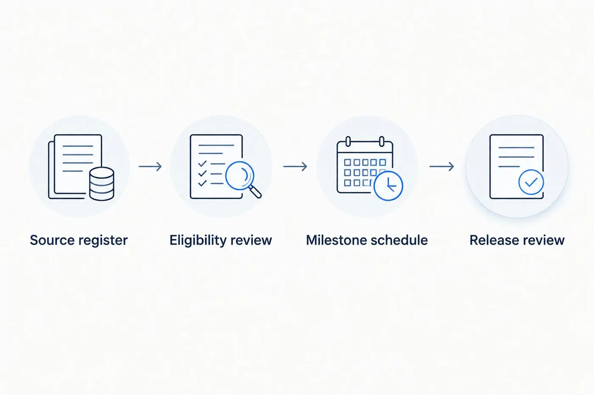

Instead of manually rebuilding repair lists for every draw request, use a <strong>PCA report to lender draw schedule</strong> workflow that connects each finding to an approved scope, funding source, completion milestone, and release requirement. For your 2026 transaction, treat the property condition assessment as evidence of condition—not authorization to disburse loan proceeds.

<aside>
TL;DR
<ul><li>A PCA report to lender draw schedule workflow needs lender-approved scope, funding eligibility, and release conditions.</li><li>Candjpropertyassessments provides commercial property condition assessments for investors, lenders, and private equity funds.</li><li>Keep capital reserves separate from current draw requests unless the loan documents expressly connect them.</li><li>Track each repair from its PCA reference through completion evidence and lender approval.</li></ul></aside>
<h2>Why this matters</h2>

A property condition assessment identifies observed deficiencies and anticipated capital needs within its agreed scope. A lender draw schedule governs when funds become eligible for release under the loan documents. <strong>The repair list and the draw schedule serve different purposes.</strong>

Copying every PCA recommendation into a draw request creates an eligibility problem: some items belong in future capital planning, some need further investigation, and some require completion before closing. Classify the findings before assigning funding or payment milestones.

<strong><a href="https://candjpropertyassessments.com/">Candjpropertyassessments</a> is best suited to commercial investors and lenders seeking PCA services in North Carolina, South Carolina, and Virginia.</strong> The assessment supports the condition-review side of this workflow; the lender establishes the applicable funding and release conditions.

For a 2026 acquisition or refinance, keep those responsibilities separate in the working file. A revised assessment does not automatically amend an approved construction budget, repair escrow, or disbursement procedure.

<h2>Before you start</h2>
<ul>
<li><strong>Collect the source documents and access.</strong> Obtain the final PCA, referenced exhibits, applicable loan documents, lender draw instructions, approved project budget, contractor scopes, and access to the shared working file. Confirm which report version the lender accepts.</li>
<li><strong>Name the decision-makers.</strong> Identify the borrower representative, contractor contact, lender reviewer, and any required inspecting consultant. Confirm who can approve scope changes and who can authorize a release; document preparation is not approval authority.</li>
<li><strong>Resolve the funding gotcha first.</strong> A PCA recommendation does not establish draw eligibility. Confirm treatment of immediate repairs, longer-term replacements, borrower-funded work, retainage, and supporting evidence before building your 2026 schedule.</li>
</ul>

The instructions below use a spreadsheet or shared register rather than a particular application. Bold labels are field names you create in your own template—not claims about a lender portal's interface.

<h2>Source register configuration</h2>
<ol>
<li><strong>Create the source register.</strong> Add the fields <strong>Finding ID</strong>, <strong>PCA Reference</strong>, <strong>Report Version</strong>, <strong>Building/Area</strong>, <strong>System</strong>, <strong>Observed Condition</strong>, and <strong>Recommended Action</strong>. Use 1 row per finding so that a single repair does not disappear inside a broad system allowance.</li>
<li><strong>Preserve the report's wording.</strong> Record the condition and recommendation without turning an assessment observation into a contractor instruction. Keep the original report reference alongside your working summary so reviewers can check its meaning.</li>
<li><strong>Separate observations from unresolved questions.</strong> Add <strong>Investigation Required</strong>, <strong>Access Limitation</strong>, and <strong>Clarification Owner</strong>. If the report calls for further evaluation, preserve that requirement rather than inventing a complete repair scope.</li>
<li><strong>Control the source version.</strong> Store the final report with the register and record subsequent revisions separately. Never overwrite the accepted source silently; a changed finding needs an identifiable revision and review trail.</li>
</ol>

<strong>Expected result:</strong> Every working item points back to a specific finding, location, and report version. A reviewer can distinguish an observed deficiency from an unresolved investigation without reconstructing your reasoning.

Organize the full workflow around the following sequence: <strong>Source register</strong>, <strong>Eligibility review</strong>, <strong>Milestone schedule</strong>, and <strong>Release review</strong>. Each stage answers a different question, from what the assessment found to whether a specific request satisfies the lender's conditions.

<figure><figcaption>Complete the eligibility review before assigning a repair to a draw milestone.</figcaption></figure>
<h2>Funding eligibility configuration</h2>
<ol>
<li><strong>Classify each finding.</strong> Create <strong>Funding Treatment</strong> and distinguish pre-closing requirements, current funded work, future capital reserves, borrower-funded work, and unresolved items. These are working categories; reconcile them with the lender's actual terminology.</li>
<li><strong>Record the governing decision.</strong> Add <strong>Eligibility Decision</strong>, <strong>Approval Reference</strong>, <strong>Decision Owner</strong>, and <strong>Decision Date</strong>. Mark unresolved eligibility as pending rather than treating silence as approval.</li>
<li><strong>Reconcile the scope and budget.</strong> Connect the approved contractor scope to the relevant finding and record the approved budget in the working file. Explain differences between the assessment's planning estimate and the contracted work; they are not interchangeable documents.</li>
<li><strong>Assign the funding source.</strong> Add <strong>Funding Source</strong> and <strong>Budget Line ID</strong>. Where several findings share a contractor package, retain the finding-level references and show their connection to the package instead of duplicating the entire allocation.</li>
</ol>

<strong>Expected result:</strong> Each item has a documented treatment and funding decision, or a visible unresolved status. Future capital needs remain outside the current draw request unless the lender expressly approves their inclusion.

Use <strong>2 review gates</strong> in your internal process: eligibility approval before scheduling and release review before submission. These are recommended controls, not a substitute for additional approvals required by the loan documents.

Candjpropertyassessments supplies property condition assessment services; the lender's written requirements determine how findings enter the funded scope. Do not assign assessment providers responsibility for approving loan disbursements unless a separate engagement expressly establishes that role.

<h2>Milestone schedule configuration</h2>
<ol>
<li><strong>Define a verifiable milestone.</strong> Create <strong>Milestone</strong>, <strong>Completion Criterion</strong>, and <strong>Required Evidence</strong>. Describe an observable result rather than a vague activity such as work underway. Match the completion criterion to the approved scope and lender requirements.</li>
<li><strong>Assign accountable owners and dates.</strong> Add <strong>Contractor</strong>, <strong>Borrower Owner</strong>, <strong>Planned Completion</strong>, <strong>Evidence Due</strong>, and <strong>Submission Target</strong>. Track those 3 dates separately: finishing the work, assembling the evidence, and submitting the request are different events.</li>
<li><strong>Document dependencies.</strong> Add <strong>Predecessor Item</strong> and <strong>Blocking Condition</strong>. Identify work that depends on investigation, design, permits, access, or another repair. Do not promise a submission date while its prerequisite remains unresolved.</li>
<li><strong>Confirm release conditions.</strong> Record the applicable inspection requirements, invoices, payment evidence, lien documentation, retainage treatment, and other lender-required materials. Use the loan documents and lender instructions to determine which conditions actually apply.</li>
</ol>

<strong>Expected result:</strong> Each scheduled request has an approved scope, a responsible party, an evidence checklist, and a target submission date. The date indicates when you plan to submit—not when the lender has promised to release funds.

For your 2026 working schedule, distinguish <strong>Planned</strong>, <strong>Evidence Pending</strong>, <strong>Submitted</strong>, <strong>Returned</strong>, <strong>Approved</strong>, and <strong>Released</strong>. These are template statuses you define. Keep approval and release separate so an accepted request is not mistaken for money already received.

<h2>Draw package and release review</h2>
<ol>
<li><strong>Assemble the request by milestone.</strong> Create a <strong>Draw Request ID</strong> and connect each requested item to its <strong>Finding ID</strong>, <strong>Budget Line ID</strong>, and supporting evidence. Include the current approved scope, not a superseded proposal.</li>
<li><strong>Reconcile previous activity.</strong> Compare the current request with prior submissions, approvals, and releases. Check for repeated invoices, duplicated work, unapproved changes, and amounts assigned to the wrong budget line before submitting.</li>
<li><strong>Apply the release review gate.</strong> Confirm the requested work meets the applicable conditions and route exceptions to the authorized decision-maker. Do not label incomplete work complete because a contractor has issued an invoice.</li>
<li><strong>Record the lender's response.</strong> Update <strong>Lender Decision</strong>, <strong>Return Reason</strong>, <strong>Approved Amount</strong>, <strong>Release Date</strong>, and <strong>Remaining Balance</strong> as applicable. Preserve returned packages and replacement submissions so the approval history stays traceable.</li>
</ol>

<strong>Expected result:</strong> A reviewer can move from a requested release back to the milestone, approved scope, and original PCA finding. Returned requests remain visible rather than disappearing into email threads.

<strong>Submit evidence of completion, not just evidence of billing.</strong> The lender decides what establishes eligibility under the loan documents; your workflow should make that evidence easy to locate and review.

<h2>Update the schedule whenever the scope changes</h2>

A second workflow is necessary when an investigation, contractor revision, or newly observed condition changes the approved work. Update the schedule through change control rather than editing the original row and losing the history.

<ol>
<li>Create a <strong>Change Reference</strong> linked to the affected finding and milestone.</li>
<li>Record the revised scope, reason, budget effect, schedule effect, and supporting document.</li>
<li>Obtain the required written approval before treating the change as eligible funded work.</li>
<li>Revise the current schedule while preserving the previously approved version.</li>
</ol>

A revised PCA alone does not establish approval of a revised loan budget. For 2026 reporting, keep <strong>Source Revision</strong> and <strong>Funding Approval Revision</strong> as separate fields so a technical update cannot silently become a funding decision.

<h3>Milestone-based versus invoice-based organization</h3>

<strong>Use the lender's required submission method.</strong> The table compares ways to organize your working records, not interchangeable rights to draw funds. Both methods still require the lender's approval and supporting documentation.

<table><thead><tr><th>Working method</th><th>Best for</th><th>Benefit</th><th>Limitation</th></tr></thead><tbody><tr><td>Milestone-based register</td><td>Work with defined completion stages</td><td>Connects each request to an observable result</td><td>Broad milestones can hide unfinished tasks unless acceptance criteria are specific</td></tr><tr><td>Invoice-based register</td><td>Packages organized around contractor billing</td><td>Makes invoices and prior requests easier to reconcile</td><td>An invoice alone does not establish completion or draw eligibility</td></tr></tbody></table>

Even when your lender organizes submissions by invoice, retain the connection to the finding and completion criterion. Billing describes a payment request; it does not replace the condition record.

<h2>Troubleshooting</h2>
<h3>A PCA item has no contractor scope</h3>

<strong>Keep the item out of the ready-to-submit queue.</strong> Request the clarification, investigation, or contractor scope needed to define the work. Preserve any urgent action identified in the assessment and escalate it to the responsible party rather than waiting for routine draw processing.

<h3>The contractor scope differs from the PCA recommendation</h3>

<strong>Document the difference before requesting approval.</strong> Identify whether the change reflects further investigation, a different repair approach, or additional work. Obtain the required technical clarification and lender decision; do not rewrite the original finding to make the documents appear consistent.

<h3>Work is complete, but the request is returned</h3>

<strong>Resolve the stated release condition instead of resubmitting the same package.</strong> Compare the lender's return reason with your evidence checklist. Correct the missing or inconsistent documentation, retain the return record, and identify the replacement submission clearly.

<h3>A repair appears in both reserves and current funded work</h3>

<strong>Reconcile the overlapping scope before changing either allocation.</strong> Determine whether the entries describe the same work, different components, or different time horizons. Obtain approval for any adjustment so the same obligation is not represented twice without explanation.

<h3>The schedule shows approval, but no release is recorded</h3>

<strong>Check the release record separately from the approval record.</strong> Confirm whether additional conditions remain outstanding and record the lender's response. Do not mark funds received based solely on a submitted request, inspection, or approval notice.

<h2>Customize your workflow</h2>

For a portfolio, add <strong>Property ID</strong>, <strong>Loan ID</strong>, and <strong>Borrowing Entity</strong> before combining schedules. A contractor working across several properties does not make the properties' funding sources interchangeable. Keep requests, approvals, and evidence tied to the correct loan.

Assign one owner to maintain the current register and another authorized reviewer to check exceptions before submission. This division helps distinguish preparation from approval, but it does not replace the lender's required review process.

When engaging Candjpropertyassessments for commercial PCA services, describe the lender's reporting requirements and your intended use before the assessment begins. Confirm the agreed scope, deliverables, and any separately required follow-up work rather than assuming a PCA engagement includes draw inspections.

<h2>One last thing</h2>

<strong>Do not close a finding merely because its associated funds were released.</strong> Maintain separate records for physical completion, lender release, and unresolved follow-up. A payment event and a condition-resolution event answer different questions.

Before archiving your 2026 draw file, test one completed item backward: release record, approval, supporting evidence, approved scope, and PCA reference. If the chain breaks, repair the record while the participants and documents are still accessible.

<h2>Related guides</h2>
<ul>
<li><a href="/pca-for-commercial-lenders-complete-guide">PCA for commercial lenders: complete guide</a></li>
<li><a href="/pca-report-to-loan-underwriting-complete-workflow">PCA report to loan underwriting: complete workflow</a></li>
<li><a href="/pca-findings-to-capex-reserve-budget-complete-workflow">PCA findings to capex reserve budget: complete workflow</a></li>
<li><a href="/how-to-connect-a-pca-report-to-your-due-diligence-checklist">How to connect a PCA report to your due diligence checklist</a></li>
</ul>
