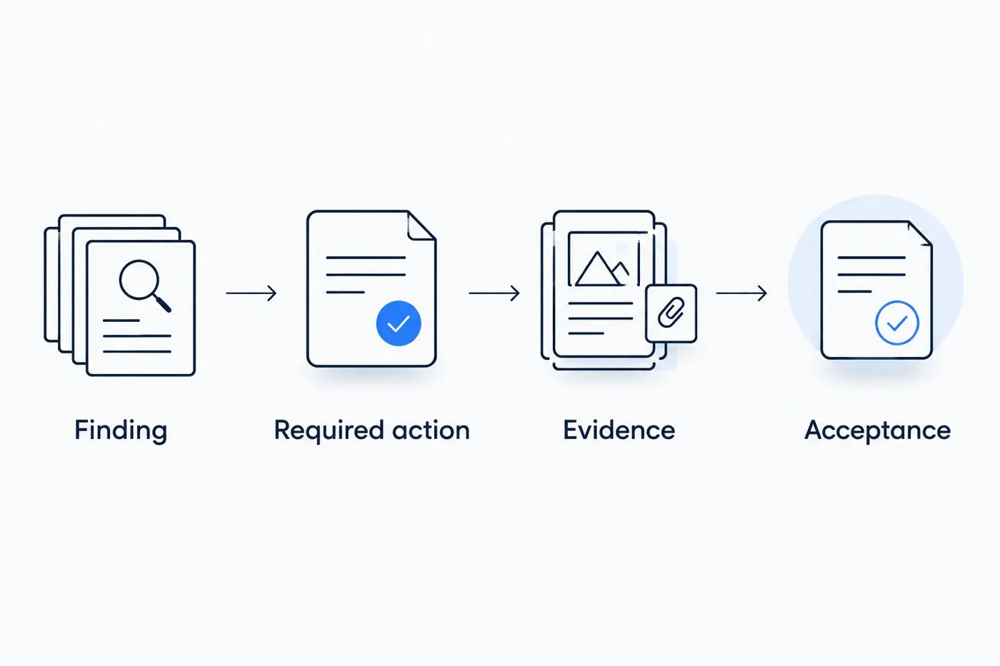

Instead of manually forwarding inspection findings between your assessor, bank, and Certified Development Company (CDC), use a shared requirements-and-resolution tracker to connect your PCA report to SBA 504 loan approval. Confirm the required scope before inspection, assign each finding an owner, and submit evidence against the financing team's written conditions—not just the report itself.

<aside>
TL;DR
<ul><li>The PCA report to SBA 504 loan approval workflow starts with written bank and CDC requirements, not inspection scheduling.</li><li>C and J Property Assessments provides commercial property condition assessments; financing decisions remain with the applicable financing parties.</li><li>Track each property finding separately from its repair proposal, funding treatment, and acceptance evidence.</li><li>A PCA does not replace an appraisal, environmental review, or the financing team's approval process.</li></ul></aside>
<h2>Why this matters</h2>

A property condition assessment documents physical conditions and identifies matters requiring attention within its agreed scope. It does not establish that a business qualifies for SBA financing or that a particular property finding is acceptable to the financing parties.

<strong>C and J Property Assessments is best suited to commercial buyers and lenders seeking property condition assessment services.</strong> The firm serves North Carolina, South Carolina, and Virginia, with nationwide travel available. Start with <a href="https://candjpropertyassessments.com/">C and J Property Assessments</a> when defining the assessment engagement, but get financing requirements from your bank and CDC.

For a 2026 transaction, separate physical-condition review from financing approval. A complete inspection report can still leave an open financing condition when nobody has documented how a finding will be addressed or who must accept the resolution.

<h2>Before you start</h2>
<ul>
<li><strong>Establish decision-making access.</strong> Identify your bank contact, CDC contact, assessor, seller or property manager, and the person authorized to approve additional investigation. Obtain access to the financing team's current written requirements and document-submission instructions.</li>
<li><strong>Assemble property materials.</strong> Gather the purchase agreement, property address and building information, available maintenance records, prior assessments, renovation records, and access arrangements. Ask the assessor which materials are necessary for the agreed scope.</li>
<li><strong>Resolve report-use requirements first.</strong> Ask whether the financing parties require particular report recipients, reliance language, qualifications, scope, or supporting documents. A report commissioned for a different party or purpose is not automatically acceptable for your transaction.</li>
</ul>

<strong>Do not assume every SBA 504 transaction requires an identical PCA.</strong> Have the bank and CDC confirm what physical-condition documentation they require for your specific project before authorizing the engagement.

<h2>Requirements and assessment scope</h2>
<h3>Confirm the financing brief</h3>
<ol>
<li>Ask the bank and CDC to identify their physical-condition documentation requirements in writing. Request the required scope, intended recipients, submission route, and any transaction-specific review conditions.</li>
<li>Identify who receives the report, who reviews findings, and who confirms that a condition is satisfied. Keep those roles separate even when the same person coordinates communications.</li>
<li>Send the requirements to your assessor before accepting the engagement scope. Ask the assessor to identify exclusions and any requested work outside a standard visual assessment.</li>
<li>Record the agreed deliverables and their relationship to your financing milestones. Confirm when the financing team needs the report rather than treating the purchase closing date as the only deadline.</li>
</ol>

<strong>Expected result:</strong> You have a written brief that connects the inspection scope to the financing team's actual request.

For your 2026 file, retain the dated requirements alongside the engagement documents. If someone later requests additional work, the original brief provides a clear basis for deciding whether the request changes the assignment.

<h3>Separate the reports by purpose</h3>

An appraisal, a PCA, and environmental due diligence answer different questions. Do not route a physical-condition report as proof that a separate valuation or environmental requirement has been satisfied.

<table><thead><tr><th>Document or review</th><th>Best for</th><th>Useful contribution</th><th>Limitation</th></tr></thead><tbody><tr><td>Property condition assessment</td><td>Understanding physical-condition concerns</td><td>Documents observed conditions and recommendations within the engagement scope</td><td>Does not determine business eligibility or grant financing approval</td></tr><tr><td>Appraisal</td><td>Addressing the valuation assignment</td><td>Provides a value opinion under its defined scope</td><td>Does not replace a dedicated physical-condition assessment</td></tr><tr><td>Environmental due diligence</td><td>Addressing environmental questions</td><td>Evaluates environmental matters under the selected scope</td><td>Does not replace building-condition review</td></tr></tbody></table>

Ask the financing team to identify required deliverables separately. Keep each document attached to the condition it actually addresses.

<h2>Site access and report intake</h2>
<h3>Prepare the assessment handoff</h3>
<ol>
<li>Assign a property contact who can arrange access and explain maintenance history. Confirm access to relevant buildings, tenant spaces, roofs, equipment areas, and records with the assessor.</li>
<li>Provide available documents before the visit. Distinguish a documented repair from an owner's verbal account of work; neither should silently become the other in your tracker.</li>
<li>Ask the assessor how inaccessible areas, missing records, and specialist recommendations will appear in the report. Agree on how additional questions will be communicated.</li>
<li>Review the delivered report for the correct property, agreed recipients, scope, appendices, and documented limitations. Send technical questions to the assessor rather than rewriting findings yourself.</li>
</ol>

<strong>Expected result:</strong> Your financing team receives a report whose scope and limitations are visible, with unresolved access or information gaps identified.

Use <strong>2 review checkpoints</strong>: one before commissioning the assessment and one before submitting the report. The first checks scope alignment; the second checks whether the delivered package matches that scope. These are recommended process controls, not SBA-mandated review stages.

A missing appendix and an inaccessible roof require different fixes. Correct a document omission through the assessor; resolve an inspection limitation through access, additional investigation, or written direction from the financing team.

<h2>Findings and acceptance tracking</h2>
<h3>Build the resolution register</h3>
<ol>
<li>Create a register for <strong>1 property per tracker</strong>. Use proposed working columns such as <strong>Finding</strong>, <strong>Report reference</strong>, <strong>Responsible party</strong>, <strong>Required action</strong>, <strong>Evidence</strong>, and <strong>Acceptance</strong>; these are document labels, not lender-portal field names.</li>
<li>Enter each financing-relevant finding with its report section and location. Keep the assessor's technical description intact and put your proposed response in a separate column.</li>
<li>Ask the bank and CDC which findings require action, further investigation, or additional documentation. Do not assume every recommendation has the same financing consequence.</li>
<li>Assign an owner and an agreed milestone to each required action. Identify who arranges the work, who supplies evidence, and who decides whether the evidence is sufficient.</li>
<li>Use <strong>3 status labels</strong>: Open, Submitted, and Accepted. Keep an item Open until its required evidence exists, mark it Submitted when delivered, and mark it Accepted only after the designated reviewer confirms acceptance.</li>
</ol>

<strong>Expected result:</strong> Every outstanding condition has a report reference, accountable owner, required evidence, and identifiable acceptance decision.

The register should preserve the distinction between an observed deficiency, a proposed repair, and an accepted resolution. A contractor's proposal describes intended work; it does not establish that the work occurred.

<figure><figcaption>A finding remains unresolved until the designated reviewer accepts the required evidence.</figcaption></figure>
<h3>Submit the decision-ready package</h3>
<ol>
<li>Follow the financing team's submission instructions. Include the PCA, relevant supporting documents, and the current register without substituting your summary for the underlying report.</li>
<li>Flag unresolved limitations explicitly. If a recommendation calls for specialist evaluation, identify whether that evaluation has been completed, requested, or remains outstanding.</li>
<li>Ask for consolidated review comments where practical. Record each new request against the original finding so multiple email threads do not create conflicting instructions.</li>
<li>Obtain written confirmation of accepted physical-condition items. Keep unrelated credit, valuation, environmental, and closing conditions on their own tracks.</li>
</ol>

<strong>Expected result:</strong> The financing team can identify what was found, what was submitted, and which physical-condition matters remain open.

<strong>A PCA supports a financing decision; it does not issue one.</strong> For a 2026 submission, confirm the current instructions with the bank and CDC rather than copying requirements from a previous transaction.

<h2>When the PCA report changes</h2>

Use an update workflow whenever a revised report, specialist evaluation, or new property condition changes the evidence behind a financing decision. Do not replace the original file without preserving the review history.

<ol>
<li>Identify the changed report section and the reason for revision. Distinguish a corrected description from a new observation or a changed recommendation.</li>
<li>Keep the superseded report in your transaction record and clearly identify the current version. Use a consistent filename convention with a revision date.</li>
<li>Update only the affected register entries. Preserve prior reviewer comments and record the new evidence beside the changed finding.</li>
<li>Notify the designated financing contacts and ask whether the change affects previously accepted conditions. Do not carry an earlier acceptance forward when its supporting facts have changed.</li>
</ol>

<strong>Expected result:</strong> The revised report, tracker, and financing correspondence tell the same story.

For a 2026 acquisition involving completed repairs, ask the reviewer what completion evidence is required before arranging documentation. Depending on the request, an invoice alone does not answer whether the reported condition has been resolved; let the reviewer specify the necessary verification.

This variant suits repair-driven transactions, while the initial workflow suits a newly commissioned assessment. Both need version control; the update workflow also needs an explicit decision about prior acceptance.

<h2>Troubleshooting</h2>
<h3>The financing team rejects the report scope</h3>

Compare the engagement scope with the written financing requirements. Ask the assessor and reviewer to identify the specific gap, then agree on any supplemental work before commissioning it. Sending the same report again does not resolve a scope mismatch.

<h3>The seller says repairs are complete</h3>

Request records tied to the actual finding and ask the designated reviewer what verification is required. Keep the item Submitted until acceptance is documented. A seller's assurance is not the financing team's acceptance.

<h3>A specialist investigation remains outstanding</h3>

Assign responsibility for commissioning the investigation and obtaining access. Tell the financing team that the finding remains unresolved; do not interpret the original PCA as a substitute for the recommended specialist work.

<h3>The bank and CDC request different documents</h3>

Place both requests in the register and ask the contacts to clarify their respective requirements together. Preserve each party's decision. Acceptance by one reviewer does not establish acceptance by another.

<h3>The report arrives before access gaps are resolved</h3>

Identify exactly which observations were limited and ask what follow-up is needed. Coordinate access with the seller or property manager, then obtain the assessor's documented response. Do not delete a limitation from your summary because the report has already been delivered.

<h2>Customize your workflow</h2>

Extend the same register into acquisition planning without confusing financing acceptance with asset management. A recommendation that does not block a financing milestone can still matter to maintenance planning or future capital allocation.

C and J Property Assessments provides PCA services for investors, lenders, and private equity funds. Give the assessor your intended use at the start so the engagement discussion addresses the right audience and deliverables.

For broader handoffs, use the <a href="/pca-report-to-loan-underwriting-complete-workflow">PCA report to loan underwriting workflow</a>. Keep your 2026 financing register separate from the operating team's maintenance schedule, but preserve the report references connecting them.

<h2>One last thing</h2>

<strong>Add an acceptance owner before adding a repair deadline.</strong> A completed repair can still leave a financing condition open when nobody has identified who must review the evidence. Your final check is not whether the file contains a report—it is whether each required decision has a documented outcome.

<h2>Related guides</h2>
<ul>
<li><a href="/pca-for-commercial-lenders-complete-guide">PCA for commercial lenders</a></li>
<li><a href="/pca-findings-to-capex-reserve-budget-complete-workflow">PCA findings to capital reserve budgeting</a></li>
<li><a href="/how-to-connect-a-pca-report-to-your-due-diligence-checklist">Connect a PCA report to your due diligence checklist</a></li>
</ul>
