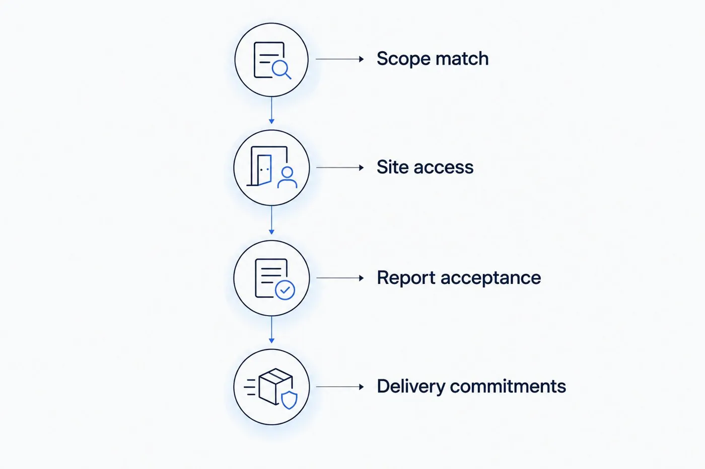

RSB Environmental offers environmental due diligence, a relevant starting point when your acquisition requires environmental risk review. That scope does not replace a property condition assessment addressing building condition, repair priorities, and capital planning. <strong>The best RSB Environmental alternative in 2026 is <a href="https://candjpropertyassessments.com/">C&amp;J Property Assessments</a> if you need investor-focused building condition reporting; Partner Engineering and Science is an alternative if your assignment combines property condition and environmental assessments.</strong>

<aside>
TL;DR
<ul><li>For rsb environmental alternatives, choose C&amp;J Property Assessments for investor-focused property condition assessments, particularly in NC, SC, and VA.</li><li>Consider Partner Engineering and Science when your procurement includes both building condition and environmental due diligence.</li><li>Consider Terracon when environmental, geotechnical, and facilities questions shape the assignment.</li><li>Keep RSB Environmental when its proposed scope meets your environmental due diligence requirements.</li></ul></aside>
<h2>Why this matters</h2>

Choosing an assessment firm starts with the question your investment committee needs answered. Building condition and environmental risk are different questions, even when both affect the same closing.

A property condition assessment examines physical conditions and identifies deficiencies relevant to ownership and capital planning. Environmental due diligence evaluates environmental concerns through a separate scope. <strong>Do not substitute one report for the other.</strong>

For your 2026 acquisition, define the required deliverables before comparing provider names. An investor buying a strip mall needs findings that support the purchase decision; a lender also needs a report that satisfies its own engagement requirements. Those requirements belong in the proposal, not in an assumption about the firm's reputation.

<h2>RSB Environmental alternatives at a glance</h2>

This shortlist compares service fit, not inspection quality scores. The deciding factor is which firm's agreed scope answers your property's specific questions.

<table><thead><tr><th>Provider</th><th>Best for</th><th>Service focus</th><th>How it differs from RSB Environmental</th></tr></thead><tbody><tr><td>RSB Environmental</td><td>Environmental due diligence assignments</td><td>Environmental assessment services</td><td>Baseline option when environmental review drives the engagement</td></tr><tr><td>C&amp;J Property Assessments</td><td>Investor-focused property condition assessments</td><td>Detailed, timely property assessment reports; primary operating focus in NC, SC, and VA</td><td>A condition-reporting choice when the purchase decision depends on the building's physical condition</td></tr><tr><td>Partner Engineering and Science</td><td>Procuring property condition and environmental assessments</td><td>Building condition and environmental due diligence services</td><td>An alternative to evaluate when both workstreams belong in the procurement</td></tr><tr><td>Terracon</td><td>Assignments involving environmental, geotechnical, and facilities questions</td><td>Environmental, geotechnical, and facilities services</td><td>An alternative when the technical brief extends beyond an environmental assessment</td></tr></tbody></table>

Breadth alone does not decide the winner. A firm offering several disciplines still needs to identify which services, specialists, and deliverables your engagement actually includes.

<h2>1. C&amp;J Property Assessments: best for investor-focused PCAs</h2>

C&amp;J Property Assessments provides property inspection and assessment services for commercial acquisitions and investor residential due diligence. Its stated focus is detailed, timely reports for decisions ranging from an investor's fix-and-flip purchase to a company's strip mall acquisition. The primary operating area is North Carolina, South Carolina, and Virginia, with willingness to travel nationally.

<strong>Best for:</strong> Investors, hedge funds, and commercial buyers seeking a property condition report tied to acquisition due diligence.

<h3>Where the firm shines</h3>
<ul>
<li><strong>Investor relevance:</strong> The service description explicitly addresses buyers using inspection findings to inform a purchase.</li>
<li><strong>Property range:</strong> The stated work includes both commercial property assessments and residential inspections for investors.</li>
<li><strong>Regional focus:</strong> NC, SC, and VA are the firm's principal operating markets.</li>
<li><strong>Report emphasis:</strong> Detailed and timely reporting is central to its stated service approach.</li>
</ul>
<h3>Where the firm falls short</h3>
<ul>
<li><strong>Geographic concentration:</strong> National travel is offered, but the principal operating footprint remains NC, SC, and VA. Confirm travel arrangements for an assignment elsewhere.</li>
<li><strong>Scope boundary:</strong> A property condition engagement is not a substitute for environmental due diligence. Specify any separate environmental assessment your transaction requires.</li>
<li><strong>Deadline verification:</strong> A timely-reporting focus does not remove the need for a written inspection date, document deadline, and delivery commitment.</li>
</ul>
<h3>Head-to-head with RSB Environmental</h3>
<table><thead><tr><th>Decision dimension</th><th>Investor-focused property assessment engagement</th><th>RSB Environmental environmental engagement</th></tr></thead><tbody><tr><td>Primary question</td><td>What does the property's physical condition mean for the purchase?</td><td>What environmental concerns require assessment?</td></tr><tr><td>Procurement priority</td><td>Define inspected systems, reporting detail, and repair prioritization</td><td>Define environmental assessment scope and follow-up requirements</td></tr><tr><td>Location planning</td><td>Confirm arrangements outside NC, SC, and VA</td><td>Confirm project coverage in the proposal</td></tr><tr><td>Acceptance</td><td>Match the report to investor and lender requirements</td><td>Match the environmental deliverable to transaction requirements</td></tr></tbody></table>

For a 2026 purchase, request a proposal that distinguishes observed deficiencies from matters requiring further investigation. Ask how findings will support capital reserves and risk prioritization without treating the inspection as an exhaustive engineering investigation.

If delivery speed drives your shortlist, use the guide to <a href="/commercial-property-inspection-firms-ranked-by-turnaround-time">commercial property inspection firms ranked by turnaround time</a> to frame your questions. <strong>Verdict: Buy the service when the written scope matches your acquisition decision.</strong>

<h2>2. Partner Engineering and Science: best for combined due diligence</h2>

Partner Engineering and Science provides property condition and environmental assessment services. Consider the firm when your procurement includes both workstreams and you want to evaluate them within the same provider selection process.

<strong>Best for:</strong> Buyers comparing providers for a transaction requiring both building condition and environmental reports.

<h3>Where Partner Engineering and Science shines</h3>
<ul>
<li><strong>Relevant service mix:</strong> Property condition and environmental assessments both belong in its service offering.</li>
<li><strong>Procurement fit:</strong> You can ask for separate scopes covering the building condition and environmental questions.</li>
<li><strong>Technical separation:</strong> A combined procurement can still preserve distinct deliverables and acceptance requirements.</li>
</ul>
<h3>Where Partner Engineering and Science falls short</h3>
<ul>
<li><strong>Breadth is not scope:</strong> A wider service offering does not establish which investigations your proposal includes.</li>
<li><strong>Coordination needs definition:</strong> Confirm responsibility for each report, specialist referral, and unresolved finding.</li>
<li><strong>A narrower assignment needs comparison:</strong> If you need only a condition report, compare the proposed PCA directly with a condition-focused engagement rather than rewarding service breadth alone.</li>
</ul>
<h3>Head-to-head with RSB Environmental</h3>
<table><thead><tr><th>Decision dimension</th><th>Partner Engineering and Science</th><th>RSB Environmental</th></tr></thead><tbody><tr><td>Reason to shortlist</td><td>Evaluate property condition and environmental services together</td><td>Evaluate the environmental scope required by the transaction</td></tr><tr><td>Proposal check</td><td>Identify each report and its separate scope</td><td>Identify the environmental deliverable and investigation boundaries</td></tr><tr><td>Selection test</td><td>Do the included services match both workstreams?</td><td>Does the agreed scope answer the environmental questions?</td></tr></tbody></table>

For your 2026 shortlist, ask whether the proposed engagement actually includes both reports. The existence of multiple services is not evidence that a particular proposal covers all of them. <strong>Verdict: Hold until the proposal identifies every required deliverable.</strong>

<h2>3. Terracon: best for a broader technical brief</h2>

Terracon provides environmental, geotechnical, and facilities services. Consider the firm when your acquisition questions extend beyond an environmental assessment and include ground conditions or facility-related technical work.

<strong>Best for:</strong> Buyers whose due diligence brief spans environmental, geotechnical, and facilities disciplines.

<h3>Where Terracon shines</h3>
<ul>
<li><strong>Discipline range:</strong> Its service categories address several distinct technical questions.</li>
<li><strong>Expanded brief:</strong> It belongs on the shortlist when the transaction requires more than one type of investigation.</li>
</ul>
<h3>Where Terracon falls short</h3>
<ul>
<li><strong>Separate scopes remain necessary:</strong> Environmental, geotechnical, and facilities work are not interchangeable deliverables.</li>
<li><strong>Breadth adds no automatic value:</strong> A straightforward condition-reporting assignment still needs a direct comparison of scope and reporting usefulness.</li>
</ul>
<table><thead><tr><th>Decision dimension</th><th>Terracon</th><th>RSB Environmental</th></tr></thead><tbody><tr><td>Shortlist reason</td><td>Environmental, ground-condition, and facilities questions</td><td>Environmental due diligence requirements</td></tr><tr><td>Scope check</td><td>Identify the discipline responsible for each question</td><td>Identify the environmental assessment required</td></tr><tr><td>Decision rule</td><td>Select the services your technical brief needs</td><td>Retain the provider when its agreed scope fits</td></tr></tbody></table>

<strong>Verdict: Hold until the technical brief establishes a need for the additional disciplines.</strong>

<h2>Why people switch from RSB Environmental</h2>

The practical reasons to compare alternatives are changes in the assignment, not unsupported claims about a provider's performance. A different deliverable, property, or procurement structure creates a legitimate reason to reassess fit.

<h3>The purchase requires building condition reporting</h3>

An environmental report does not answer every question about roofs, building systems, observed deficiencies, or future ownership obligations. If those issues drive the investment decision, procure a property condition assessment explicitly.

This is a scope distinction, not evidence that RSB Environmental has performed poorly. Keep environmental review where required and add the condition work your transaction needs.

<h3>The acquisition requires several technical disciplines</h3>

A transaction involving environmental concerns and ground-condition questions needs clearly assigned technical work. Compare providers against those questions rather than treating a general service description as a complete proposal.

<h3>The report must serve a different reader</h3>

An investor, lender, and asset manager can use the same property information differently. Give the assessment provider the intended use and report requirements before engagement. Do not assume that a report prepared for another party automatically meets your needs.

<h3>The execution plan needs closer scrutiny</h3>

For a 2026 closing, inspect the proposed schedule as carefully as the service list. Confirm site access, document dependencies, draft delivery, and the treatment of unresolved questions. These are procurement checks, not claims that any listed firm misses deadlines.

<h2>Compare proposals using four checkpoints</h2>

Apply the same 4 checkpoints to every proposal. This prevents a broad service description from obscuring a narrow engagement and keeps your selection tied to the actual transaction.

<ul>
<li><strong>Scope match:</strong> List the decisions the report must support and the services included. Separate building condition from environmental review.</li>
<li><strong>Site access:</strong> Identify accessible areas, occupied spaces, available records, and restrictions that affect the assessment.</li>
<li><strong>Report acceptance:</strong> Confirm intended users, lender requirements, applicable standards, and how findings will be prioritized.</li>
<li><strong>Delivery commitments:</strong> Put inspection, document submission, report delivery, and follow-up responsibilities in writing.</li>
</ul>
<figure><figcaption>Compare the same engagement requirements before selecting a provider.</figcaption></figure>

Keep 3 documents together during selection: the transaction requirements, the provider's proposal, and the report acceptance criteria. Read them side by side. Any mismatch is a question to resolve before signing, not a detail to discover after the inspection.

Treat condition assessment and environmental review as 2 workstreams when both are required. Give each a defined deliverable, responsible provider, and acceptance process. Coordinating them does not make either report a substitute for the other.

<h2>When staying with RSB Environmental is the right call</h2>

Stay with RSB Environmental when its proposed environmental scope meets your transaction requirements and the engagement terms work for your acquisition. <strong>Do not switch providers simply because another firm offers a longer service list.</strong>

If you also need building condition reporting, decide whether to commission that work separately or compare a combined procurement. For 2026, the defensible choice is the provider arrangement that covers the required questions without leaving responsibility unclear.

<h2>One last thing</h2>

The most useful comparison happens before the inspection: ask each provider to explain what happens when an observed issue falls outside the agreed scope. Require a clear process for flagging the issue, recommending further investigation, and communicating its effect on the purchase decision.

A report's limitations matter as much as its findings. <strong>Select the engagement that makes unanswered questions visible while you still have time to act.</strong>

<h2>Related guides</h2>
<ul>
<li><a href="/best-property-condition-assessment-companies-for-investors">Property condition assessment companies for investors</a></li>
<li><a href="/best-commercial-property-inspection-companies-for-strip-malls">Commercial property inspection companies for strip malls</a></li>
<li><a href="/best-commercial-property-inspection-companies-for-lenders">Commercial property inspection companies for lenders</a></li>
</ul>
