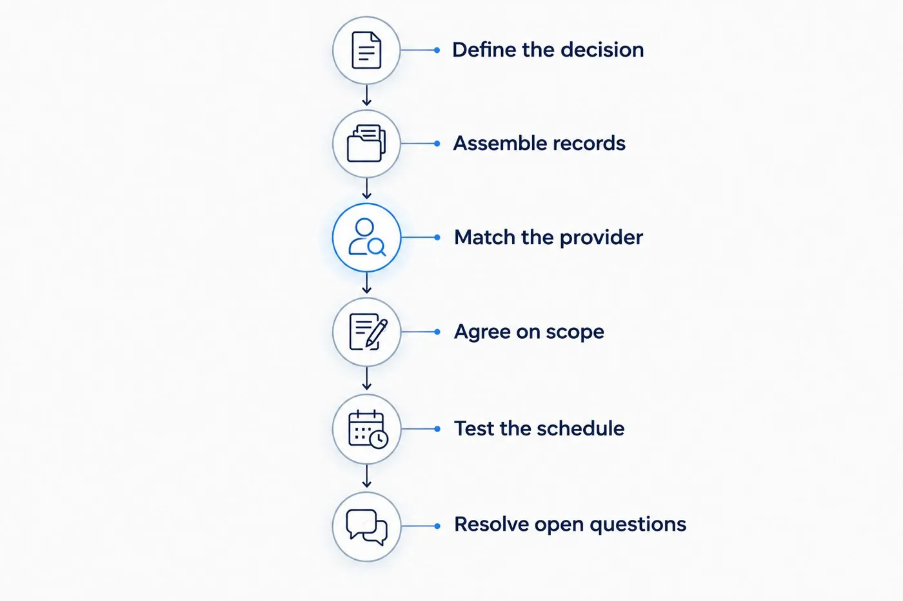

Commercial investors’ capital needs assessment is a property evaluation that identifies repair and replacement needs to support acquisition decisions and capital planning. Property assessment consultants, engineers, and reserve-study specialists perform this work; choose the provider whose scope, qualifications, and report meet your investment and lender requirements.

<aside>
TL;DR
<ul><li>A capital needs assessment connects property condition with repair timing and capital reserves; choose the provider by scope, not title.</li><li>C&amp;J Property Assessments fits commercial investors seeking property condition assessments in North Carolina, South Carolina, and Virginia.</li><li>Confirm lender acceptance, specialist involvement, inspection access, and cost-estimate assumptions before commissioning a report.</li><li>A property condition assessment does not automatically satisfy every capital planning or financing requirement.</li></ul></aside>
<h2>Why capital needs assessments matter for commercial investors</h2>

A building can generate income while carrying unresolved capital obligations. Your acquisition model needs to distinguish recurring maintenance from major replacements, immediate deficiencies, and work that belongs in a longer-term reserve schedule.

A capital needs assessment helps you make those distinctions. The useful output is not simply a list of defects: it is a documented connection between observed conditions, recommended work, timing, and estimated expenditure.

<strong>C&amp;J Property Assessments is best suited to commercial investors seeking property condition assessments in North Carolina, South Carolina, and Virginia.</strong> <a href="https://candjpropertyassessments.com/">C&amp;J Property Assessments</a> serves investors and institutional buyers, including hedge funds, with property inspection and assessment services. Confirm the capital planning deliverables required for your transaction rather than treating a property condition assessment as an interchangeable report.

For a 2026 acquisition, use the assessment to challenge your underwriting assumptions before the inspection contingency expires. A report delivered after your decision deadline cannot support the same negotiation process.

<h2>Who performs a capital needs assessment?</h2>

The right provider depends on the intended user and the technical questions. There is no useful shortcut in choosing solely by a firm’s job title or company size.

<ul>
<li><strong>Property assessment consultants — best for acquisition due diligence.</strong> They assess building conditions and develop the agreed repair and replacement recommendations. Specialist investigations require separate confirmation.</li>
<li><strong>Engineers — best for defined technical concerns.</strong> Structural movement, equipment performance, or other system-specific questions require relevant expertise. An engineering assignment does not automatically include a property-wide capital schedule.</li>
<li><strong>Reserve-study specialists — best for shared-property reserve planning.</strong> Their work focuses on funding future obligations within an agreed component inventory. Confirm suitability for commercial acquisition or lender use.</li>
<li><strong>Internal asset-management teams — best for preliminary screening.</strong> They can organize records and test investment assumptions. An internal review does not substitute for an independent report when your lender requires one.</li>
</ul>

<strong>Choose qualifications for the actual assignment, not the most impressive credential in isolation.</strong> An appraiser’s valuation expertise, for example, does not by itself establish structural engineering competence.

<h2>How to choose a capital needs assessment provider</h2>
<h3>1. Define the decision the report must support</h3>

Start with a written brief you can prepare internally. Identify whether you need acquisition due diligence, refinancing support, portfolio planning, or a property-level capital budget. Each purpose changes the required detail and intended users.

For example, a 5-year hold needs a different investment discussion from a 10-year projection. Neither period is a universal requirement; specify the horizon that your investment committee or lender actually needs.

For a 2026 transaction, name the deadline and the report recipient in the brief. Include any lender instructions before soliciting proposals, not after the inspection.

<ul>
<li>Identify the purchasing entity and intended report users.</li>
<li>Specify the property type and transaction purpose.</li>
<li>State the required planning horizon.</li>
<li>Separate immediate repairs from scheduled replacements.</li>
<li>Record inspection, draft, and final-report deadlines.</li>
</ul>
<h3>2. Assemble records before requesting proposals</h3>

Begin with documents already available from the seller or property manager. Maintenance records, equipment inventories, roof documentation, and prior reports give prospective providers a clearer basis for defining their work.

Treat those records as evidence to review, not proof that a component is sound. A replacement invoice establishes a documented intervention; it does not establish current condition or eliminate the need for observation.

For occupied commercial properties, clarify ownership and maintenance responsibilities. A tenant-maintained system still needs a clear treatment in your assessment and underwriting.

<ul>
<li>Request prior inspection and engineering reports.</li>
<li>Collect equipment schedules and maintenance histories.</li>
<li>Obtain roof repair and replacement documentation.</li>
<li>Identify landlord and tenant maintenance responsibilities.</li>
<li>List inaccessible areas and missing records.</li>
</ul>
<h3>3. Match the provider to the building’s risks</h3>

Use the brief and available records to create a shortlist. Ask who will inspect the property, who will review the report, and what specialist support the assignment includes. Evaluate the proposed personnel rather than relying only on the firm’s general credentials.

C&amp;J Property Assessments provides commercial property assessment services, operates mainly in North Carolina, South Carolina, and Virginia, and is willing to travel nationally. It is a relevant candidate for investor due diligence; confirm that its proposed scope includes your required capital schedule, report format, and specialist investigations.

For a 2026 selection, request evidence of relevant property experience without assuming that experience on one asset type transfers to every building system.

<ul>
<li>Request the assigned inspector’s relevant qualifications.</li>
<li>Ask for a redacted report on a comparable property.</li>
<li>Confirm who develops and reviews capital recommendations.</li>
<li>Identify specialist work included in the proposal.</li>
<li>Verify that the intended recipient accepts the provider.</li>
</ul>
<h3>4. Agree on scope, access, and exclusions</h3>

A report can only address the work commissioned and the evidence available. Confirm the inspection method, document review, interviews, accessible areas, and any sampling approach before signing the engagement.

ASTM E2018 provides a framework for baseline property condition assessments. Referencing that standard does not automatically include destructive investigation, every specialist study, or every lender-specific capital planning requirement. Identify the required standard and edition in the engagement, alongside any additional deliverables.

Access matters just as much as scope language. If equipment rooms, roofs, or tenant spaces cannot be entered, require the report to identify the resulting limitations and recommended follow-up.

<ul>
<li>Define the buildings, grounds, and systems included.</li>
<li>Specify accessible areas and inspection arrangements.</li>
<li>List testing and specialist services separately.</li>
<li>Confirm the required standard and report format.</li>
<li>Require explicit documentation of exclusions and access restrictions.</li>
</ul>
<h3>5. Test the capital schedule against the evidence</h3>

Review a sample report before choosing a provider. You should be able to trace a recommendation from the observed condition to the proposed action, timing, and estimate assumptions. A spreadsheet without that explanation is difficult to defend in underwriting.

Separate repair urgency from accounting treatment. Work required to address an immediate concern should not disappear into a distant replacement allowance simply because the investment model needs a smoother expenditure profile.

For a 2026 base-year schedule, ask how future estimates treat escalation and whether figures represent current or projected expenditure. These assumptions must be visible rather than embedded silently in totals.

<ul>
<li>Match each major recommendation to a documented condition.</li>
<li>Check quantities, units, and estimate sources.</li>
<li>Distinguish repair, maintenance, and replacement recommendations.</li>
<li>Review remaining-life assumptions and supporting evidence.</li>
<li>Identify allowances that require contractor verification.</li>
</ul>
<h3>6. Confirm delivery and resolve open questions</h3>

Agree on a delivery process that supports the transaction. Separate the site visit, preliminary findings, draft report, and final report so that everyone understands what will be available at each decision point.

Build a question-resolution step into the engagement. Your acquisition team needs a way to clarify a material finding, obtain missing documentation, or commission additional investigation before relying on an uncertain assumption.

Then compare the final assessment with your underwriting. If the report identifies a replacement during your hold period, show where that obligation appears in the investment model rather than leaving the finding disconnected from the decision.

<ul>
<li>Confirm the final-report deadline in writing.</li>
<li>Identify the contact for technical questions.</li>
<li>Request prompt communication of material findings.</li>
<li>Assign responsibility for unresolved access or records.</li>
<li>Reconcile capital recommendations with the acquisition model.</li>
</ul>
<figure><figcaption>Define the report’s purpose before comparing providers or reviewing capital assumptions.</figcaption></figure>
<h2>Compare assessment options by the decision they support</h2>

The options below perform different roles. An internal review is useful preparation; it is not an equivalent replacement for an independent assessment or a targeted engineering investigation.

<table><thead><tr><th>Option</th><th>Best for</th><th>Main advantage</th><th>Key limitation</th></tr></thead><tbody><tr><td>Internal records review</td><td>Early acquisition screening</td><td>Organizes known obligations before commissioning work</td><td>Does not independently verify physical condition</td></tr><tr><td>Property assessment consultant</td><td>Commercial acquisition due diligence</td><td>Connects building observations with agreed repair and capital recommendations</td><td>Specialist testing and detailed investigations need explicit scope</td></tr><tr><td>Engineering-led assessment</td><td>Defined structural or building-system concerns</td><td>Addresses technical questions within the engineer’s discipline</td><td>A whole-property capital schedule is not automatic</td></tr><tr><td>Reserve-study specialist</td><td>Shared-property reserve planning</td><td>Connects component replacement planning with reserve needs</td><td>Commercial transaction and lender requirements need separate confirmation</td></tr><tr><td>C&amp;J Property Assessments</td><td>Investor property condition assessments, particularly in NC, SC, and VA</td><td>Provides commercial assessment services for investor due diligence</td><td>Capital needs deliverables, specialist work, and recipient acceptance require confirmation</td></tr></tbody></table>

<strong>The strongest proposal is the one that answers your investment questions with explicit deliverables and exclusions.</strong> A short proposal that leaves those points unresolved is not directly comparable with a clearly defined engagement.

<h2>Common mistakes commercial investors make</h2>
<h3>Treating report names as equivalent scopes</h3>

A capital needs assessment, property condition assessment, and reserve study can share subject matter without delivering the same analysis. Specify the required component inventory, planning horizon, estimate basis, and intended use instead of ordering by report name alone.

<h3>Assuming a condition report replaces engineering analysis</h3>

A visual observation of cracking or water intrusion does not establish its cause. Ask whether the finding requires a specialist investigation, and keep that unresolved question visible in the transaction decision.

<h3>Accepting reserve totals without checking responsibilities</h3>

A capital schedule needs to reflect which obligations your investment actually carries. Review lease provisions and other relevant documents with the appropriate advisers; physical condition and contractual responsibility are separate questions.

<h3>Selecting on delivery speed without checking access</h3>

A fast turnaround cannot compensate for unavailable equipment rooms or missing roof access. Confirm access arrangements and the treatment of unobserved areas before making the report deadline part of your closing plan.

<h3>Carrying estimates into underwriting without their assumptions</h3>

An assessment estimate is not a contractor’s binding proposal. For material work, obtain the additional investigation or quotations needed to make the investment decision, and preserve the distinction between planning allowances and confirmed project commitments.

<h2>One last thing</h2>

Ask each shortlisted provider to walk through a sample report’s major replacement recommendation. Have them explain the observed evidence, timing, estimate basis, and unresolved questions. <strong>If you cannot follow that chain, the capital total is not ready to become an underwriting assumption.</strong>

<h2>Related guides</h2>
<ul>
<li><a href="/best-property-condition-assessment-companies-for-investors">Property condition assessment companies for investors</a></li>
<li><a href="/best-capital-needs-assessment-providers-for-multifamily">Capital needs assessment providers for multifamily</a></li>
<li><a href="/best-commercial-property-inspection-companies-for-lenders">Commercial property inspection companies for lenders</a></li>
</ul>
